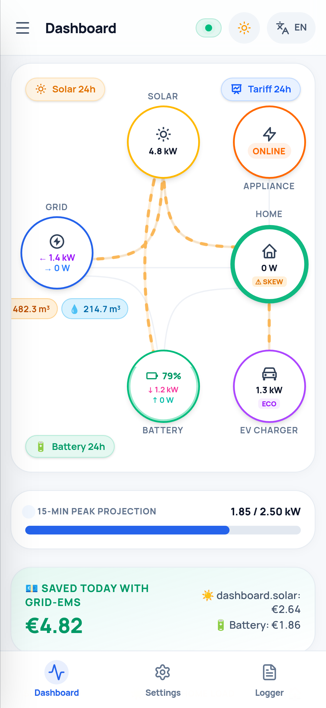
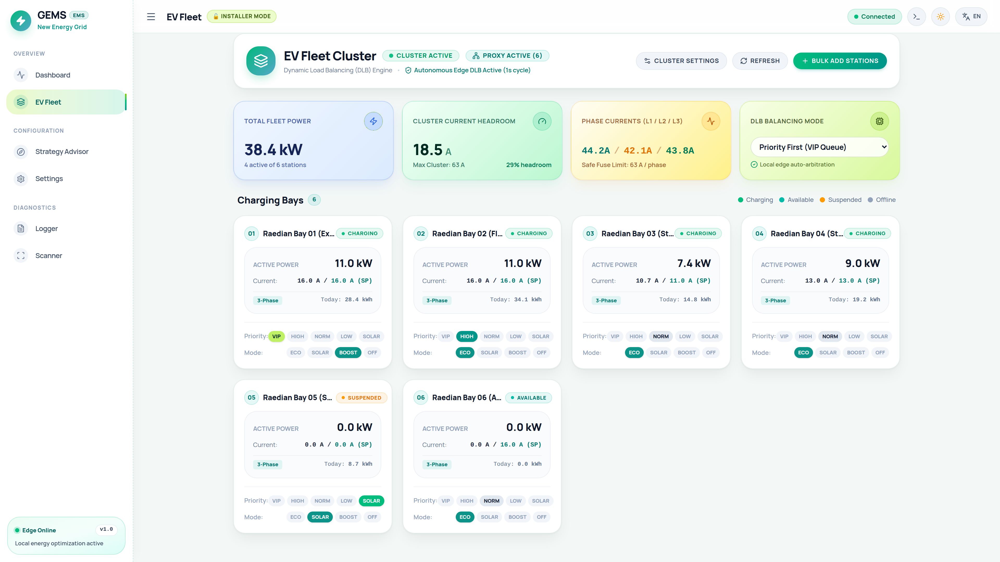
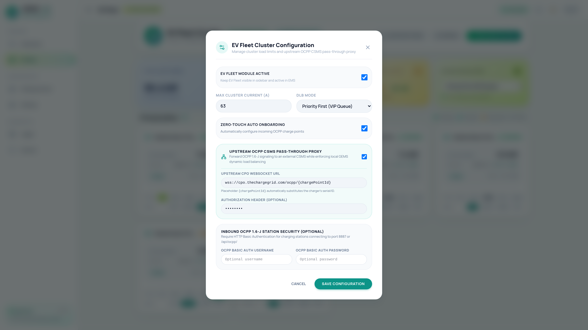
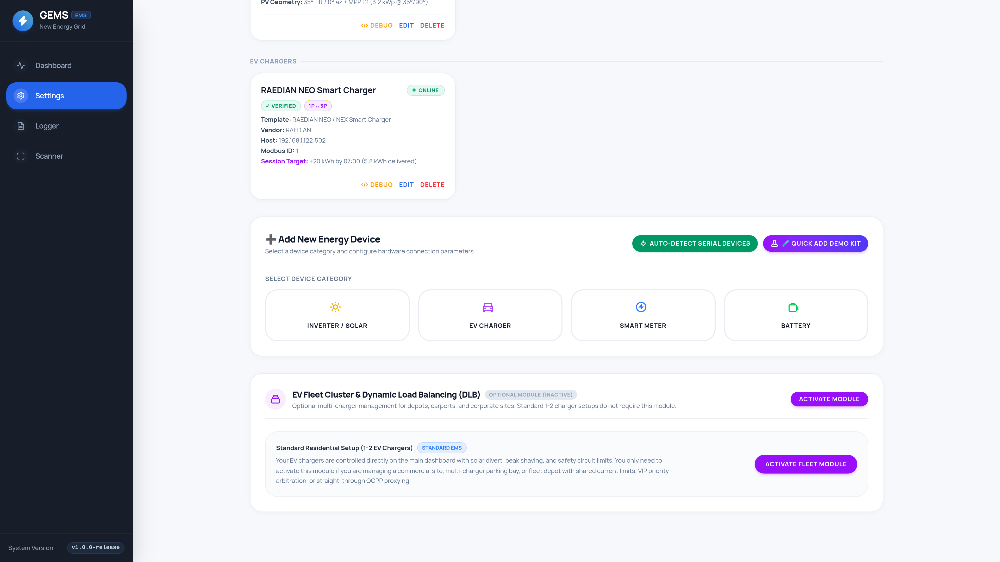
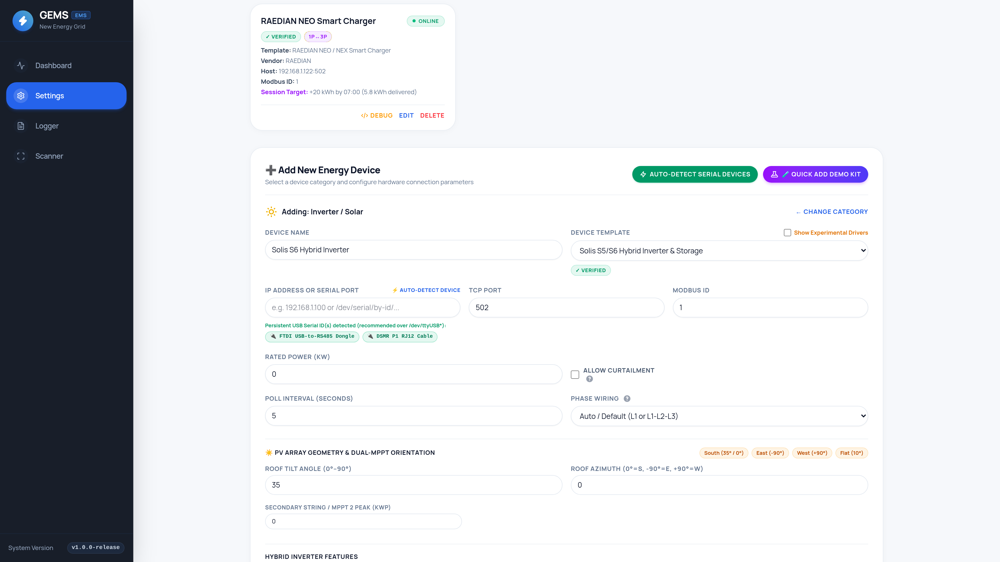
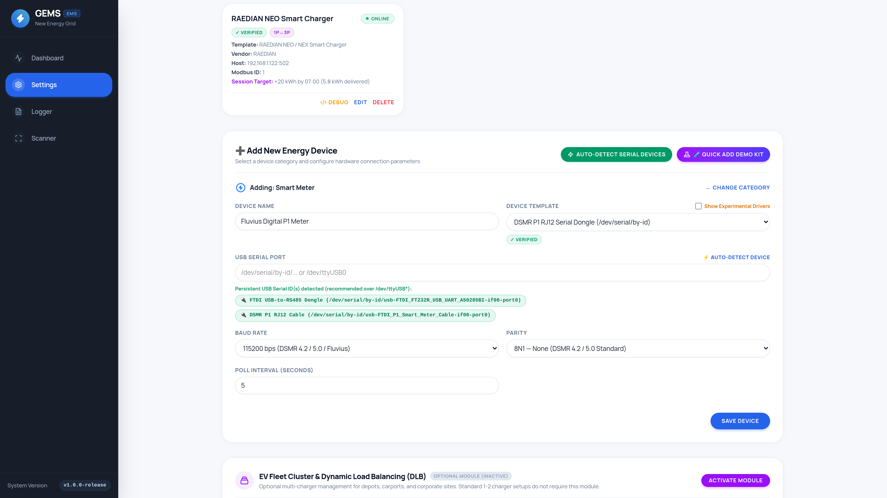
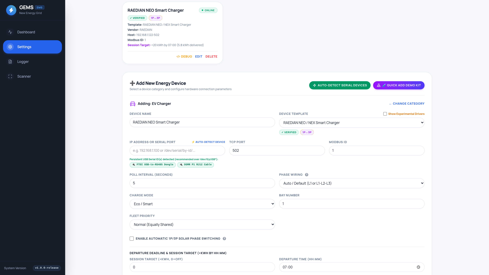
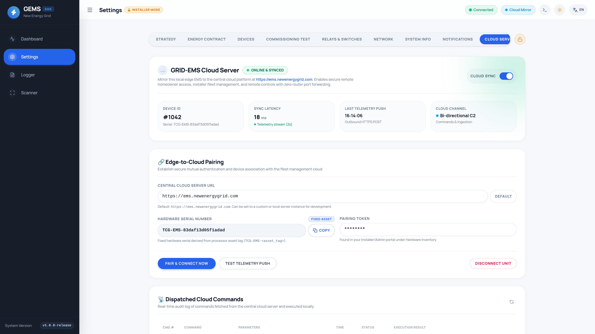

<p align="center">
  <a href="README.md"></a>
  <a href="README.nl.md"></a>
  <a href="README.fr.md"></a>
</p>

<p align="center">
  <a href="README.md">🇬🇧 English (<code>README.md</code>)</a> &nbsp;|&nbsp; <a href="README.nl.md">🇳🇱 Nederlands (<code>README.nl.md</code>)</a> &nbsp;|&nbsp; <strong>🇫🇷 Français</strong>
</p>

<h1 align="center">⚡ GEMS (Grid Energy Management System)</h1>

<p align="center">Un système de gestion énergétique (EMS) léger, ultra-réactif et entièrement piloté par interface graphique, optimisé pour Raspberry Pi afin de superviser, piloter, automatiser et optimiser les installations solaires, batteries domestiques, bornes de recharge VE et réseaux électriques résidentiels et tertiaires.</p>

<p align="center">
  <a href="https://go.dev/"></a>
  <a href="https://vuejs.org/"></a>
  <a href="https://www.sqlite.org/"></a>
  <a href="https://www.raspberrypi.com/"></a>
  <a href="https://openchargealliance.org/"></a>
  
</p>

<p align="center">
  <a href="manuals/fr/gems-installer-manual-fr.pdf"></a>
  <a href="manuals/fr/gems-user-manual-fr.pdf"></a>
  <a href="docs/fr/GRID-EMS-Return-On-Investment-fr.pdf"></a>
  <a href="manuals/fr/gems-server-connection-manual-fr.pdf"></a>
  <a href="manuals/fr/gems-p1-meter-manual-fr.pdf"></a>
  <a href="manuals/fr/gems-supported-hardware-manual-fr.pdf"></a>
  <a href="manuals/fr/gems-fleet-dlb-manual-fr.pdf"></a>
  <a href="manuals/fr/gems-solis-easyway-manual-fr.pdf"></a>
  <a href="manuals/fr/gems-huawei-manual-fr.pdf"></a>
  <a href="manuals/fr/gems-enerlution-manual-fr.pdf"></a>
  <a href="manuals/fr/index.html"></a>
</p>

## Fonctionnalités Clés

- **Plateforme Matérielle Optimisée** : Spécialement conçu pour Raspberry Pi (Debian/Linux ARM64). Les métriques de charge CPU sont volontairement exclues de l'interface afin de garantir une empreinte système minimale. Le numéro de build est généré dynamiquement depuis le tag de version (`git describe --tags --always`).
- **Architecture Monolithique** : Binaire unique cohérent associant un backend Go (Golang) servant à la fois d'API et de serveur web à une application web moderne Vue 3 (SPA).
- **Intégration Cloud GRID-EMS-SERVER** : Synchronisation sortante exclusivement chiffrée en TLS 1.3 vers la plateforme centrale de gestion de flotte (`https://ems.newenergygrid.com`). Prend en charge la télémétrie haute fréquence, l'exécution d'ordres distants (`set_strategy_mode`, `set_battery_mode`, `throttle_ev_charger`, `set_relay`), l'authentification cryptographique par jeton matériel et une sécurité sans aucun port entrant ouvert.
- **Usure Minimale du Stockage SD / NVMe** : Base de données locale SQLite finement optimisée en mode Write-Ahead Logging (WAL) avec écritures transactionnelles groupées en mémoire.
- **Pilotage 100 % Graphique** : Aucune configuration YAML requise. Découverte, ajout, paramétrage, test et suppression des équipements entièrement depuis l'interface web intuitive (disponible en français, néerlandais et anglais).
- **184 Modèles Matériels Enregistrés** : Prise en charge native de 178 modèles d'équipements physiques (plus 6 profils de simulation intégrés) couvrant les onduleurs solaires et hybrides, batteries stationnaires (BESS), bornes de recharge VE (Modbus TCP/RTU, OCPP 1.6-J, REST local), compteurs communicants P1 et Modbus, routeurs solaires linéaires, pompes à chaleur SG-Ready 4 états, relais intelligents et profils Modbus personnalisés via l'UI.
- **Plateformes Matérielles de Référence** : Conformément aux directives d'architecture système, **RAEDIAN** (gammes NEO, NEX et Gemini) constitue le modèle de référence principal pour les bornes de recharge VE et l'équilibrage dynamique de charge, et **Solis** (séries S5/S6 Hybride et Solis Retrofit) constitue le modèle de référence principal pour les onduleurs solaires hybrides et le stockage batterie.
- **Proxy OCPP 1.6-J Pass-Through pour Facturation Externe & DLB** : Moteur proxy OCPP 1.6-J bidirectionnel transparent permettant aux bornes (telles que Raedian et les wallbox OCPP 1.6-J) de se connecter directement aux plateformes de facturation CPO externes et aux services de remboursement employeur. GEMS achemine tous les messages OCPP sans altération tout en inspectant les télémesures, états de prise et transactions pour exécuter un équilibrage dynamique de charge (DLB) autonome à la seconde. Résilient en périphérie (edge) : en cas de coupure Internet, le délestage local continue sans interruption pour protéger l'installation électrique du site.
- **Cluster de Flotte VE Autonome & Dynamic Load Balancing (DLB) (Module Optionnel)** : Gestion multi-bornes prenant en charge jusqu'à 32 emplacements de charge (extensible à 64 sur Raspberry Pi 5) sous un plafond électrique partagé avec trois stratégies (`Equal Share`, `Priority Queue` à cinq niveaux `VIP > Haute > Normale > Basse > Solaire Seul` et `Solar First`), provisionnement automatique et cockpit dédié **Flotte EV**. Activable ou désactivable comme module optionnel dans **Paramètres &rarr; Appareils** afin de conserver une interface épurée sur les sites résidentiels.
- **Stratégies Dynamiques d'Optimisation du Site** :
  - *Mode Éco Solaire* : Maximise l'autoconsommation photovoltaïque et privilégie le stockage local et la charge VE plutôt que l'injection sur le réseau.
  - *Mode Flandre (Écrêtage Prédictif & Suivi du Pic Mensuel)* : Suit en continu la puissance quart-horaire glissante (15 minutes) dans SQLite. Réduit proactivement le courant des bornes VE et décharge la batterie domestique pour maintenir le pic quart-horaire projeté sous `capacity_peak_limit_kw`. Intègre un **Plafond Adaptatif Intelligent** qui s'ajuste automatiquement au pic mensuel déjà atteint afin de recharger plus rapidement sans augmenter d'un seul euro le tarif capacitaire. Protège les installations flamandes bénéficiant de **Certificats Verts (GSC)** grâce à des paliers prédéfinis (90 €, 210 €, 230 €, 250 €, 270 €, 330 €, 350 €, 450 €/MWh), garantissant la rentabilité de l'injection même lors d'heures spot négatives.
  - *Mode Pays-Bas (Saldering Intelligent, Règles d'Injection Post-2027 & Zéro-Injection)* : Protection par phase `3×25A` et limitation d'injection solaire (`min_profitable_export_price`), avec préréglages légaux HTVA 2026/2027 d'*Energiebelasting* (`0,09161 €` / `0,08802 €/kWh`), frais d'injection post-saldering (`fixed_feed_in_cost_kwh`) et vérification du plancher légal 2027–2029 (`>= 50 %` du tarif de fourniture nu).
  - *Arbitrage Dynamique de Batterie & Réserve Solaire Prix Négatifs* : Combine les tarifs EPEX Spot Day-Ahead quart-horaires (`15m`) ou horaires moyens (`60m`), la prévision solaire désactivable (`solar_forecast_enabled`) tenant compte de l'inclinaison/azimut de double toiture avec auto-étalonnage d'ombrage, des bornes SoC configurables (`min_battery_soc` `0 %–80 %`, `max_battery_soc` `50 %–100 %`) et l'apprentissage épuré de la charge domestique Semaine/Week-end sur 24 h — incluant le maintien **Réserve Solaire (`solar_hold`)** le matin afin de conserver de la capacité batterie libre pour absorber le photovoltaïque à prix négatif l'après-midi avant tout écrêtement.
  - *Objectif de Départ Borne VE (`+kWh avant HH:MM`, Sans API Véhicule)* : Cible énergétique et heure de départ optionnelles par borne (mesurées exclusivement par le compteur interne de la borne telle que **RAEDIAN**), sélectionnant le surplus solaire et les quarts d'heure les moins chers dans le respect du disjoncteur principal et du plafond capacitaire flamand.
  - *SG-Ready 4 États Double Relais & Préchauffage Thermique* : Associe deux canaux relais (ou REST local) en un contrôleur pompe à chaleur SG-Ready 4 états (`Délestage`, `Normal`, `Solaire/Creux Recommandé`, `Boost Forcé`) avec préchauffage confort et délestage de pointe en dernier recours.
- **Intégration Locale en Lecture Seule (MQTT & Modbus TCP)** : Client sortant MQTT v3.1.1 sans dépendance externe (avec auto-découverte Home Assistant en un clic) et serveur local LAN Modbus TCP en lecture seule (`FC03`/`FC04`, écritures refusées) sous **Paramètres &rarr; Réseau** — exposant puissances, courants/tensions par phase, index kWh et compteurs P1 M-Bus Gaz (`m³`) & Eau (`m³`).
- **Sous-Comptage Automatique Gaz (`m³`) & Eau (`m³` / `L`) via P1 M-Bus** : Décode automatiquement les canaux M-Bus gaz (`0-n:24.1.0(003)`, dont `24.2.3` belge) et eau potable (`0-n:24.1.0(007)`) des compteurs P1 DSMR / e-MUCS (ainsi que HomeWizard, YouLess, ESPHome et Custom Modbus), avec suivi journalier/mensuel/annuel, index fiscaux, graphiques historiques, rapports PDF et synchronisation 1:1 vers `GRID-EMS-SERVER`.
- **Marché Benelux 2026/2027 & Préréglages Fournisseurs / GRD** : Modèles tarifaires natifs pour Vattenfall Nederland FlexPrijs, Eneco Dynamic, Frank Energie, TotalEnergies Pixel Dynamic, Mega Smart/Cosy Dynamic, Bolt Dynamisch, Engie Dynamic / Flextime, Luminus Dynamic, Ecopower, Dats 24, Octa+, Trevion, Aspiravi et Bihoraire Belge, avec préréglages GRD pour la Flandre (Fluvius), Bruxelles (SIBELGA), la Wallonie (ORES & RESA fixe ou CWaPE `Tarif Impact` `ECO`/`MEDIUM`/`PIC`), l'accise fédérale belge 2027 (`0,0392 €/kWh`) et l'*Energiebelasting* néerlandaise (TVA `21 %`).
- **Visualiseur Interactif de Courbe Tarifaire 24h** : Graphique `15m` / `60m` empilé détaillant le prix spot de gros, la marge fournisseur, les tarifs réseau GRD (y compris les tranches wallonnes `ECO`/`MEDIUM`/`PIC`), les accises et la TVA, le tarif d'injection dynamique et les alertes d'écrêtement à prix négatif.
- **Intégration des Bornes VE (Modbus TCP Recommandé & OCPP 1.6-J Natif)** : Pilotage local direct prenant en charge la modulation dynamique de courant sous la seconde (pause 0 A et plage 6 A–32 A) pour l'écrêtage capacitaire et le suivi solaire. **Modbus TCP** est privilégié pour sa réactivité instantanée et permet aux bornes de rester connectées simultanément en OCPP aux plateformes CPO / split-billing (remboursement employeur). En alternative, un serveur WebSocket **OCPP 1.6-J** natif embarqué (`ws://<ems-ip>:8887/<ChargePointID>` et `ws://<ems-ip>:8080/api/ocpp/<ChargePointID>`) est disponible pour les bornes autonomes ou en mode proxy.
- **Scanner Réseau Local** : Scanner de sous-réseau local et bus RS-485 sans dépendance externe exploitant une base MAC OUI embarquée pour identifier instantanément les équipements compatibles.
- **Schéma Interactif des Flux Énergétiques (PowerFlow)** : Vue centrale du tableau de bord illustrant en direct les flux entre Réseau, Solaire, Batterie, Maison et Borne VE. Un clic sur chaque nœud ouvre ses courbes historiques et métriques détaillées.
- **Rapports PDF & Exportation de Journaux** : Exportation des journaux techniques structurés (`.txt`) depuis **Journal** et génération de rapports énergétiques PDF (Aujourd'hui, 7 derniers jours, 30 derniers jours, Année en cours) depuis le **Tableau de bord**.
- **Mises à Jour Logicielles OTA & Conformité EU CRA** : Mises à jour OTA signées Ed25519 et téléversement hors ligne `.deb` depuis **Infos système**, nomenclatures CycloneDX 1.5 SBOM et divulgation coordonnée des vulnérabilités RFC 9116 (`/.well-known/security.txt`).
- **Notifications & Alertes Webhook** : Alertes webhook configurables en cas d'erreur système, de perte de communication matérielle ou de dépassement de seuil capacitaire.

---

## 📸 Aperçu de l'Interface Utilisateur

### ⚡ Tableau de Bord & Flux d'Énergie en Direct
| Tableau de Bord PowerFlow (Bureau) | Vue Mobile Responsive |
| :---: | :---: |
|  |  |

### 🚗 Cluster de Flotte VE & Dynamic Load Balancing (Module Optionnel)
| Cockpit Multi-Bornes Flotte EV | Arbitrage de Flotte & Limites Dynamiques |
| :---: | :---: |
|  |  |

### 🔍 Fenêtres Historiques Détaillées au Clic
| Production Solaire & Écrêtement | Télémétrie Batterie & État de Charge (SOC) |
| :---: | :---: |
|  |  |

| Prélèvement/Injection Réseau & Pointe Capacitaire | Historique Borne VE & Consigne de Courant |
| :---: | :---: |
|  |  |

### ⚙️ Stratégie & Optimisation Dynamique
| Écrêtage Capacitaire Flandre & Plafonds | Modes Opérationnels Multi-Stratégies |
| :---: | :---: |
|  |  |

### 💶 Contrat d'Énergie Dynamique & Courbe Tarifaire 24h
| Formules Fournisseur & Taxes | Visualiseur Interactif des Tarifs sur 24h |
| :---: | :---: |
|  |  |

### 🔌 Gestion des Appareils & Assistants de Configuration
| Gestion des Appareils Configurés | Assistant de Sélection de Catégorie |
| :---: | :---: |
|  |  |

| Configuration Modbus TCP Onduleur | Formulaire Compteur P1 Série / Réseau |
| :---: | :---: |
|  |  |

| Configuration Borne VE (Modbus TCP & OCPP) | Relais Intelligents & Règles d'Automatisation |
| :---: | :---: |
|  |  |

### 🛠️ Diagnostics, Infos Système, Alertes Webhook & Serveur Cloud
| Scanner Réseau Local | Journal de Diagnostic en Temps Réel |
| :---: | :---: |
|  |  |

| Identité Système, Sauvegardes & Mises à Jour OTA | Alertes Webhook & Rapports Hebdomadaires |
| :---: | :---: |
|  |  |

| Serveur Cloud Central (GRID-EMS-SERVER) | |
| :---: | :---: |
|  | |

---

## 🔌 Équipements Compatibles & Mise en Service en 4 Étapes

GEMS intègre **174 modèles matériels natifs** (plus 6 profils de simulation — **180 au total**). L'ajout d'un équipement s'effectue en 4 étapes simples depuis l'interface web :

1. **Analyser le sous-réseau** : Ouvrez **Scanner** dans le menu latéral pour détecter l'adresse IP et le fabricant MAC de votre équipement.
2. **Préparer le matériel** : Activez Modbus TCP sur le dongle de votre onduleur (ex. Solis S5/S6 Hybride, Huawei SDongleA, SMA Speedwire, SolarEdge SetApp), activez Modbus TCP sur votre borne VE (recommandé pour le délestage sous la seconde et la coexistence avec un opérateur de facturation CPO, ex. RAEDIAN NEO/NEX/Gemini) ou renseignez l'URL du serveur OCPP (`ws://<IP-GEMS>:8887/<ID>`), ou activez l'*API Locale* dans l'application de votre compteur communicant / module Shelly.
3. **Ajouter l'appareil dans l'interface** : Rendez-vous dans **Paramètres &rarr; Appareils &rarr; + Ajouter un appareil énergétique**, choisissez la catégorie, sélectionnez le modèle matériel et saisissez les paramètres IP ou série.
4. **Vérifier la télémétrie** : Assurez-vous que la carte de l'appareil affiche <span style="color:#10b981; font-weight:bold;">● En ligne</span> et observez les flux énergétiques en direct sur le **Tableau de bord**.

### Matrice Récapitulative des Équipements

| Catégorie | Marques & Modèles Pris en Charge | Protocoles Principaux | Paramètres Clés |
| :--- | :--- | :--- | :--- |
| **Onduleurs Solaires & Hybrides** *(41 modèles)* | **Solis (Référence Principale)**, Huawei SUN2000, SMA Sunny Boy/Tripower, Fronius Gen24/Symo, GoodWe, Growatt, SolarEdge, SolaX, SofarSolar, Sungrow, Victron GX, Deye, Sunsynk, FoxESS, SAJ, Senergy, Sigenergy, Enerlution, Alpha ESS, Anker, Afore, Marstek, LG ESS, Enphase, ABB / Fimer, Autarco, Chisage ESS, Delta, HYXiPOWER, KACO blueplanet, KSTAR BluE, Solinteg, Solplanet, KOSTAL Plenticore, FENECON FEMS, Hoymiles DTU, APsystems EZ1-M | Modbus TCP/RTU (Port 502 / 1502), SunSpec M123/M124, REST Local | IP hôte, Port, ID esclave Modbus (ex. `1` ou `126`), Puissance nominale (kW) |
| **Systèmes de Stockage Batterie Dédiés (BESS)** *(20 modèles)* | **Solis Retrofit & Easyway BESS (Référence Principale)**, Sessy, VARTA Pulse/Element, Zendure SolarFlow, Tesla Powerwall Gateway, Sonnen, Solarwatt, Siemens Junelight, Pylontech US/Force, Dyness, Duracell Energy, Elecnova C&I, Enerlution BESS, Goneo, Mastervolt MLI Ultra, Power Sonic C&I, Poweroad, Sinexcel PWS, Socomec SUNSYS, Sunwoda AtSmart | Modbus TCP, SunSpec, HTTPS/REST Local | IP hôte, Port, ID esclave Modbus, Capacité utile (kWh) |
| **Bornes de Recharge VE & Wallbox** *(61 modèles)* | **Modbus TCP / RS485 (Recommandé & DLB < 1s)** : **RAEDIAN NEO / NEX / Gemini (Référence Principale)**, KEBA P30/P40, Webasto Live/Next, Peblar, Phoenix Contact Charx / EV-CC, Veton, Alfen Eve, Mennekes AMTRON, ABB Terra AC, SolarEdge Home EVSE, ABL, Sigenergy, GoodWe HCA, Enovates, ETEK, Etrel, Hardy Barth cPµ1/cPµ2, Heidelberg Energy Control / Amperfied, Sungrow AC011E/AC22E, FoxESS Wallbox, SolaX EV Charger, Vestel EVC04.<br>**OCPP 1.6-J (Proxy Pass-Through & CSMS)** : Huawei FusionCharge, EVBox Elvi/Livo, Schneider EVlink, Siemens VersiCharge, Elli/VW ID. Charger, Alpitronic, Autel, Hager, BMW, Mercedes, Porsche, Fronius Wattpilot, Teltonika TeltoCharge, Wallbox Pulsar Plus, Kempower, Borne CPO Externe.<br>**REST / Local & Cloud** : go-e Charger Gemini, WARP Charger 2/3, openWB Pro, cFos Power Brain, SmartEVSE, MyEnergi Zappi, Easee, Zaptec, Volt Time Source, Wallbox Cloud, Passerelle REST Générique | Modbus TCP/RTU (Port 502 / RS485, recommandé pour modulation instantanée & coexistence facturation externe), Proxy OCPP Pass-Through, WebSocket OCPP 1.6-J Natif (`ws://<IP>:8887/<ID>`), HTTP REST | IP hôte & ID esclave Modbus (pour Modbus) ou ChargePoint ID (pour OCPP), Mode de charge |
| **Compteurs Intelligents & Analyseurs Réseau** *(40 modèles)* | Fluvius / DSMR P1 Série & Réseau, HomeWizard Wi-Fi P1, Shelly 3EM / Pro 3EM / Gen3 3EM-63T, Eastron (SDM120/230/630/72D/X96), Chint DTSU666, Carlo Gavazzi (EM112/340/540/24), ABB (A43/B23), Schneider Acti9, Siemens PAC2200, SMA Energy Meter 2.0, KOSTAL KSEM, Huawei EMMA-A02, Fronius Smart Meter IP, Tasmota SML IR, Socomec, WAGO 879, Eltako, Finder, Inepro, Lovato, Acrel, ESPHome, Loxone, Niko, Accuenergy Acuvim/AcuRev, Algodue, Hager, Janitza UMG, Kamstrup, Landis+Gyr, Phoenix Contact EMpro, Weidmüller, YouLess LS120 | Série DSMR, Modbus TCP/RTU, REST Local, UDP | Port série (`/dev/ttyUSB0`) & Débit (`115200`), ou IP hôte & Port |
| **Relais Intelligents, Routeurs PV & Pompes à Chaleur** *(12 modèles)* | Shelly Plus 1PM / Pro 1PM, Shelly Plus 1 / Pro 1, Shelly Plus 2PM / Pro 2PM, Relais Tasmota, Routeur Linéaire my-PV AC•THOR / AC ELWA 2, Thermoplongeur PV Askoma ASKOHEAT+, Stiebel Eltron ISG, NIBE Série S, Daikin Altherma HomeHub, Boost PAC SG-Ready, Relais E/S Modbus, Relais HTTP Générique | REST Gen 2 Local, HTTP JSON, Modbus TCP | IP hôte, Port `80` / `502`, Seuil de surplus solaire (W) ou Plancher de prix spot (€) |

> 📖 **Guides Détaillés Étape par Étape pour Chaque Appareil** : Consultez le [Manuel Interactif des Appareils](manuals/fr/devices.html), [Supported_devices.fr.md](Supported_devices.fr.md) ou [docs/fr/user_manual.md](docs/fr/user_manual.md).

---

## 🛠️ Matériel de Référence Officiel

GEMS est conçu, testé et validé sur l'architecture matérielle de référence suivante :

| Composant | Spécification Matérielle | Standard / Exigence |
| :--- | :--- | :--- |
| **Contrôleur Système & Boîtier** | **Matériel de Référence Raspberry Pi 5**<br>• Raspberry Pi 5 (4 Go ou 8 Go de RAM)<br>• Alimentation officielle USB-C PD 27 W (5 V / 5 A)<br>• Boîtier aluminium avec refroidisseur actif<br>• Carte d'extension M.2 NVMe PCIe HAT & nappe FPC 16 broches<br>• Carte MicroSD (pour la configuration initiale du bootloader) | Plateforme matérielle de référence recommandée |
| **Stockage Interne Haute Vitesse** | **SSD M.2 NVMe 128 Go+**<br>• Format : M.2 2280 (ou 2230/2242) clé M<br>• Interface : PCIe Gen 3.0 / Gen 2.0 x4 NVMe<br>• Haute endurance (TBW), faible consommation<br>• Lecture : jusqu'à 1 600+ Mo/s / Écriture : jusqu'à 600+ Mo/s | Stockage NVMe sans usure et latence inférieure à la seconde |

> 📖 **Spécifications Matérielles Complètes & Brochages** : Voir [docs/fr/hardware_reference.md](docs/fr/hardware_reference.md).

---

## ⚡ Connexion au Compteur Communicant du Gestionnaire de Réseau (Port P1 & Câble DIY)

GEMS lit en temps réel le prélèvement, l'injection, les tensions et les courants par phase directement depuis le port client P1 du compteur communicant (ex. Fluvius, ORES et RESA en Belgique, Enexis/Liander/Stedin aux Pays-Bas, ou tout compteur conforme DSMR 5.0.2 / e-MUCS v1.4).

### 🛠️ Matériel Nécessaire (Nomenclature)
- **Adaptateur Série USB-vers-UART** : FTDI FT232R (recommandé) ou CP2102.
- **Câble Téléphonique RJ11 (6P4C) ou RJ12 (6P6C)** : Câble téléphonique plat standard à 4 ou 6 conducteurs.
- **Inverseur de Signal** : Le port P1 utilise une logique inversée à collecteur ouvert (0 V = 1, 5 V = 0).
  - *Inversion matérielle* : 1 transistor NPN BC547, 1 résistance 1 kΩ, 1 résistance 10 kΩ.
  - *Inversion logicielle (FTDI uniquement)* : Puce FT232R configurée via `ftdi_eeprom` avec `invert_rxd=true`.

### 📌 Brochage du Port P1
| Broche RJ12 | Fil RJ11 | Fonction | Connexion GEMS / USB |
| :---: | :---: | :--- | :--- |
| **Broche 1** | *N/A* | Alimentation +5 V | Non requise (le Raspberry Pi alimente le dongle USB) |
| **Broche 2** | Fil 1 | Demande de données (RTS) | Relier au +5 V USB (active l'envoi continu des télégrammes) |
| **Broche 3** | Fil 2 | Masse données (GND) | Relier au GND USB |
| **Broche 4** | Fil 3 | Non connecté (NC) | Inutilisé |
| **Broche 5** | Fil 4 | Ligne de données (TxD) | Signal inversé vers RXD USB |
| **Broche 6** | *N/A* | Masse alimentation (GND) | Reliée à la broche 3 / GND USB |

> 📖 **Guide Complet d'Assemblage DIY** : Pour les schémas électroniques complets, montages sur platine d'essai, vérifications au multimètre, activation du port client (Fluvius / ORES / RESA) et commandes de test, consultez le **[Manuel Compteur P1 (PDF)](manuals/fr/gems-p1-meter-manual-fr.pdf)**, le **[Guide Web Interactif P1](manuals/fr/p1-meter.html)** ou **[docs/fr/p1_port_manual.md](docs/fr/p1_port_manual.md)**.

---

## ⚡ Configuration du Bootloader SSD NVMe (Démarrage sur NVMe)

Sur un Raspberry Pi 5 neuf équipé d'une carte NVMe HAT et d'un SSD M.2 NVMe, l'EEPROM d'usine démarre exclusivement sur la carte SD (`BOOT_ORDER=0xf41`) sans interroger le bus PCIe.

### 🌟 Procédure Rapide en 3 Minutes (avec Raspberry Pi Imager)
1. Insérez une carte MicroSD dans votre ordinateur.
2. Ouvrez **[Raspberry Pi Imager](https://www.raspberrypi.com/software/)** &rarr; Choisissez l'appareil : **Raspberry Pi 5** &rarr; Choisissez l'OS : **Misc utility images** &rarr; **Bootloader** &rarr; **NVMe/PCIe Boot**.
3. Sélectionnez votre carte MicroSD et cliquez sur **Écrire (Write)**.
4. Installez le SSD M.2 NVMe sur le HAT NVMe du Pi 5, insérez la carte MicroSD et branchez l'alimentation officielle 27 W.
5. En ~5 secondes, la LED ACT clignote rapidement et l'écran HDMI devient **vert fixe**, confirmant la mise à jour de l'EEPROM (`BOOT_ORDER=0xf461`, `PCIE_PROBE=1`).
6. Débranchez l'alimentation, retirez la carte MicroSD et flashez `gems-os-image.img.xz` directement sur le SSD NVMe (ou consultez [docs/fr/nvme_boot_guide.md](docs/fr/nvme_boot_guide.md) pour flasher en ligne de commande).
7. Remettez sous tension sans carte SD : le système démarre sur le SSD NVMe en moins de 8 secondes !

> 📖 **Dépannage & Diagnostic NVMe Détaillés** : Voir [docs/fr/nvme_boot_guide.md](docs/fr/nvme_boot_guide.md).

---

## Déploiement & Installation

GEMS est déployé principalement via des livrables automatisés : une image système Raspberry Pi OS préconfigurée et un paquet Debian (`.deb`).

### Option A : Image Système Raspberry Pi OS Préconfigurée (Recommandé)

La méthode la plus rapide pour déployer GEMS consiste à flasher l'image personnalisée Raspberry Pi OS Lite (Bookworm ARM64) sur un SSD NVMe ou une carte SD.

1. Téléchargez `gems-os-image.img.xz` depuis la dernière version publiée (`v*`).
2. Flashez directement l'archive `.img.xz` avec [BalenaEtcher](https://etcher.balena.io/) ou [Raspberry Pi Imager](https://www.raspberrypi.com/software/).
3. Insérez le support dans votre Raspberry Pi et démarrez.

**Configuration Clé en Main** :
- **Nom d'hôte** : `ems` (accessible sur `http://ems` ou `http://ems.local`).
- **Proxy Inverse Nginx** : Préconfiguré avec SSL et prise en charge WebSocket/SSE redirigeant vers GEMS sur le port 8080.
- **Bureau Kiosque** : Environnement Wayland léger (`wayfire`) exécuté sous le compte sans privilèges `gems-kiosk`, lançant automatiquement Chromium en mode kiosque sur `http://127.0.0.1`.
- **Terminal Web Cockpit** : Console d'administration web accessible sur `https://ems.local:9090` (réservée aux identifiants installateur autorisés).
- **Raspberry Pi Connect** : Préinstallé pour l'assistance à distance supervisée après appairage par un installateur agréé (accès automatique non supervisé désactivé par défaut).
- **Prêt pour NVMe** : `dtparam=pciex1` et `dtparam=pciex1_gen=2` activés d'origine.

---

### Option B : Installation via Paquet Debian (.deb)

Si vous disposez déjà d'une installation Debian/Ubuntu ARM64 sur votre Raspberry Pi :

1. Téléchargez le dernier paquet `gems_*_arm64.deb` depuis les ressources de version.
2. Installez le paquet :
   ```bash
   sudo dpkg -i gems_*_arm64.deb
   sudo apt-get install -f # résout les éventuelles dépendances manquantes
   ```

Le paquet crée automatiquement un utilisateur système restreint `gems` (membre du groupe `dialout` pour l'accès série aux adaptateurs P1 et RS485), installe le service et l'interface compilée dans `/opt/gems`, puis active et démarre `gems.service` via systemd.

---

## Bibliothèque Documentaire

| Guide / Manuel | Langues / Téléchargements | Description |
| :--- | :---: | :--- |
| 📈 **[Brochure Retour sur Investissement (ROI) (PDF)](docs/fr/GRID-EMS-Return-On-Investment-fr.pdf)** | [🇫🇷 FR](docs/fr/GRID-EMS-Return-On-Investment-fr.pdf) · [🇬🇧 EN](docs/GRID-EMS-Return-On-Investment.pdf) · [🇳🇱 NL](docs/nl/GRID-EMS-Return-On-Investment-nl.pdf) | **Brochure exécutive & rentabilité client** (Analyse chiffrée du temps de retour, gain d'autoconsommation solaire, économies sur le tarif capacitaire, arbitrage dynamique EPEX et protection des certificats verts) |
| 📕 **[Manuel d'Installation & de Mise en Service (PDF)](manuals/fr/gems-installer-manual-fr.pdf)** | [🇫🇷 FR](manuals/fr/gems-installer-manual-fr.pdf) · [🇬🇧 EN](manuals/gems-installer-manual.pdf) · [🇳🇱 NL](manuals/nl/gems-installer-manual-nl.pdf) | **Guide PDF imprimable officiel pour installateurs** (Nomenclature matérielle, démarrage NVMe, intégration des 180 modèles d'appareils, limites réseau, écrêtage capacitaire, protection GSC et alertes webhook) |
| 📗 **[Manuel Utilisateur & Propriétaire (PDF)](manuals/fr/gems-user-manual-fr.pdf)** | [🇫🇷 FR](manuals/fr/gems-user-manual-fr.pdf) · [🇬🇧 EN](manuals/gems-user-manual.pdf) · [🇳🇱 NL](manuals/nl/gems-user-manual-nl.pdf) | **Guide PDF imprimable officiel pour utilisateurs finaux** (Schéma PowerFlow, fenêtres historiques détaillées, modes de charge VE, courbe tarifaire 24h, relais intelligents et rapports PDF) |
| ☁️ **[Manuel de Connexion GRID-EMS-SERVER (PDF)](manuals/fr/gems-server-connection-manual-fr.pdf)** | [🇫🇷 FR](manuals/fr/gems-server-connection-manual-fr.pdf) · [🇬🇧 EN](manuals/gems-server-connection-manual.pdf) · [🇳🇱 NL](manuals/nl/gems-server-connection-manual-nl.pdf) | **Guide PDF imprimable officiel pour l'intégration cloud & flotte** (Architecture sortante TLS 1.3, appairage par jeton matériel, ingestion JSON temps réel et commandes à distance) |
| ⚡ **[Manuel Compteur Intelligent P1 & Câble DIY (PDF)](manuals/fr/gems-p1-meter-manual-fr.pdf)** | [🇫🇷 FR](manuals/fr/gems-p1-meter-manual-fr.pdf) · [🇬🇧 EN](manuals/gems-p1-meter-manual.pdf) · [🇳🇱 NL](manuals/nl/gems-p1-meter-manual-nl.pdf) | **Guide PDF imprimable officiel pour compteurs communicants** (Standard Fluvius/ORES/RESA/DSMR, brochages RJ12/RJ11, assemblage câble USB DIY avec BC547/FTDI, activation du port P1 et intégration GEMS) |
| 🔌 **[Manuel du Matériel & des Appareils Compatibles (PDF)](manuals/fr/gems-supported-hardware-manual-fr.pdf)** | [🇫🇷 FR](manuals/fr/gems-supported-hardware-manual-fr.pdf) · [🇬🇧 EN](manuals/gems-supported-hardware-manual.pdf) · [🇳🇱 NL](manuals/nl/gems-supported-hardware-manual-nl.pdf) | **Référentiel PDF imprimable officiel du matériel supporté** (Spécifications complètes des registres, télémétrie lue, consignes pilotables et câblage pour les 168 profils matériels natifs) |
| ⚡ **[Manuel Cluster de Flotte VE & Dynamic Load Balancing (PDF)](manuals/fr/gems-fleet-dlb-manual-fr.pdf)** | [🇫🇷 FR](manuals/fr/gems-fleet-dlb-manual-fr.pdf) · [🇬🇧 EN](manuals/gems-fleet-dlb-manual.pdf) · [🇳🇱 NL](manuals/nl/gems-fleet-dlb-manual-nl.pdf) | **Guide PDF imprimable officiel pour flottes VE & DLB** (Équilibrage autonome en périphérie, seuil minimal 6 A IEC 61851, protection par phase du disjoncteur, surplus solaire et proxy OCPP pass-through) |
| 🔋 **[Manuel Solis Retrofit / Hybride & Easyway UNIV5200 (PDF)](manuals/fr/gems-solis-easyway-manual-fr.pdf)** | [🇫🇷 FR](manuals/fr/gems-solis-easyway-manual-fr.pdf) · [🇬🇧 EN](manuals/gems-solis-easyway-manual.pdf) · [🇳🇱 NL](manuals/nl/gems-solis-easyway-manual-nl.pdf) | **Guide PDF imprimable officiel Solis & Easyway UNIV5200** (Câblage DC parallèle & jeu de barres, brochages CAN RJ45 isolés, commutateurs DIP ADD, compteurs Eastron `SDM72D-M` & `SDM630-M`, précharge et recettes GEMS) |
| ☀️ **[Manuel Huawei SUN2000, LUNA2000 & FusionSolar (PDF)](manuals/fr/gems-huawei-manual-fr.pdf)** | [🇫🇷 FR](manuals/fr/gems-huawei-manual-fr.pdf) · [🇬🇧 EN](manuals/gems-huawei-manual.pdf) · [🇳🇱 NL](manuals/nl/gems-huawei-manual-nl.pdf) | **Guide PDF imprimable officiel Huawei & FusionSolar** (Configuration installateur pas à pas dans FusionSolar pour SDongleA-05, EMMA-A02, batterie LUNA2000, brochages RS-485 et optimisation GEMS) |
| ⚡ **[Manuel Onduleurs Hybrides & Stockage Enerlution (PDF)](manuals/fr/gems-enerlution-manual-fr.pdf)** | [🇫🇷 FR](manuals/fr/gems-enerlution-manual-fr.pdf) · [🇬🇧 EN](manuals/gems-enerlution-manual.pdf) · [🇳🇱 NL](manuals/nl/gems-enerlution-manual-nl.pdf) | **Guide PDF imprimable officiel Enerlution** (Câblage batteries 51,2 V BT parallèles & HT empilables, brochages CAN RJ45, adressage DIP à froid, borniers DTSU666/SDM630 et bridage solaire GEMS au watt près) |
| 💻 [Portail Documentaire HTML Interactif](manuals/fr/index.html) | [🇫🇷 FR](manuals/fr/index.html) · [🇬🇧 EN](manuals/index.html) · [🇳🇱 NL](manuals/nl/index.html) | Suite documentaire web complète avec recherche plein texte (à ouvrir dans un navigateur) |
| 🛠️ [Manuel Installateur Interactif (HTML)](manuals/fr/gems-installer-manual-fr.html) | [🇫🇷 FR](manuals/fr/gems-installer-manual-fr.html) · [🇬🇧 EN](manuals/gems-installer-manual.html) · [🇳🇱 NL](manuals/nl/gems-installer-manual-nl.html) | Guide complet de mise en service sur site avec captures haute résolution et schémas de câblage |
| 🏠 [Manuel Utilisateur Interactif (HTML)](manuals/fr/gems-user-manual-fr.html) | [🇫🇷 FR](manuals/fr/gems-user-manual-fr.html) · [🇬🇧 EN](manuals/gems-user-manual.html) · [🇳🇱 NL](manuals/nl/gems-user-manual-nl.html) | Manuel illustré pour propriétaires avec explorateur de paramètres et détail des courbes tarifaires |
| ⚡ [Manuel Cluster Flotte VE & DLB Interactif (HTML)](manuals/fr/gems-fleet-dlb-manual-fr.html) | [🇫🇷 FR](manuals/fr/gems-fleet-dlb-manual-fr.html) · [🇬🇧 EN](manuals/gems-fleet-dlb-manual.html) · [🇳🇱 NL](manuals/nl/gems-fleet-dlb-manual-nl.html) | Guide complet des grappes de recharge multi-bornes, stratégies DLB et proxy OCPP transparent |
| 🔋 [Guide Interactif Solis & Easyway UNIV5200 (HTML)](manuals/fr/solis.html) | [🇫🇷 FR](manuals/fr/solis.html) · [🇬🇧 EN](manuals/solis.html) · [🇳🇱 NL](manuals/nl/solis.html) | Guide dédié Solis Retrofit/Hybride, câblage batterie Easyway UNIV5200, SolisCloud App et optimisation GEMS |
| ☀️ [Guide Interactif Huawei & FusionSolar (HTML)](manuals/fr/huawei.html) | [🇫🇷 FR](manuals/fr/huawei.html) · [🇬🇧 EN](manuals/huawei.html) · [🇳🇱 NL](manuals/nl/huawei.html) | Guide dédié Huawei SUN2000, LUNA2000, SDongleA-05, EMMA-A02 et optimisation GEMS |
| ⚡ [Guide Interactif Enerlution Hybride & Stockage (HTML)](manuals/fr/enerlution.html) | [🇫🇷 FR](manuals/fr/enerlution.html) · [🇬🇧 EN](manuals/enerlution.html) · [🇳🇱 NL](manuals/nl/enerlution.html) | Guide dédié onduleurs Enerlution HY/HYTH, batteries LFPWall/Roller/GroundHV et optimisation GEMS |
| ☁️ [Manuel Serveur Cloud Interactif (HTML)](manuals/fr/cloud-server.html) | [🇫🇷 FR](manuals/fr/cloud-server.html) · [🇬🇧 EN](manuals/cloud-server.html) · [🇳🇱 NL](manuals/nl/cloud-server.html) | Guide web pour relier les unités locales GEMS à la plateforme centrale GRID-EMS-SERVER |
| ⚡ [Guide Interactif Compteur P1 & Câble DIY (HTML)](manuals/fr/p1-meter.html) | [🇫🇷 FR](manuals/fr/p1-meter.html) · [🇬🇧 EN](manuals/p1-meter.html) · [🇳🇱 NL](manuals/nl/p1-meter.html) | Guide pas à pas d'assemblage DIY avec schémas électriques et liste des composants |
| 🔌 [Manuel Interactif du Matériel Compatible (HTML)](manuals/fr/gems-supported-hardware-manual-fr.html) | [🇫🇷 FR](manuals/fr/gems-supported-hardware-manual-fr.html) · [🇬🇧 EN](manuals/gems-supported-hardware-manual.html) · [🇳🇱 NL](manuals/nl/gems-supported-hardware-manual-nl.html) | Répertoire matériel exhaustif des profils compatibles avec recherche instantanée et filtres |
| 🔌 [Manuels d'Appareils & Modèles (HTML)](manuals/fr/devices.html) | [🇫🇷 FR](manuals/fr/devices.html) · [🇬🇧 EN](manuals/devices.html) · [🇳🇱 NL](manuals/nl/devices.html) | Procédures d'intégration détaillées pour chaque modèle d'équipement pris en charge |
| 📋 [Référentiel des Appareils Compatibles (Markdown)](Supported_devices.fr.md) | [🇫🇷 FR](Supported_devices.fr.md) · [🇬🇧 EN](Supported_devices.md) · [🇳🇱 NL](Supported_devices.nl.md) | Spécification technique complète au niveau des registres pour les 168 profils matériels natifs |
