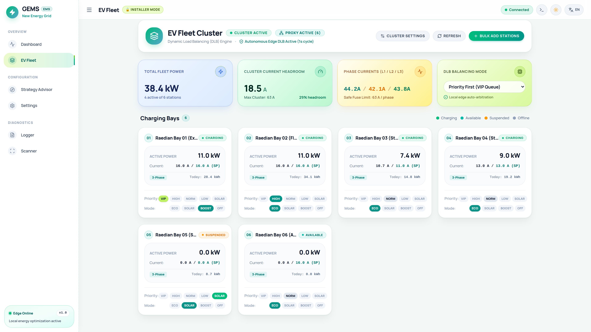
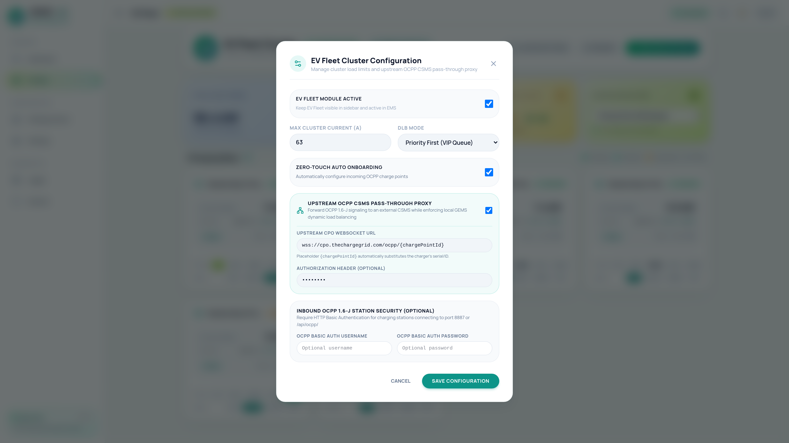
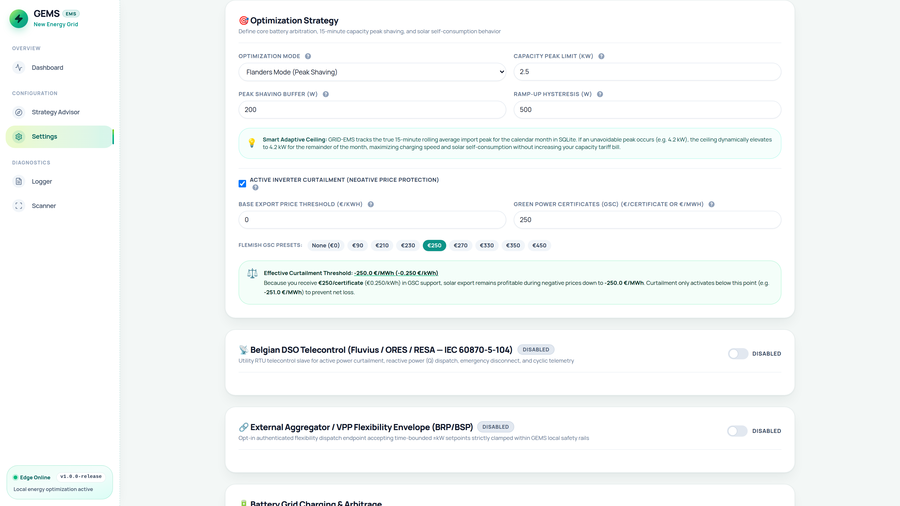
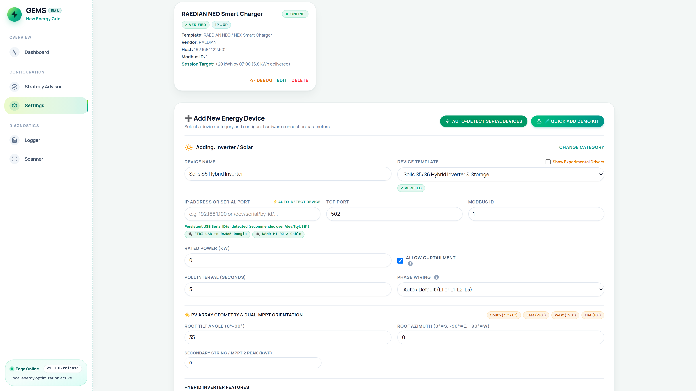
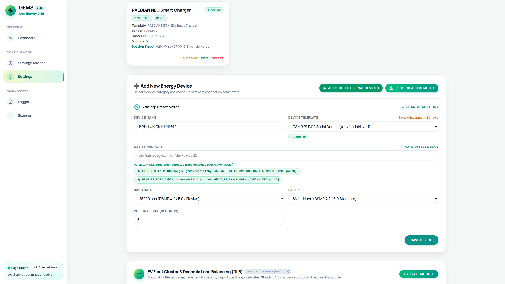
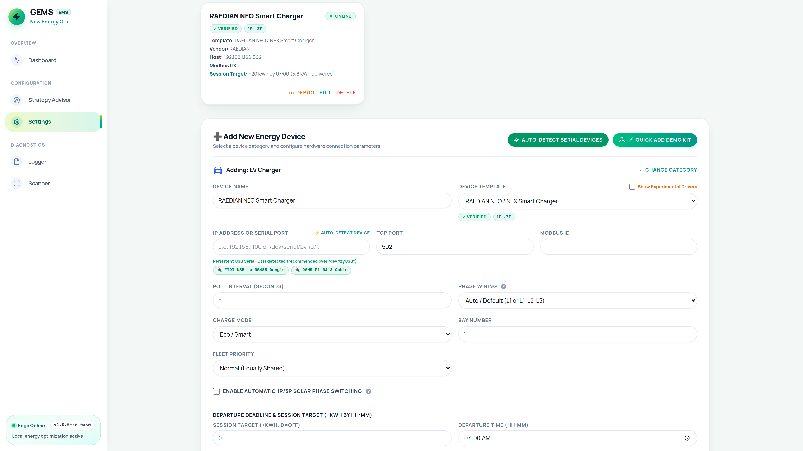
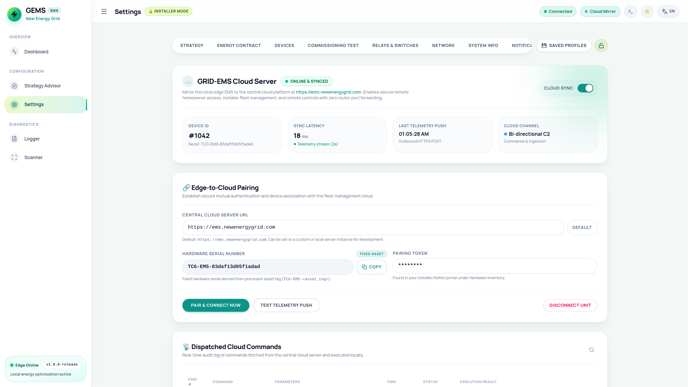

<p align="center">
  <a href="README.md"></a>
  <a href="README.nl.md"></a>
  <a href="README.fr.md"></a>
</p>

<p align="center">
  <a href="README.md">🇬🇧 English (<code>README.md</code>)</a> &nbsp;|&nbsp; <strong>🇳🇱 Nederlands</strong> &nbsp;|&nbsp; <a href="README.fr.md">🇫🇷 Français (<code>README.fr.md</code>)</a>
</p>

<h1 align="center">⚡ GEMS (Grid Energy Management System)</h1>

<p align="center">Een lichtgewicht, uiterst responsief en volledig UI-gestuurd Energy Management System (EMS), geoptimaliseerd voor Raspberry Pi om residentiële en kleinzakelijke zonne-energie, thuisbatterijen, EV-laadpalen en slimme elektriciteitsnetten te monitoren, aan te sturen, te automatiseren en te optimaliseren.</p>

<p align="center">
  <a href="https://go.dev/"></a>
  <a href="https://vuejs.org/"></a>
  <a href="https://www.sqlite.org/"></a>
  <a href="https://www.raspberrypi.com/"></a>
  <a href="https://openchargealliance.org/"></a>
  
</p>

<p align="center">
  <a href="manuals/nl/gems-installer-manual-nl.pdf"></a>
  <a href="manuals/nl/gems-user-manual-nl.pdf"></a>
  <a href="docs/nl/GRID-EMS-Return-On-Investment-nl.pdf"></a>
  <a href="docs/nl/GRID-EMS-Strategy-Guide-nl.pdf"></a>
  <a href="manuals/nl/gems-server-connection-manual-nl.pdf"></a>
  <a href="manuals/nl/gems-p1-meter-manual-nl.pdf"></a>
  <a href="manuals/nl/gems-supported-hardware-manual-nl.pdf"></a>
  <a href="manuals/nl/gems-fleet-dlb-manual-nl.pdf"></a>
  <a href="manuals/nl/gems-solis-easyway-manual-nl.pdf"></a>
  <a href="manuals/nl/gems-huawei-manual-nl.pdf"></a>
  <a href="manuals/nl/gems-enerlution-manual-nl.pdf"></a>
  <a href="manuals/nl/index.html"></a>
</p>

## Belangrijkste Functies

- **Hardware-optimalisatie**: Diepgaand geoptimaliseerd voor Raspberry Pi (Debian/Linux ARM64). CPU- en hardwarebelasting zijn bewust weggelaten uit de systeeminformatie voor een slank systeemprofiel. Het versienummer wordt dynamisch afgeleid van de releasetag (`git describe --tags --always`).
- **Monolithische Architectuur**: Een compacte monolithische applicatie met een Go (Golang) backend als uniforme API- en webserver, gecombineerd met een moderne Vue 3 Single Page Application (SPA).
- **GRID-EMS-SERVER Cloudkoppeling**: Uitsluitend uitgaande TLS 1.3-synchronisatie met het centrale vlootbeheerplatform (`https://ems.newenergygrid.com`). Ondersteunt hoogfrequente telemetrie-overdracht, commando's op afstand (`set_strategy_mode`, `set_battery_mode`, `throttle_ev_charger`, `set_relay`), cryptografische apparaatauthenticatie en beveiliging zonder geopende inkomende poorten.
- **Minimale SD-/NVMe-slijtage**: Maakt gebruik van een lokaal geoptimaliseerde SQLite-database in Write-Ahead Logging (WAL)-modus met gebundelde transacties in het werkgeheugen.
- **Volledig UI-gestuurd**: Geen enkel YAML-configuratiebestand nodig. Ontdek, configureer, test en verwijder alle energietoestellen volledig via de intuïtieve webinterface (beschikbaar in het Nederlands, Frans en Engels).
- **184 Geregistreerde Hardwaretemplates**: Ingebouwde ondersteuning voor 178 fysieke hardwaretemplates (plus 6 ingebouwde simulatieprofielen) voor Zonne-omvormers, Thuisbatterijen (BESS), EV-laadpalen (Modbus TCP/RTU, OCPP 1.6-J, Lokale REST), P1- & Modbus-energiemeters, Lineaire PV-stroomverdelers, 4-Standen SG-Ready Warmtepompen, Slimme Relais en de UI Aangepaste Modbus-profielbouwer.
- **Aanbevolen Referentiehardware**: Volgens de systeemarchitectuurrichtlijnen is **RAEDIAN** (NEO-, NEX- en Gemini-serie) vastgesteld als primair referentieplatform voor EV-laadstations en Dynamic Load Balancing, en **Solis** (S5/S6 Hybride-serie en Solis Retrofit-serie) als primair referentieplatform voor hybride zonne-omvormers en batterijopslag.
- **Straight-Through OCPP Smart Forwarder (Proxy) voor Externe Verrekening & DLB**: Bidirectionele OCPP 1.6-J pass-through proxy waarmee laadpalen (zoals Raedian en OCPP 1.6-J wallboxen) rechtstreeks verbonden blijven met externe CPO-verrekenplatformen en werkgeversvergoedingsdiensten. GEMS stuurt alle OCPP-berichten transparant door en leest gelijktijdig meetwaarden, socketstatussen en laadsessies uit voor autonome Dynamic Load Balancing (DLB) op een cyclus van 1 seconde. Edge-veerkrachtig: bij internetuitval blijft lokale load balancing ononderbroken actief om de fysieke elektrische installatie te beschermen.
- **Autonome EV-Laadcluster & Dynamic Load Balancing (DLB) (Optionele Module)**: Multi-laadpaal vlootbeheer voor clusters tot 32 laadpunten (uitbreidbaar tot 64 op Raspberry Pi 5) onder een gedeeld elektrisch stroomplafond met drie balanceringstrategieën (`Equal Share`, `Priority Queue` met vijf niveaus `VIP > Hoog > Normaal > Laag > Enkel Zon` en `Solar First`), automatische onboarding en een overzichtelijk EV-Laadcluster dashboard. Kan als optionele module worden in- of uitgeschakeld onder **Instellingen &rarr; Toestellen**, zodat residentiële installaties overzichtelijk blijven.
- **Dynamische Optimalisatiestrategieën**:
  - *Eco Zon-modus*: Maximaliseert het eigen verbruik van zonne-energie en geeft voorrang aan lokale batterijopslag en slim laden boven teruglevering aan het net.
  - *Vlaanderen-modus (Voorspellende Piekbewaking & Maandpiek-opvolging)*: Bewaakt continu de rollende kwartierpiek (15 minuten gemiddelde netafname) in SQLite. Knijpt proactief EV-laadpalen en ontlaadt de thuisbatterij om de verwachte kwartierpiek onder `capacity_peak_limit_kw` te houden. Voorzien van een **Slim Adaptief Piekplafond** dat zich dynamisch aanpast aan de reeds geregistreerde hoogste maandpiek, zodat de wagen sneller laadt zonder één euro extra capaciteitstarief. Beschermt oudere Vlaamse zonnepaneelinstallaties met **Groenestroomcertificaten (GSC)**-waardepresets (€90, €210, €230, €250, €270, €330, €350, €450/MWh), zodat teruglevering rendabel blijft bij negatieve spotprijzen.
  - *Nederland-modus (Slim Salderen, Post-2027 Terugleverregels & Zero-Export)*: Per-fase `3×25A` hoofdzekeringbewaking en zero-export terugregellogica (`min_profitable_export_price`), met wettelijke 2026/2027 *Energiebelasting*-presets excl. btw (`€ 0,09161` / `€ 0,08802/kWh`), optionele post-saldering *terugleverkosten* (`fixed_feed_in_cost_kwh`) en controle op de wettelijke 2027–2029 minimumvergoeding (`>= 50%` kaal leveringstarief).
  - *Dynamische Batterij-arbitrage & Negatieve-Prijs Zonneruimte*: Combineert 15-minuten (`15m`) of klokuurgemiddelde (`60m`) EPEX Spot Day-Ahead prijzen, uitschakelbare dakhelling-/oriëntatiebewuste PV-voorspellingen (`solar_forecast_enabled`) met zelfkalibrerende schaduwcorrectie, instelbare SoC-grenzen (`min_battery_soc` `0%–80%`, `max_battery_soc` `50%–100%`) en zuivere weekdag/weekend basislastprofielen voor 24-uurs batterijsturing — inclusief **Zonneruimte Reserveren (`solar_hold`)** in rendabele ochtenduren zodat lege batterijcapaciteit 's middags negatief geprijsde zonnestroom opvangt vóór terugregeling nodig is.
  - *Laadpaal-gestuurd EV-vertrekdoel (`+kWh tegen UU:MM`, Zonder Voertuig-API's)*: Optioneel energie- en vertrektijddoel per laadpaal (strikt gemeten via de eigen energiemeter van de laadpaal zoals **RAEDIAN**) dat zonne-overschot en de goedkoopste kwartieren benut binnen het hoofdzekering- en Vlaamse capaciteitsplafond.
  - *4-Standen Dubbel-Relais SG-Ready & Thermische Voorverwarming*: Koppelt twee relaiskanalen (of lokale REST) tot een volwaardige 4-standen SG-Ready warmtepompregeling (`Blokkering`, `Normaal`, `Zon/Dal Aanbevolen`, `Geforceerde Boost`) inclusief thermische voorverwarming en piekafschakeling in uiterste nood.
- **Alleen-lezen Lokale Integratie (MQTT & Modbus TCP)**: Optionele uitgaande MQTT v3.1.1-publisher (met één-klik Home Assistant MQTT Auto-Discovery) en opt-in LAN-only alleen-lezen Modbus TCP-server (`FC03`/`FC04`, schrijfacties geblokkeerd) onder **Instellingen &rarr; Netwerk** — inclusief vermogen, fasestromen/-spanningen, kWh-telwerken en P1 M-Bus Gas- (`m³`) & Waterstanden (`m³`).
- **Automatische P1 M-Bus Gas- (`m³`) & Watermeting (`m³` / `L`)**: Ontleedt automatisch gekoppelde M-Bus gasmeters (`0-n:24.1.0(003)`, incl. Belgisch `24.2.3`) en digitale drinkwatermeters (`0-n:24.1.0(007)`) op DSMR- en Belgische e-MUCS P1-meters (evenals HomeWizard-, YouLess-, ESPHome- en Custom Modbus-tellers), compleet met dag-/maand-/jaarverbruik, actuele meterstanden, staafgrafieken, PDF-rapportregels en 1:1 synchronisatie met `GRID-EMS-SERVER`.
- **Benelux 2026/2027 Energiemarkt & Netbeheerderspresets**: Ingebouwde tariefformules voor Vattenfall Nederland FlexPrijs, Eneco Dynamisch, Frank Energie, TotalEnergies Pixel Dynamic, Mega Smart/Cosy Dynamic, Bolt Dynamisch, Engie Dynamic / Flextime, Luminus Dynamic, Ecopower, Dats 24, Octa+, Trevion, Aspiravi en Belgisch Tweevoudig Uurtarief, inclusief DNB-presets voor Vlaanderen (Fluvius), Brussel (SIBELGA), Wallonië (ORES & RESA vlak of CWaPE `Tarif Impact` `ECO`/`MEDIUM`/`PIC`), Belgische federale accijns 2027 (`€ 0,0392/kWh`) en Nederlandse *Energiebelasting* (`21%` btw).
- **Live 24-uurs Effectieve Tariefcurve**: Interactieve `15m`/`60m` gestapelde kostenopbouw met groothandels-spotprijs, leveranciersmarge, nettarieven (inclusief Waalse `ECO`/`MEDIUM`/`PIC`-schijven), accijnzen & btw, dynamische injectievergoeding en waarschuwingen bij negatieve prijzen.
- **EV-Laadpaalintegratie (Aanbevolen Modbus TCP & Ingebouwde OCPP 1.6-J)**: Directe lokale aansturing met sub-seconde dynamische stroomregeling (0A pauze & 6A–32A) voor Vlaamse piekbewaking en zonvolgend laden. **Modbus TCP** verdient de voorkeur voor directe respons en laat laadpalen gelijktijdig verbonden blijven met externe CPO-/split-billingplatformen (werkgeversvergoeding) via OCPP. Daarnaast beschikt GEMS over een ingebouwde lokale **OCPP 1.6-J** WebSocket-server (`ws://<ems-ip>:8887/<ChargePointID>` en `ws://<ems-ip>:8080/api/ocpp/<ChargePointID>`) voor zelfstandige en proxy-laadpalen.
- **Lokale Netwerkscanner**: Afhankelijkheidsvrije lokale subnet- en RS-485-scanner met MAC OUI-herkenning om ondersteunde energietoestellen op uw netwerk direct te vinden en te identificeren.
- **Interactief Energiestroomdiagram (PowerFlow)**: Centraal dashboardelement dat actieve vermogensstromen toont tussen Net, Zon, Batterij, Woning en Laadpaal. Klik op een knooppunt om gedetailleerde historische grafieken en meetwaarden te openen.
- **Rapportage & Gegevensexport**: Exporteer gestructureerde technische systeemlogboeken (`.txt`) via **Logboek** en visuele PDF-energierapporten (Vandaag, Laatste 7 dagen, Laatste 30 dagen, Huidig jaar) via het **Dashboard**.
- **Handmatige & Online OTA-updates & EU CRA-naleving**: Ed25519-ondertekende online OTA-updates en offline `.deb`-uploads onder **Systeeminformatie**, CycloneDX 1.5 SBOM-artefacten en RFC 9116 kwetsbaarheidsmelding (`/.well-known/security.txt`).
- **Meldingen & Webhook-waarschuwingen**: Configureerbare webhook-meldingen voor systeemfouten, onbereikbare toestellen en overschrijding van capaciteitspiekdrempels.

---

## 📸 Overzicht van de Gebruikersinterface

### ⚡ Dashboard & Live Energiestromen
| Desktop PowerFlow Dashboard | Mobiele Responsieve Weergave |
| :---: | :---: |
|  |  |

### 🚗 EV-Laadcluster & Dynamic Load Balancing (Optionele Module)
| Multi-Laadpaal EV Vloot Dashboard | Clusterinstellingen & Dynamische Limieten |
| :---: | :---: |
|  |  |

### 🔍 Klikbare Historische Detailvensters
| Zonneproductie & Terugregeling | Batterijtelemetrie & Laadtoestand (SOC) |
| :---: | :---: |
|  |  |

| Netafname/Injectie & Kwartierpiek | Laadpaalgeschiedenis & Stroomlimiet |
| :---: | :---: |
|  |  |

### ⚙️ Strategie & Dynamische Optimalisatie
| Vlaamse Piekbewaking & Capaciteitslimieten | Operationele Strategiemodi |
| :---: | :---: |
|  |  |

### 💶 Dynamisch Energiecontract & 24u Tariefcurve
| Leverancierscontract & Belastingformules | Interactieve 24u Tariefopbouw |
| :---: | :---: |
|  |  |

### 🔌 Toestelbeheer & Configuratiewizards
| Geconfigureerde Toestellen | Categoriewizard Nieuw Toestel |
| :---: | :---: |
|  |  |

| Omvormer Modbus TCP-configuratie | Slimme Meter P1 Serieel/Netwerk |
| :---: | :---: |
|  |  |

| EV-Laadpaalconfiguratie (Modbus TCP & OCPP) | Relais & Automatiseringsregels |
| :---: | :---: |
|  |  |

### 🛠️ Diagnose, Systeeminformatie, Webhooks & Cloudserver
| Lokale Netwerkscanner | Realtime Systeemlogboek |
| :---: | :---: |
|  |  |

| Systeemidentiteit, Back-ups & OTA-updates | Webhook-meldingen & Wekelijkse Rapporten |
| :---: | :---: |
|  |  |

| Centrale Cloudserver (GRID-EMS-SERVER) | |
| :---: | :---: |
|  | |

---

## 🔌 Ondersteunde Toestellen & Stapsgewijze Inbedrijfstelling

GEMS bevat **178 ingebouwde hardwaretemplates** (plus 6 simulatieprofielen — **184 in totaal**). Een energietoestel koppelen gebeurt in 4 eenvoudige stappen via de webinterface:

1. **Subnet scannen**: Open **Scanner** in de zijbalk om het IP-adres en de MAC-fabrikant van uw toestel te detecteren.
2. **Hardware voorbereiden**: Activeer Modbus TCP in uw omvormer-dongle (bijv. Solis S5/S6 Hybrid, Huawei SDongleA, SMA Speedwire, SolarEdge SetApp), schakel Modbus TCP in op uw EV-laadpaal (aanbevolen voor sub-seconde sturing én gelijktijdige CPO-verrekening, bijv. RAEDIAN NEO/NEX/Gemini) of stel de OCPP-server-URL in (`ws://<GEMS-IP>:8887/<ID>`), of activeer de *Lokale API* in uw slimme meter / Shelly-app.
3. **Toestel toevoegen in de UI**: Ga naar **Instellingen &rarr; Toestellen &rarr; + Nieuw energietoestel toevoegen**, kies de categorie, selecteer de juiste hardwaretemplate en vul de IP- of seriële parameters in.
4. **Telemetrie verifiëren**: Controleer of de toestelkaart <span style="color:#10b981; font-weight:bold;">● Online</span> toont en bekijk de realtime energiestromen op het **Dashboard**.

### Beknopt Overzicht per Categorie

| Categorie | Ondersteunde Merken & Templates | Primaire Protocollen | Belangrijkste Parameters |
| :--- | :--- | :--- | :--- |
| **Zonne- & Hybride Omvormers** *(41 templates)* | **Solis (Primaire Referentie)**, Huawei SUN2000, SMA Sunny Boy/Tripower, Fronius Gen24/Symo, GoodWe, Growatt, SolarEdge, SolaX, SofarSolar, Sungrow, Victron GX, Deye, Sunsynk, FoxESS, SAJ, Senergy, Sigenergy, Enerlution, Alpha ESS, Anker, Afore, Marstek, LG ESS, Enphase, ABB / Fimer, Autarco, Chisage ESS, Delta, HYXiPOWER, KACO blueplanet, KSTAR BluE, Solinteg, Solplanet, KOSTAL Plenticore, FENECON FEMS, Hoymiles DTU, APsystems EZ1-M | Modbus TCP/RTU (Poort 502 / 1502), SunSpec M123/M124, Lokale REST | Host-IP, Poort, Modbus Slave-ID (bijv. `1` of `126`), Nominaal vermogen (kW) |
| **Thuis- & Bedrijfsbatterijen (BESS)** *(20 templates)* | **Solis Retrofit & Easyway BESS (Primaire Referentie)**, Sessy, VARTA Pulse/Element, Zendure SolarFlow, Tesla Powerwall Gateway, Sonnen, Solarwatt, Siemens Junelight, Pylontech US/Force, Dyness, Duracell Energy, Elecnova C&I, Enerlution BESS, Goneo, Mastervolt MLI Ultra, Power Sonic C&I, Poweroad, Sinexcel PWS, Socomec SUNSYS, Sunwoda AtSmart | Modbus TCP, SunSpec, Lokale HTTPS/REST | Host-IP, Poort, Modbus Slave-ID, Bruikbare capaciteit (kWh) |
| **EV-Laadpalen & Wallboxen** *(61 templates)* | **Modbus TCP / RS485 (Aanbevolen & Sub-seconde DLB)**: **RAEDIAN NEO / NEX / Gemini (Primaire Referentie)**, KEBA P30/P40, Webasto Live/Next, Peblar, Phoenix Contact Charx / EV-CC, Veton, Alfen Eve, Mennekes AMTRON, ABB Terra AC, SolarEdge Home EVSE, ABL, Sigenergy, GoodWe HCA, Enovates, ETEK, Etrel, Hardy Barth cPµ1/cPµ2, Heidelberg Energy Control / Amperfied, Sungrow AC011E/AC22E, FoxESS Wallbox, SolaX EV Charger, Vestel EVC04.<br>**OCPP 1.6-J (Straight-Through Proxy & CSMS)**: Huawei FusionCharge, EVBox Elvi/Livo, Schneider EVlink, Siemens VersiCharge, Elli/VW ID. Charger, Alpitronic, Autel, Hager, BMW, Mercedes, Porsche, Fronius Wattpilot, Teltonika TeltoCharge, Wallbox Pulsar Plus, Kempower, Externe CPO-laadpaal.<br>**REST / Lokaal & Cloud**: go-e Charger Gemini, WARP Charger 2/3, openWB Pro, cFos Power Brain, SmartEVSE, MyEnergi Zappi, Easee, Zaptec, Volt Time Source, Wallbox Cloud, Generieke REST-gateway | Modbus TCP/RTU (Poort 502 / RS485, aanbevolen voor sub-seconde regeling & externe verrekening), Straight-Through OCPP Proxy, Ingebouwde OCPP 1.6-J WebSocket (`ws://<IP>:8887/<ID>`), HTTP REST | Host-IP & Modbus Slave-ID (voor Modbus) of ChargePoint-ID (voor OCPP), Laadmodus |
| **Digitale & Slimme Energiemeters** *(40 templates)* | Fluvius / DSMR P1 Serieel & Netwerk, HomeWizard Wi-Fi P1, Shelly 3EM / Pro 3EM / Gen3 3EM-63T, Eastron (SDM120/230/630/72D/X96), Chint DTSU666, Carlo Gavazzi (EM112/340/540/24), ABB (A43/B23), Schneider Acti9, Siemens PAC2200, SMA Energy Meter 2.0, KOSTAL KSEM, Huawei EMMA-A02, Fronius Smart Meter IP, Tasmota SML IR, Socomec, WAGO 879, Eltako, Finder, Inepro, Lovato, Acrel, ESPHome, Loxone, Niko, Accuenergy Acuvim/AcuRev, Algodue, Hager, Janitza UMG, Kamstrup, Landis+Gyr, Phoenix Contact EMpro, Weidmüller, YouLess LS120 | Serieel DSMR, Modbus TCP/RTU, Lokale REST, UDP | Seriële poort (`/dev/ttyUSB0`) & Baudrate (`115200`), of Host-IP & Poort |
| **Slimme Relais, PV-Diverters & Warmtepompen** *(12 templates)* | Shelly Plus 1PM / Pro 1PM, Shelly Plus 1 / Pro 1, Shelly Plus 2PM / Pro 2PM, Tasmota Slim Relais, my-PV AC•THOR / AC ELWA 2 Lineaire Diverter, Askoma ASKOHEAT+ PV-boilerweerstand, Stiebel Eltron ISG, NIBE S-serie, Daikin Altherma HomeHub, SG-Ready Warmtepomp Boost, Modbus Digitale I/O-relais, Generiek HTTP-relais | Lokale Gen 2 REST, HTTP JSON, Modbus TCP | Host-IP, Poort `80` / `502`, Zonne-overschotdrempel (W) of Spotprijsdrempel (€) |

> 📖 **Volledige Stapsgewijze Handleidingen voor Elk Toestel**: Raadpleeg de interactieve [Toestelhandleidingen & Templates](manuals/nl/devices.html), [Supported_devices.nl.md](Supported_devices.nl.md) of [docs/nl/user_manual.md](docs/nl/user_manual.md).

---

## 🛠️ Officiële Referentiehardware

GEMS is ontworpen, getest en gevalideerd op de volgende referentiehardware:

| Component | Hardwarespecificatie | Standaard / Vereiste |
| :--- | :--- | :--- |
| **Systeemcontroller & Behuizing** | **Raspberry Pi 5 Referentiehardware**<br>• Raspberry Pi 5 (4GB of 8GB RAM)<br>• Officiële 27W USB-C PD-voeding (5V / 5A)<br>• Aluminium behuizing met actieve koeler<br>• M.2 NVMe PCIe HAT / Base & 16-pins FPC-lintkabel<br>• MicroSD-kaart (voor eenmalige bootloaderconfiguratie) | Aanbevolen referentieplatform |
| **Interne Hogesnelheidsopslag** | **128GB+ M.2 NVMe SSD**<br>• Formfactor: M.2 2280 (of 2230/2242) M-Key<br>• Interface: PCIe Gen 3.0 / Gen 2.0 x4 NVMe<br>• Hoge duurzaamheid (TBW), laag stroomverbruik<br>• Lezen: tot 1.600+ MB/s / Schrijven: tot 600+ MB/s | Solid-state NVMe-opslag voor minimale slijtage & sub-seconde latentie |

> 📖 **Volledige Hardwarespecificaties & Pinouts**: Zie [docs/nl/hardware_reference.md](docs/nl/hardware_reference.md).

---

## ⚡ Aansluiten op de Digitale Meter (P1-poort & Zelfbouwkabel)

GEMS leest realtime netafname, injectie, fasespanningen en fasestromen rechtstreeks uit via de P1-gebruikerspoort van uw digitale of slimme meter (zoals Fluvius in België, Enexis/Liander/Stedin in Nederland, of elke DSMR 5.0.2 / e-MUCS v1.4-compatibele meter).

### 🛠️ Benodigdheden (Onderdelenlijst)
- **USB-naar-UART Seriële Dongle**: FTDI FT232R (aanbevolen) of CP2102.
- **RJ11 (6P4C) of RJ12 (6P6C) Telefoonkabel**: Standaard 4-aderige of 6-aderige platte telefoonkabel.
- **Signaalinverter**: De P1-poort gebruikt open-collector geïnverteerde logica (0V = 1, 5V = 0).
  - *Hardwarematige inversie*: 1x BC547 NPN-transistor, 1x 1kΩ weerstand, 1x 10kΩ weerstand.
  - *Softwarematige inversie (enkel FTDI)*: FT232R geprogrammeerd via `ftdi_eeprom` met `invert_rxd=true`.

### 📌 P1-poort Pinbezetting
| RJ12 Pin | RJ11 Ader | Functie | GEMS / USB-aansluiting |
| :---: | :---: | :--- | :--- |
| **Pin 1** | *N.v.t.* | +5V Voedingsspanning | Niet nodig (de Raspberry Pi voedt de USB-dongle) |
| **Pin 2** | Ader 1 | Data Request (RTS) | Verbinden met USB +5V (activeert continue telegramstroom) |
| **Pin 3** | Ader 2 | Data Massa (GND) | Verbinden met USB GND |
| **Pin 4** | Ader 3 | Niet aangesloten (NC) | Ongebruikt |
| **Pin 5** | Ader 4 | Datalijn (TxD) | Geïnverteerd signaal naar USB RXD |
| **Pin 6** | *N.v.t.* | Voedingsmassa (GND) | Doorverbonden met Pin 3 / USB GND |

> 📖 **Volledige Zelfbouwgids & Schema's**: Voor gedetailleerde schakelschema's, breadboard-opbouw, multimetercontroles, P1-poortactivatie via *Mijn Fluvius* en testcommando's, raadpleeg de **[P1 Slimme Meter Handleiding (PDF)](manuals/nl/gems-p1-meter-manual-nl.pdf)**, de **[Interactieve P1 Webgids](manuals/nl/p1-meter.html)** of **[docs/nl/p1_port_manual.md](docs/nl/p1_port_manual.md)**.

---

## ⚡ NVMe SSD Bootloader Instellen (Opstarten vanaf NVMe)

Bij een gloednieuwe Raspberry Pi 5 met NVMe HAT en M.2 NVMe SSD staat de fabrieks-EEPROM standaard ingesteld om uitsluitend vanaf een SD-kaart op te starten (`BOOT_ORDER=0xf41`) zonder PCIe-opslag te initialiseren.

### 🌟 Snelle Configuratie in 3 Minuten (met Raspberry Pi Imager)
1. Plaats een MicroSD-kaart in uw computer.
2. Open **[Raspberry Pi Imager](https://www.raspberrypi.com/software/)** &rarr; Kies Toestel: **Raspberry Pi 5** &rarr; Kies OS: **Misc utility images** &rarr; **Bootloader** &rarr; **NVMe/PCIe Boot**.
3. Selecteer uw MicroSD-kaart en klik op **Write**.
4. Monteer de M.2 NVMe SSD op de Pi 5 NVMe HAT, plaats de MicroSD-kaart en sluit de officiële 27W-voeding aan.
5. Binnen ~5 seconden knippert het ACT-ledje snel en kleurt het HDMI-scherm **egaal groen**, ten teken dat de EEPROM is bijgewerkt (`BOOT_ORDER=0xf461`, `PCIE_PROBE=1`).
6. Haal de stroom los, verwijder de MicroSD-kaart en flash `gems-os-image.img.xz` rechtstreeks naar de NVMe SSD (of zie [docs/nl/nvme_boot_guide.md](docs/nl/nvme_boot_guide.md) om via de terminal te flashen).
7. Schakel de voeding in zonder SD-kaart — het systeem start in minder dan 8 seconden op vanaf de NVMe SSD!

> 📖 **Uitgebreide NVMe-diagnose & Probleemoplossing**: Zie [docs/nl/nvme_boot_guide.md](docs/nl/nvme_boot_guide.md).

---

## Installatie & Ingebruikname

GEMS wordt uitgerold via geautomatiseerde release-artefacten: een kant-en-klare Raspberry Pi OS-systeemimage en een Debian-installatiepakket (`.deb`).

### Optie A: Voorgeconfigureerde Raspberry Pi OS-image (Aanbevolen)

De snelste manier om GEMS in bedrijf te stellen is het flashen van de voorgebouwde Raspberry Pi OS Lite (Bookworm ARM64)-image op een NVMe SSD of SD-kaart.

1. Download `gems-os-image.img.xz` van de nieuwste GitHub-releasetag (`v*`).
2. Flash het `.img.xz`-archief rechtstreeks met [BalenaEtcher](https://etcher.balena.io/) of [Raspberry Pi Imager](https://www.raspberrypi.com/software/).
3. Plaats het opslagmedium in uw Raspberry Pi en start op.

**Standaard Voorgeconfigureerd**:
- **Hostnaam**: `ems` (bereikbaar via `http://ems` of `http://ems.local`).
- **Nginx Reverse Proxy**: Voorzien van SSL en WebSocket/SSE-ondersteuning naar GEMS op poort 8080.
- **Kiosk-werkblad**: Minimale Wayland-omgeving (`wayfire`) onder het afgeschermde `gems-kiosk`-account die Chromium automatisch in kioskmodus opent op `http://127.0.0.1`.
- **Cockpit Webterminal**: Webgebaseerd systeembeheer en terminal op `https://ems.local:9090` (beveiligd met installateursreferenties).
- **Raspberry Pi Connect**: Vooraf geïnstalleerd voor begeleide ondersteuning op afstand na koppeling door een geautoriseerde installateur (onbeheerde automatische toegang standaard uitgeschakeld).
- **NVMe-klaar**: `dtparam=pciex1` en `dtparam=pciex1_gen=2` zijn direct geactiveerd.

---

### Optie B: Installatie via Debian-pakket (.deb)

Beschikt u al over een bestaande Debian/Ubuntu ARM64-installatie op uw Raspberry Pi:

1. Download het nieuwste `gems_*_arm64.deb`-pakket bij de releasebestanden.
2. Installeer het pakket:
   ```bash
   sudo dpkg -i gems_*_arm64.deb
   sudo apt-get install -f # los eventuele ontbrekende afhankelijkheden op
   ```

Het pakket maakt automatisch een beveiligde `gems`-systeemgebruiker aan (met `dialout`-groepsrechten voor P1- en RS485-adapters), installeert de backend en gecompileerde frontend in `/opt/gems`, en activeert `gems.service` via systemd.

---

## Documentatiebibliotheek

| Handleiding / Gids | Talen / Downloads | Beschrijving |
| :--- | :---: | :--- |
| 📈 **[Terugverdientijd & ROI-brochure (PDF)](docs/nl/GRID-EMS-Return-On-Investment-nl.pdf)** | [🇳🇱 NL](docs/nl/GRID-EMS-Return-On-Investment-nl.pdf) · [🇬🇧 EN](docs/GRID-EMS-Return-On-Investment.pdf) · [🇫🇷 FR](docs/fr/GRID-EMS-Return-On-Investment-fr.pdf) | **Commerciële ROI- & besparingsbrochure** (Kwantitatieve terugverdienanalyse, verhoogd zonnezelfverbruik, besparing op Vlaams capaciteitstarief, dynamische EPEX-arbitrage en GSC-bescherming) |
| 🧭 **[Beste Strategie per Land & Installatie (PDF)](docs/nl/GRID-EMS-Strategy-Guide-nl.pdf)** | [🇳🇱 NL](docs/nl/GRID-EMS-Strategy-Guide-nl.pdf) · [🇬🇧 EN](docs/GRID-EMS-Strategy-Guide.pdf) · [🇫🇷 FR](docs/fr/GRID-EMS-Strategy-Guide-fr.pdf) | **Visuele strategiekeuzegids in 4 pagina's** (Beslissingsschema in 10 seconden, Land × Contractmatrix voor Vlaanderen, Wallonië, Brussel, Nederland, Duitsland & Luxemburg, alle 6 1-Klik UI-profielen, opstellingen per installatietype, EV-Vloot DLB-modi en 5-minuten opleverchecklist) |
| 📕 **[Installateurs- & Inbedrijfstellingshandleiding (PDF)](manuals/nl/gems-installer-manual-nl.pdf)** | [🇳🇱 NL](manuals/nl/gems-installer-manual-nl.pdf) · [🇬🇧 EN](manuals/gems-installer-manual.pdf) · [🇫🇷 FR](manuals/fr/gems-installer-manual-fr.pdf) | **Officiële afdrukbare PDF-handleiding voor installateurs** (Hardware-onderdelenlijst, NVMe-setup, onboarding van 184 hardwaretemplates, netlimieten, Vlaamse piekbewaking, GSC-schild en webhooks) |
| 📗 **[Gebruikershandleiding voor Eigenaars (PDF)](manuals/nl/gems-user-manual-nl.pdf)** | [🇳🇱 NL](manuals/nl/gems-user-manual-nl.pdf) · [🇬🇧 EN](manuals/gems-user-manual.pdf) · [🇫🇷 FR](manuals/fr/gems-user-manual-fr.pdf) | **Officiële afdrukbare PDF-gids voor eindgebruikers** (PowerFlow-diagram, klikbare detailgrafieken, EV-laadmodi, 24u-tariefcurve, slimme relais en PDF-energierapporten) |
| ☁️ **[GRID-EMS-SERVER Cloudkoppeling Handleiding (PDF)](manuals/nl/gems-server-connection-manual-nl.pdf)** | [🇳🇱 NL](manuals/nl/gems-server-connection-manual-nl.pdf) · [🇬🇧 EN](manuals/gems-server-connection-manual.pdf) · [🇫🇷 FR](manuals/fr/gems-server-connection-manual-fr.pdf) | **Officiële afdrukbare PDF-gids voor cloud- & vlootintegratie** (Uitgaande TLS 1.3-architectuur, koppelingstokens, JSON-telemetrie en stuurcommando's op afstand) |
| ⚡ **[P1 Slimme Meter & Zelfbouwkabel Handleiding (PDF)](manuals/nl/gems-p1-meter-manual-nl.pdf)** | [🇳🇱 NL](manuals/nl/gems-p1-meter-manual-nl.pdf) · [🇬🇧 EN](manuals/gems-p1-meter-manual.pdf) · [🇫🇷 FR](manuals/fr/gems-p1-meter-manual-fr.pdf) | **Officiële afdrukbare PDF-gids voor slimme meters** (Fluvius/DSMR-standaard, RJ12/RJ11-pinouts, zelfbouw USB-kabel met BC547/FTDI, poortactivatie en GEMS-configuratie) |
| 🔌 **[Ondersteunde Hardware & Toestellen Handleiding (PDF)](manuals/nl/gems-supported-hardware-manual-nl.pdf)** | [🇳🇱 NL](manuals/nl/gems-supported-hardware-manual-nl.pdf) · [🇬🇧 EN](manuals/gems-supported-hardware-manual.pdf) · [🇫🇷 FR](manuals/fr/gems-supported-hardware-manual-fr.pdf) | **Officiële afdrukbare PDF-hardwarereferentie** (Volledige registerspecificaties, uitgelezen telemetrie, stuurbare setpoints en bekabelingsrichtlijnen voor alle 168 ondersteunde profielen) |
| ⚡ **[EV-Laadcluster & Dynamic Load Balancing Handleiding (PDF)](manuals/nl/gems-fleet-dlb-manual-nl.pdf)** | [🇳🇱 NL](manuals/nl/gems-fleet-dlb-manual-nl.pdf) · [🇬🇧 EN](manuals/gems-fleet-dlb-manual.pdf) · [🇫🇷 FR](manuals/fr/gems-fleet-dlb-manual-fr.pdf) | **Officiële afdrukbare PDF-gids voor laadpleinen & DLB** (Autonome edge load balancing, IEC 61851 6A-drempel, hoofdzekeringbewaking per fase, zonne-overschot en OCPP-proxy) |
| 🔋 **[Solis Retrofit / Hybride & Easyway UNIV5200 Handleiding (PDF)](manuals/nl/gems-solis-easyway-manual-nl.pdf)** | [🇳🇱 NL](manuals/nl/gems-solis-easyway-manual-nl.pdf) · [🇬🇧 EN](manuals/gems-solis-easyway-manual.pdf) · [🇫🇷 FR](manuals/fr/gems-solis-easyway-manual-fr.pdf) | **Officiële afdrukbare PDF-gids voor Solis & Easyway UNIV5200** (DC-busbarbekabeling, CAN RJ45-pinouts, binaire ADD DIP-switches, Eastron `SDM72D-M` & `SDM630-M`, voorlaadprocedure, SolisCloud App en GEMS-recepten) |
| ☀️ **[Huawei SUN2000, LUNA2000 & FusionSolar Handleiding (PDF)](manuals/nl/gems-huawei-manual-nl.pdf)** | [🇳🇱 NL](manuals/nl/gems-huawei-manual-nl.pdf) · [🇬🇧 EN](manuals/gems-huawei-manual.pdf) · [🇫🇷 FR](manuals/fr/gems-huawei-manual-fr.pdf) | **Officiële afdrukbare PDF-gids voor Huawei & FusionSolar** (Stapsgewijze FusionSolar-installateursconfiguratie voor SDongleA-05, EMMA-A02, LUNA2000, RS-485-pinouts en GEMS-optimalisatie) |
| ⚡ **[Enerlution Hybride Omvormers & Batterijopslag Handleiding (PDF)](manuals/nl/gems-enerlution-manual-nl.pdf)** | [🇳🇱 NL](manuals/nl/gems-enerlution-manual-nl.pdf) · [🇬🇧 EN](manuals/gems-enerlution-manual.pdf) · [🇫🇷 FR](manuals/fr/gems-enerlution-manual-fr.pdf) | **Officiële afdrukbare PDF-gids voor Enerlution** (51,2V LV parallelle & HV stapelbare batterijbekabeling, CAN RJ45-pinouts, DIP-switchadressering, DTSU666/SDM630-klemmen en 1-Watt terugregeling) |
| 💻 [Interactieve HTML Documentatie Hub](manuals/nl/index.html) | [🇳🇱 NL](manuals/nl/index.html) · [🇬🇧 EN](manuals/index.html) · [🇫🇷 FR](manuals/fr/index.html) | Complete webdocumentatie met directe zoekfunctie (openen in browser) |
| 🛠️ [Interactieve Installateurshandleiding (HTML)](manuals/nl/gems-installer-manual-nl.html) | [🇳🇱 NL](manuals/nl/gems-installer-manual-nl.html) · [🇬🇧 EN](manuals/gems-installer-manual.html) · [🇫🇷 FR](manuals/fr/gems-installer-manual-fr.html) | Uitgebreide opleveringsgids met schermafbeeldingen in hoge resolutie en aansluitschema's |
| 🏠 [Interactieve Gebruikershandleiding (HTML)](manuals/nl/gems-user-manual-nl.html) | [🇳🇱 NL](manuals/nl/gems-user-manual-nl.html) · [🇬🇧 EN](manuals/gems-user-manual.html) · [🇫🇷 FR](manuals/fr/gems-user-manual-fr.html) | Geïllustreerde gebruikersgids met uitleg van alle instellingen en tariefgrafieken |
| ⚡ [Interactieve EV-Laadcluster & DLB Handleiding (HTML)](manuals/nl/gems-fleet-dlb-manual-nl.html) | [🇳🇱 NL](manuals/nl/gems-fleet-dlb-manual-nl.html) · [🇬🇧 EN](manuals/gems-fleet-dlb-manual.html) · [🇫🇷 FR](manuals/fr/gems-fleet-dlb-manual-fr.html) | Uitgebreide handleiding voor laadclusters met meerdere laadpalen, DLB-modi en OCPP-proxy |
| 🔋 [Interactieve Solis & Easyway UNIV5200 Gids (HTML)](manuals/nl/solis.html) | [🇳🇱 NL](manuals/nl/solis.html) · [🇬🇧 EN](manuals/solis.html) · [🇫🇷 FR](manuals/fr/solis.html) | Praktijkgids voor Solis Retrofit/Hybride, Easyway UNIV5200-bekabeling, SolisCloud App en GEMS-sturing |
| ☀️ [Interactieve Huawei & FusionSolar Gids (HTML)](manuals/nl/huawei.html) | [🇳🇱 NL](manuals/nl/huawei.html) · [🇬🇧 EN](manuals/huawei.html) · [🇫🇷 FR](manuals/fr/huawei.html) | Praktijkgids voor Huawei SUN2000, LUNA2000, SDongleA-05, EMMA-A02 en GEMS-sturing |
| ⚡ [Interactieve Enerlution Hybride & Opslag Gids (HTML)](manuals/nl/enerlution.html) | [🇳🇱 NL](manuals/nl/enerlution.html) · [🇬🇧 EN](manuals/enerlution.html) · [🇫🇷 FR](manuals/fr/enerlution.html) | Praktijkgids voor Enerlution HY/HYTH-omvormers, LFPWall/Roller/GroundHV-batterijen en GEMS-sturing |
| ☁️ [Interactieve Cloudserver Handleiding (HTML)](manuals/nl/cloud-server.html) | [🇳🇱 NL](manuals/nl/cloud-server.html) · [🇬🇧 EN](manuals/cloud-server.html) · [🇫🇷 FR](manuals/fr/cloud-server.html) | Webhandleiding voor het koppelen van lokale GEMS-controllers met GRID-EMS-SERVER |
| ⚡ [Interactieve P1-meter & Zelfbouwkabel Gids (HTML)](manuals/nl/p1-meter.html) | [🇳🇱 NL](manuals/nl/p1-meter.html) · [🇬🇧 EN](manuals/p1-meter.html) · [🇫🇷 FR](manuals/fr/p1-meter.html) | Stapsgewijze zelfbouwgids met elektrische schema's en onderdelenlijst |
| 🔌 [Interactieve Ondersteunde Hardware Handleiding (HTML)](manuals/nl/gems-supported-hardware-manual-nl.html) | [🇳🇱 NL](manuals/nl/gems-supported-hardware-manual-nl.html) · [🇬🇧 EN](manuals/gems-supported-hardware-manual.html) · [🇫🇷 FR](manuals/fr/gems-supported-hardware-manual-fr.html) | Compleet hardwareoverzicht van alle ondersteunde toestelprofielen met zoek- en filterfunctie |
| 🔌 [Toestelhandleidingen & Templates (HTML)](manuals/nl/devices.html) | [🇳🇱 NL](manuals/nl/devices.html) · [🇬🇧 EN](manuals/devices.html) · [🇫🇷 FR](manuals/fr/devices.html) | Stapsgewijze koppelinstructies per ondersteund energietoestel |
| 📋 [Referentie Ondersteunde Toestellen (Markdown)](Supported_devices.nl.md) | [🇳🇱 NL](Supported_devices.nl.md) · [🇬🇧 EN](Supported_devices.md) · [🇫🇷 FR](Supported_devices.fr.md) | Volledige technische registerspecificatie voor alle 168 ingebouwde hardwareprofielen |
