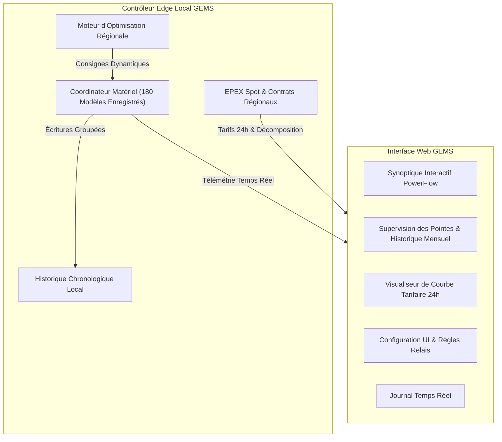
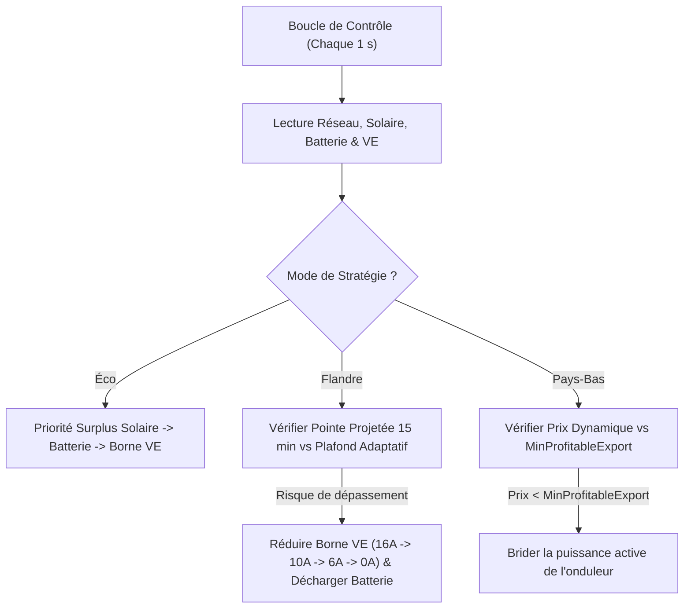
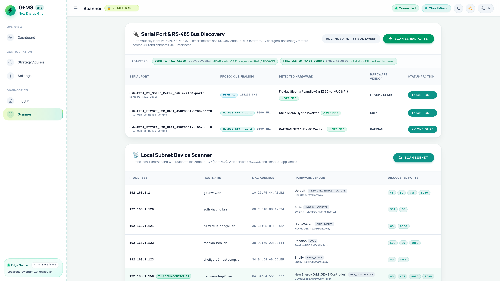
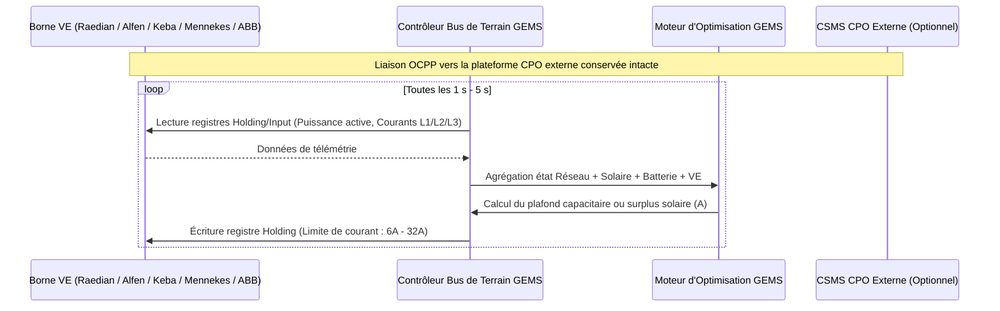
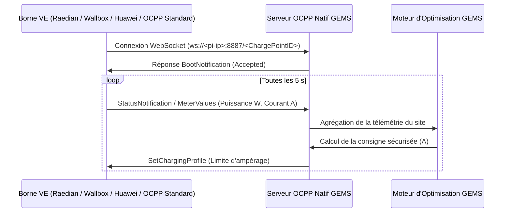

# 📖 GEMS - Manuel Opérationnel Avancé

> 🌐 **Langue / Taal / Language:** [English](../advanced_manual.md) | [Nederlands](../nl/advanced_manual.md) | **Français**

Bienvenue dans le **Manuel Opérationnel Avancé de GEMS**. Ce document fournit un guide exhaustif expliquant étape par étape le fonctionnement de chaque fonctionnalité, paramètre de configuration, stratégie régionale, règle d'automatisation, moteur de contrat dynamique et outil de diagnostic intégré à GEMS.

> [!TIP]
> **Télécharger les Manuels Officiels de Terrain (PDF) :**
> - 📕 **[Manuel Installateur & Mise en Service GEMS (PDF)](../../manuals/fr/gems-installer-manual-fr.pdf)** (5.7 MB)
> - 📗 **[Manuel Utilisateur & Particulier GEMS (PDF)](../../manuals/fr/gems-user-manual-fr.pdf)** (3.5 MB)
> - ☁️ **[Manuel de Connexion Cloud GRID-EMS-SERVER (PDF)](../../manuals/fr/gems-server-connection-manual-fr.pdf)** (1.1 MB)
> - 💻 **[Portail Interactif de Documentation](../../manuals/fr/index.html)**

---

## 📑 Table des Matières
1. [Architecture & Vue d'Ensemble du Système](#1-architecture--vue-densemble-du-système)
2. [Tableau de Bord & Synoptique des Flux Énergétiques](#2-tableau-de-bord--synoptique-des-flux-énergétiques)
3. [Moteur de Stratégie Régionale](#3-moteur-de-stratégie-régionale)
4. [Relais Intelligents & Automatisation SG-Ready](#4-relais-intelligents--automatisation-sg-ready)
5. [Tarifs Dynamiques & Calculs Contractuels](#5-tarifs-dynamiques--calculs-contractuels)
6. [Gestion des Appareils & Diagnostics Modbus](#6-gestion-des-appareils--diagnostics-modbus)
7. [Recharge VE : Modbus TCP & Serveur OCPP Natif](#7-recharge-ve--modbus-tcp--serveur-ocpp-natif)
8. [Maintenance Système, Journaux & Mises à Jour](#8-maintenance-système-journaux--mises-à-jour)

---

## 1. Architecture & Vue d'Ensemble du Système

GEMS (Grid Energy Management System par New Energy Grid & The Charge Grid) est conçu pour une empreinte mémoire minimale et une réactivité instantanée sur matériel Raspberry Pi (Debian/Linux ARM64).

> [!NOTE]
> **Optimisation Raspberry Pi & Stockage NVMe :** GEMS est officiellement certifié sur Raspberry Pi 5 équipé d'une base PCIe M.2 NVMe et d'un SSD M.2 NVMe haute endurance de 128 Go+. Les écritures en base de données sont mises en mémoire tampon et validées par lots transactionnels d'une minute. Le mode Write-Ahead Logging (`WAL`) de SQLite et le sous-échantillonnage périodique non bloquant préservent les supports de stockage et assurent des requêtes inférieures à la milliseconde sur NVMe.

---

## 2. Tableau de Bord & Synoptique des Flux Énergétiques

Le **Tableau de bord** constitue l'écran principal de supervision de GEMS.

| Tableau de Bord PowerFlow (Bureau) | Vue Responsive Mobile |
| :---: | :---: |
|  |  |

### 2.1 Synoptique Interactif des Flux Énergétiques
* **Affichage Dynamique des Nœuds :** Le Réseau, l'Onduleur Solaire, la Batterie, la Borne VE et les Relais Intelligents s'affichent **uniquement** lorsqu'ils sont configurés et actifs.
* **Vecteurs de Puissance Animés :** Des flux lumineux animés indiquent en temps réel le sens et l'intensité des transferts d'énergie.
* **Fenêtre Historique au Clic :** Cliquer sur n'importe quel nœud (Réseau, Batterie, Solaire, Borne VE) ouvre une fenêtre graphique haute résolution présentant les bilans énergétiques, les taux d'autoconsommation et les filtres temporels (Jour, Semaine, Mois, Année).

| Fenêtre Télémétrie Batterie | Fenêtre Production Solaire |
| :---: | :---: |
|  |  |

| Fenêtre Import/Export Réseau | Fenêtre Historique Borne VE |
| :---: | :---: |
|  |  |

### 2.2 Moniteur de Pointe Quart-Horaire Flandre (`capaciteitstarief`)
* **Lecture Fiscale OBIS 1.6.0 :** Intègre directement le registre officiel de pointe maximale 15 minutes du compteur communicant.
* **Supervision Prédictive du Quart d'Heure :** Projette en continu la demande moyenne attendue sur chaque fenêtre de facturation de 15 minutes à partir de l'énergie déjà consommée et de la puissance instantanée.
* **Suivi Mensuel & Plafond Adaptatif Intelligent :** GEMS enregistre localement la pointe mensuelle réelle. Si une pointe domestique inévitable est atteinte au cours du mois, le plafond opérationnel s'adapte dynamiquement à ce niveau afin d'autoriser une vitesse de charge maximale sans augmenter la facture capacitaire.
* **Indicateurs d'État :**
  * **NORMAL (Vert) :** Pointe projetée $<80\%$ du plafond configuré (`capacity_peak_limit_kw`).
  * **ATTENTION (Ambre) :** Pointe projetée comprise entre $80\%$ et $99\%$ du plafond.
  * **BRIDÉ (Rouge) :** Pointe projetée $\ge 100\%$ du plafond ; délestage actif engagé.

### 2.3 Exportateur de Rapports Énergétiques PDF
* Génère des rapports PDF formatés directement téléchargeables depuis le Tableau de bord.
* Plages disponibles : **7 derniers jours (PDF)**, **30 derniers jours (PDF)**, **Année en cours (PDF)** et **Tout l'historique (PDF)**.

---

## 3. Moteur de Stratégie Régionale

Sélectionnez votre stratégie opérationnelle active dans **Paramètres &rarr; Stratégie** :

| Aperçu des Paramètres de Stratégie | Modes de Stratégie Opérationnels |
| :---: | :---: |
|  |  |

### 3.1 Stratégie Éco (`eco`)
* Maximise l'autoconsommation solaire.
* Oriente le surplus photovoltaïque en priorité vers le stockage batterie domestique, puis vers les bornes VE, et enfin vers les relais thermiques/intelligents.

### 3.2 Stratégie d'Écrêtage Capacitaire Flandre (`flanders`)
* Conçue pour la réglementation belge (Flandre) du tarif capacitaire.
* Surveille la moyenne glissante sur 15 minutes du prélèvement réseau.
* Réduit dynamiquement les bornes VE et commande la décharge de la batterie dès que la demande totale menace de pousser la pointe quart-horaire au-delà de `capacity_peak_limit_kw`.
* Applique la marge `peak_shaving_buffer_w` et la remontée progressive `peak_shaving_rampup_w` une fois la charge stabilisée.

### 3.3 Stratégie Pays-Bas Smart Saldering & Zéro-Export (`netherlands`)
* Répond à la congestion réseau néerlandaise et aux frais d'injection (*terugleverkosten*).
* **Option Smart Saldering :** Compare en temps réel les prix spot EPEX au seuil `min_profitable_export_price`.
* Lorsque le tarif d'injection passe sous ce seuil (ou devient négatif), la stratégie bride la puissance active de l'onduleur solaire pour suivre exactement la consommation de la maison, supprimant toute injection à perte.

### 3.4 Arbitrage Tarifaire Dynamique & Modélisation d'Usure Batterie
* Détermine les créneaux optimaux de recharge batterie à partir des prix spot Day-Ahead EPEX.
* **Coût d'Usure Cyclique :** Intègre le coût de dégradation configuré ($€/\text{kWh}$) dans le calcul d'écart tarifaire afin de ne déclencher un cycle de décharge que lorsque le gain net couvre largement l'usure batterie.

### 3.5 Équilibrage de Charge Triphasé par Phase
* Surveille les courants individuels par phase ($L_1, L_2, L_3$) issus des compteurs triphasés P1 ou Modbus.
* Impose la limite `phase_limit_amps` (par ex. $25\text{ A}$ par phase). Dès qu'une seule phase approche le calibre du disjoncteur, les bornes VE sont immédiatement réduites, quelle que soit la puissance globale triphasée disponible.

---

## 4. Relais Intelligents & Automatisation SG-Ready

Configurez des règles de commutation automatisées pour ballons d'eau chaude sanitaire, pompes à chaleur et gros consommateurs dans **Paramètres &rarr; Relais & Commutateurs**.

| Gestion des Relais Intelligents | Règles d'Automatisation des Relais |
| :---: | :---: |
|  |  |

### 4.1 Paramètres des Règles d'Automatisation
* **Types de Conditions :**
  * `solar_export_exceeds` : Déclenche lorsque le surplus solaire injecté dépasse `threshold_watts`.
  * `grid_import_below` : Déclenche lorsque le prélèvement réseau descend sous `threshold_watts`.
  * `price_below` : Déclenche lorsque le prix spot dynamique descend sous le seuil configuré.
* **Temporisations de Sécurité Anti-Court-Cycle :**
  * `min_run_time_seconds` : Maintient le relais ACTIVÉ pendant une durée minimale afin de protéger les compresseurs et contacteurs contre les battements rapides.
  * `min_off_time_seconds` : Maintient le relais DÉSACTIVÉ pendant un temps de repos minimal avant tout réenclenchement.

### 4.2 Modes de Fonctionnement Pompe à Chaleur SG-Ready
GEMS associe l'état des contacteurs aux 4 états normalisés SG-Ready des pompes à chaleur :
1. **Mode 1 (Verrouillage Réseau / EVU-Sperre) :** Coupe temporairement la pompe à chaleur lors des pointes critiques.
2. **Mode 2 (Fonctionnement Normal) :** Régulation standard selon le thermostat interne.
3. **Mode 3 (Surplus Solaire Recommandé) :** Relève les consignes de température pour stocker l'excédent solaire sous forme thermique.
4. **Mode 4 (Chauffe Forcée) :** Maximise l'accumulation thermique lors des heures à prix nul ou négatif.

---

## 5. Tarifs Dynamiques & Calculs Contractuels

GEMS calcule en temps réel le prix effectif de l'électricité en appliquant les formules fournisseurs et les taxes régionales aux prix spot Day-Ahead EPEX.

| Configuration du Contrat d'Énergie | Courbe Tarifaire sur 24 Heures |
| :---: | :---: |
|  |  |

### 5.1 Préréglages Fournisseurs Régionaux Pris en Charge
* **TotalEnergies Pixel Dynamic (BE) :** EPEX Spot BE + multiplicateur + marge + redevance fixe.
* **Mega Smart / Cosy Dynamic (BE) :** Multiplicateur de prélèvement, marge commerciale et formule d'injection configurables.
* **Bolt Dynamisch (BE) :** Contrat dynamique 100 % vert local au prix spot réel.
* **Engie Dynamic & Flextime (BE) :** Indexation spot directe et majorations multi-paliers horaires.
* **Luminus, Eneco, Frank Energie, Ecopower, Dats 24, Octa+, Trevion, Aspiravi, Vattenfall FlexPrijs (NL) :** Formules régionales belges et néerlandaises.
* **Bi-Horaire Belge (Plein/Creux) :** Tarifs jour/nuit fixes avec TVA 6 % et préréglages GRD.
* **Enovos (Luxembourg) :** Tarification dynamique intégrant les frais réseau Creos.

### 5.2 Visualiseur en Direct de la Courbe Tarifaire 24h
Le graphique intégré décompose le coût horaire de l'électricité en 4 strates empilées :
1. **Marché de gros EPEX Spot brut**
2. **Marge fournisseur & abonnement**
3. **Réseau GRD & Transport (Fluvius / ORES / RESA / SIBELGA / Taxe énergétique)**
4. **Accises & TVA (6 % BE / 21 % NL)**
Complété par la courbe en paliers du **Revenu d'Injection Solaire** et d'**Alertes Automatiques d'Écrêtement à Prix Négatif**.

---

## 6. Gestion des Appareils & Diagnostics Modbus

Administrez l'ensemble du matériel depuis **Paramètres &rarr; Appareils**.

| Gestion des Appareils Configurés | Assistant d'Ajout d'Appareil |
| :---: | :---: |
|  |  |

### 6.1 Scanner de Bus Série & Réseau Local
* Cliquez sur **Scanner** dans la barre latérale pour détecter à la fois les adaptateurs physiques USB / RS-485 et les équipements IP sur votre sous-réseau local.
* **Découverte Ports Série & Bus RS-485 :** Identifie automatiquement les compteurs intelligents P1 DSMR / e-MUCS ainsi que les onduleurs, bornes VE et compteurs Modbus RTU RS-485 (débit, parité, Slave ID et chemins persistants `/dev/serial/by-id/*`), avec pré-remplissage en un clic via **Configurer** et un **Balayage RS-485 avancé** pour les bus multi-esclaves.
* **Scanner réseau local :** Reconnaît automatiquement le contrôleur GEMS lui-même (`THIS GEMS CONTROLLER`) et découvre les onduleurs solaires, batteries, compteurs intelligents, relais et bornes VE du réseau — y compris derrière des clés Wi-Fi/Ethernet génériques.

### 6.2 Sonde de Joignabilité Matérielle
* Cliquez sur **Tester la connexion (Test Connection)** dans la fenêtre de n'importe quel équipement.
* Exécute un test immédiat sur le réseau LAN ou le bus série, mesure la latence aller-retour ($ms$) et confirme la communication avant l'enregistrement.

---

## 7. Recharge VE : Modbus TCP & Serveur OCPP Natif

### 7.1 Pilotage par Bus de Terrain Modbus TCP (Recommandé & Privilégié)
**Modbus TCP constitue le mode de connexion privilégié pour les bornes VE** :
* **Réponse Inférieure à la Seconde :** Les registres Modbus permettent à GEMS de lire les courants par phase et d'appliquer instantanément les consignes de courant (6 A à 32 A) sans latence WebSocket, essentiel pour l'écrêtage capacitaire flamand et le suivi fin du surplus solaire.
* **Coexistence CPO / Remboursement Employeur :** Si votre borne est connectée en OCPP à une plateforme externe CPO ou un service de remboursement employeur, GEMS pilote localement la puissance en Modbus TCP *sans déconnecter ni perturber votre service de facturation cloud*.

### 7.2 Serveur OCPP 1.6-J Natif & Proxy Pass-Through CSMS Optionnel
Pour les bornes dépourvues de Modbus TCP, GEMS intègre nativement un **Serveur OCPP 1.6-J** sans dépendance externe (`ws://<pi-ip>:8887/<ChargePointID>` et `ws://<pi-ip>:8080/api/ocpp/<ChargePointID>`) :

> [!IMPORTANT]
> **Autonomie Locale & Coexistence CPO Optionnelle :** Les bornes VE dialoguent directement avec l'unité GEMS sur le réseau local (Modbus TCP ou WebSockets LAN) afin que la recharge et l'équilibrage dynamique se poursuivent sans coupure même en cas de panne Internet. Sur les bornes exclusivement OCPP nécessitant une facturation externe, le **Proxy Pass-Through OCPP CSMS Amont** relaie le trafic CSMS tout en imposant localement les limites de sécurité du site.

---

## 8. Maintenance Système, Journaux & Mises à Jour

| Identité Système & Mises à Jour Signées | Alertes Webhook & Rapports |
| :---: | :---: |
|  |  |

### 8.1 Journal Temps Réel & Export Technique
* Consultez en direct les événements système filtrés par gravité (`INFO`, `WARN`, `ERROR`, `DEBUG`).
* Exportez l'intégralité des journaux techniques au format `.txt` structuré.

### 8.2 Raccourci vers le Terminal Web Cockpit
* En **Mode installateur certifié**, accédez directement au terminal Linux web et à l'administration système en cliquant sur le lien **Terminal** dans l'en-tête de navigation (`https://<pi-ip>:9090`).

### 8.3 Mises à Jour Système Signées OTA & Hors Ligne
* Rendez-vous dans **Paramètres &rarr; Infos système** pour rechercher les versions officielles signées ou téléverser manuellement un paquet de mise à jour `.deb` hors ligne.
* Cliquez sur **Télécharger et installer** (ou **Téléverser et installer**) pour vérifier la signature cryptographique Ed25519 et l'empreinte SHA-256 avant une mise à niveau transparente préservant intégralement vos paramètres et données locales.

---
*Version du Manuel 9.2.0 — Équipe Documentation GEMS*
