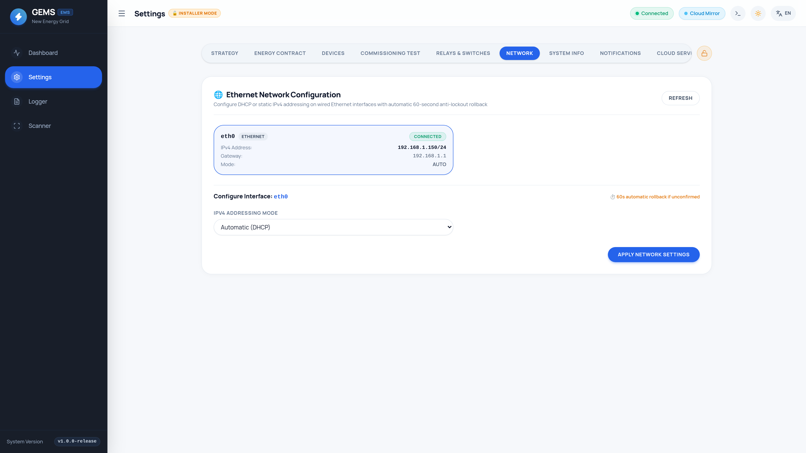
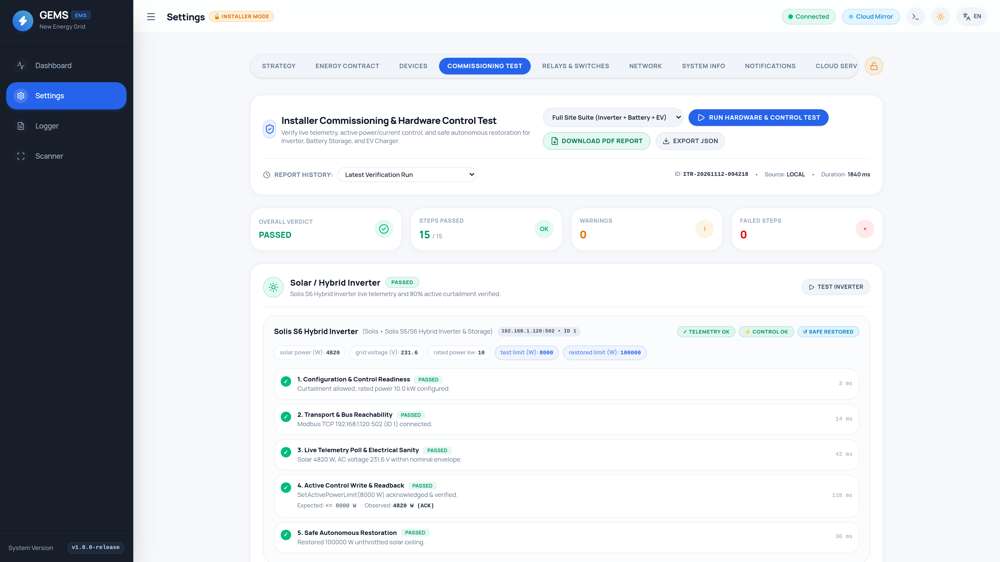

# GEMS : Documentation des Paramètres

> 🌐 **Langue / Taal / Language:** [English](../settings.md) | [Nederlands](../nl/settings.md) | **Français**

Ce document présente une explication complète et détaillée de l'ensemble des paramètres de configuration de GEMS (Grid Energy Management System). Ces réglages déterminent la façon dont GEMS supervise, optimise et protège votre installation énergétique résidentielle ou tertiaire.

---

## 1. Optimisation du Site & Stratégie Générale

Ce groupe de paramètres définit le comportement fondamental de l'EMS : son interaction avec le réseau public, le plafonnement des prélèvements/injections et l'ordre de priorité entre les équipements connectés.

| Aperçu de l'Onglet Stratégie | Modes de Stratégie Opérationnels |
| :---: | :---: |
|  |  |

* **`country`** & **`region`**
  * **Description :** Juridiction géographique (`BE`, `NL`, `DE`, `LU`, `FR`, `AT`, `CH`, `UK`, `ES`, `IT`, `SE`, `DK`) et sous-région (`flanders`, `wallonia`, `brussels`). Impose une isolation stricte par pays tant dans l'interface que dans le moteur backend : l'écrêtage quart-horaire flamand *Capaciteitstarief* (`capacity_peak_limit_kw`) et les *Groenestroomcertificaten* (`gsc_value_eur_mwh`) s'exécutent uniquement sur `BE` + `flanders` ; la synchronisation renouvelable Elia, le Super-Creux (`01:00–07:00`) et le télécontrôle GRD IEC 60870-5-104 s'exécutent uniquement sur `BE` ; le mode `netherlands` s'exécute uniquement sur `NL` ; et la modulation allemande `§14a EnWG` s'exécute uniquement sur `DE`.
* **`strategy_mode`**
  * **Description :** Mode principal d'optimisation opérationnelle du système (automatiquement validé selon le couple `country`/`region`).
  * **Valeurs :**
    * `eco` : Privilégie l'autoconsommation solaire et réduit le prélèvement sur le réseau (universel dans tous les pays).
    * `flanders` : *(Flandre `BE` uniquement)* Active l'écrêtage prédictif des pointes 15 minutes selon le modèle flamand *Capaciteitstarief*, avec prise en charge du Plafond Adaptatif Intelligent.
    * `netherlands` : *(Pays-Bas `NL` uniquement)* Met l'accent sur la protection DLB par phase des disjoncteurs `3×25A`, l'évitement des frais d'injection (*terugleverkosten*), le seuil minimal d'export rentable, l'écrêtement actif lors des prix négatifs et l'arbitrage dynamique EPEX NL.
* **`capacity_peak_limit_kw`**
  * **Description :** *(Flandre `BE` uniquement)* Plafond cible de prélèvement moyen sur 15 minutes (par ex. `2.5` kW). Automatiquement désactivé (`0.0` kW) et masqué hors Flandre afin de ne jamais brider inutilement les installations non flamandes.
* **`peak_shaving_buffer_w`**
  * **Description :** Marge de sécurité en watts (par ex. 200 W) retranchée du plafond capacitaire afin de déclencher le délestage proactif avant tout dépassement quart-horaire.
* **`peak_shaving_rampup_w`**
  * **Description :** Pas d'hystérésis en puissance (par défaut `500` W) requis avant de ré-accélérer les bornes VE bridées ou de réduire la décharge batterie lorsque la marge réseau réaugmente.
* **`active_inverter_curtailment`**
  * **Description :** Autorise l'EMS à brider activement la puissance de sortie des onduleurs solaires via registres Modbus pour suivre la consommation domestique lorsque le tarif net d'injection devient négatif. Disponible dans tous les modes de stratégie.
* **`min_profitable_export_price`**
  * **Description :** Seuil de base de rentabilité pour l'injection solaire (€/kWh). L'injection est autorisée tant que le revenu net égale ou dépasse ce seuil diminué de la compensation GSC. En dessous, l'excédent charge la batterie/VE, puis les onduleurs sont écrêtés une fois le stockage plein.
* **`gsc_value_eur_mwh`**
  * **Description :** Valeur garantie des Certificats Verts flamands/belges (GSC) en € par certificat ou €/MWh (par ex. 250, 350, 450). La production et l'injection restent rentables lors des prix spot négatifs tant que la pénalité ne dépasse pas la valeur du certificat. L'écrêtement ne s'active qu'en dessous de `min_profitable_export_price - (gsc_value_eur_mwh / 1000.0)` (par ex. à -251 €/MWh pour un GSC à 250 €/MWh).
* **`battery_grid_charge_strategy`**
  * **Description :** Définit la façon dont la batterie domestique utilise le réseau pour se charger et réaliser de l'arbitrage tarifaire.
  * **Valeurs :**
    * `price_only` : Charge/décharge strictement selon les seuils de prix spot EPEX (`force_charge_below_euro` / `force_discharge_above_euro`).
    * `super_dal_only` : Restreint la charge réseau aux fenêtres super-creuses du fournisseur (par ex. Engie Superdal).
    * `hybrid` : Combine les seuils de prix spot avec les fenêtres super-creuses contractuelles.
    * `dynamic_forecast` : Calcule une trajectoire optimale sur 24 heures à partir des prévisions solaires Open-Meteo et du talon de consommation domestique.
* **`force_charge_below_euro`**
  * **Description :** Seuil de prix spot (€/kWh) déclenchant la charge forcée de la batterie depuis le réseau.
* **`force_discharge_above_euro`**
  * **Description :** Seuil de prix spot (€/kWh) autorisant la décharge batterie vers le réseau lors des fortes pointes tarifaires.
* **`smart_ev_cheapest_hours`**
  * **Description :** Sélectionne automatiquement le nombre d'heures les moins chères de la journée (par ex. 3) pour recharger le véhicule électrique.
* **`grid_nominal_current_a`**
  * **Description :** Calibre nominal du disjoncteur principal de l'installation en ampères (par ex. 25, 32, 40). GEMS réduit le courant des bornes VE pour éviter tout déclenchement du disjoncteur.
* **`phase_limit_amps`**
  * **Description :** Courant maximal autorisé sur chaque phase individuelle ($L_1, L_2, L_3$) pour l'équilibrage dynamique par phase.
* **`grid_system`**
  * **Description :** Schéma physique de raccordement électrique du site.
  * **Valeurs :** `single_phase_230v`, `three_phase_400v` (400V + Neutre), ou `three_phase_230v_delta` (triphasé belge 3×230V sans neutre).
* **`allowed_grid_import_kw`**
  * **Description :** Limite stricte continue sur la puissance prélevée au réseau en kW.
* **`allowed_grid_export_kw`**
  * **Description :** Limite stricte continue sur la puissance injectée au réseau en kW (régler sur `0.0` pour un zéro-export strict).

---

## 2. Informations Système et Localisation

Paramètres relatifs à l'emplacement géographique, à la synchronisation horaire et aux diagnostics généraux.

* **`timezone`**
  * **Description :** Fuseau horaire de l'installation (par ex. `Europe/Brussels`, `Europe/Amsterdam`), indispensable pour synchroniser les prix Day-Ahead et les fenêtres quart-horaires.
* **`address`**
  * **Description :** Adresse postale du site.
* **`latitude`** & **`longitude`**
  * **Description :** Coordonnées GPS résolues automatiquement via le géocodage OpenStreetMap Nominatim, utilisées pour les prévisions d'ensoleillement Open-Meteo.
* **`log_level`**
  * **Description :** Niveau de détail des journaux de diagnostic backend (`INFO`, `DEBUG`, `WARN`, `ERROR`).
* **`language`**
  * **Description :** Langue de l'interface utilisateur (`nl`, `fr`, `en`).
* **`commissioning_completed`**
  * **Description :** Indique si l'**Assistant de mise en service initiale** en 5 étapes a été complété. L'installateur peut relancer cet assistant à tout moment depuis **Paramètres &rarr; Infos système**.
* **Code d'accès installateur & Mode Particulier Épuré (`Paramètres -> Infos système`)**
  * **Description :** En utilisation quotidienne (**Mode Normal** verrouillé), la page **Paramètres** présente une vue épurée regroupant les **Appareils connectés** (avec diagnostic **Debug** en direct et envoi en un clic d'un rapport de modèle vers **GRID-EMS-SERVER**) ainsi que les **Infos système** (incluant **Redémarrer le système** et la **Mise à jour logicielle** signée), aux côtés du **Tableau de bord**, du sélecteur de **mode de charge VE** et du **Journal** en lecture seule. Les fonctions d'ingénierie et d'administration — telles que le Scanner réseau, le raccourci Terminal Cockpit (`:9090`), les onglets Stratégie/Contrat d'énergie/Relais & Commutateurs/Réseau/Notifications/Serveur Cloud, l'ajout/modification/suppression d'appareils, l'Autorité CA locale & Certificat SSL, les sauvegardes et la réinitialisation d'usine — restent masquées tant que l'icône cadenas de l'en-tête **Paramètres** n'est pas cliquée et que le **Code PIN/mot de passe installateur** local (défini à l'étape 1 de l'assistant et modifiable sous **Paramètres &rarr; Infos système &rarr; Code d'accès installateur**) n'est pas saisi pour déverrouiller les 8 onglets du **Mode installateur certifié** (protégé contre les essais répétés après 5 échecs).
* **Sauvegarde, Restauration & Réinitialisation d'usine (Mode Installateur)**
  * **Description :** Une fois le **Mode Installateur** déverrouillé via l'icône cadenas, vous pouvez exporter une sauvegarde JSON portable (paramètres du site, appareils, règles relais et règles tarifaires batterie), restaurer de façon atomique une sauvegarde sur une unité de remplacement, ou lancer une **Réinitialisation d'usine** confirmée effaçant proprement l'historique local, les identifiants et les appareils.

---

## 2.1 Configuration Réseau de l'Unité (`Paramètres -> Réseau`)

* **Gestion Ethernet Filaire :** Configurez les interfaces Ethernet filaires (`eth0`) entre **Automatique (DHCP)** et **IPv4 Statique (Manuel)** (`IPv4/CIDR`, `Passerelle`, `DNS`) directement depuis le navigateur sans connexion SSH. Les interfaces sans fil (`wlan*`) sont exclues afin de garantir une fiabilité LAN industrielle déterministe.
* **Rétablissement Automatique après 60 Secondes :** L'application d'un changement réseau arme un compte à rebours de sécurité de 60 secondes. Si vous ne cliquez pas sur **Confirmer et conserver** depuis votre navigateur avant l'expiration du délai, GEMS rétablit automatiquement l'ancien profil IP dans NetworkManager afin d'éviter tout blocage d'accès sur site.

---

## 3. Contrat d'Énergie & Tarification Dynamique Régionale

Configure la formule contractuelle de votre fournisseur afin de calculer en temps réel vos coûts nets de prélèvement et vos revenus d'injection.

| Configuration du Contrat d'Énergie | Courbe Tarifaire sur 24 Heures |
| :---: | :---: |
|  |  |

### 3.1 Types de Contrats (`contract_type`)
* `vattenfall_dynamic` : **Vattenfall Nederland — FlexPrijs** (EPEX Spot NL `1,00×` + marge `0,0211 €/kWh`, abonnement fixe `95,40 €/an`, préréglages légaux hors TVA de l'*Energiebelasting* néerlandaise pour **2026 (`0,09161 €/kWh` HTVA 21 %)** et **2027 (`0,08802 €/kWh` HTVA 21 %)**, TVA `21 %` et injection `1,00×` EPEX Spot NL).
* `eneco_dynamic` : Eneco Dynamic (Pays-Bas / Belgique).
* `frank_energie_dynamic` : Frank Energie Dynamic (NL / BE).
* `totalenergies_dynamic` : TotalEnergies Pixel Dynamic (Belgique EPEX Spot BE).
* `mega_dynamic` : Mega Smart / Cosy Dynamic (Belgique).
* `bolt_dynamic` : Bolt Dynamisch (Belgique 100 % vert local).
* `engie_dynamic` : Engie Dynamic Day-Ahead (Belgique).
* `engie_flextime` : Engie Flextime à plages horaires (Belgique).
* `luminus_dynamic` : Luminus Dynamic (Belgique).
* `ecopower_dynamic` : Ecopower Dynamic (Belgique).
* `dats24_dynamic` : Dats 24 Dynamisch (Belgique).
* `octa_dynamic` : Octa+ Dynamic (Belgique).
* `trevion_dynamic` : Trevion Dynamisch (Belgique).
* `aspiravi_dynamic` : Aspiravi Dynamisch (Belgique).
* `belgium_dual_tariff` : Bi-horaire fixe belge (Heures Pleines/Creuses + TVA 6 %).
* `fixed` : Tarif Fixe / Variable (incluant aux Pays-Bas `NL` le paramètre optionnel post-2027 `fixed_feed_in_cost_kwh` pour les *terugleverkosten* et la vérification du plancher légal d'injection `>= 50 %` du tarif de fourniture nu).
* `dynamic` : Tarif dynamique EPEX générique.
* `enovos_dynamic` : Enovos Dynamic (Luxembourg).

### 3.2 Formules Dynamiques, Granularité de Règlement & Tarifs GRD Régionaux
Pour les contrats dynamiques belges et néerlandais, le prix effectif d'importation est calculé selon :
$$\text{Prix}_{\text{import}} = \left( (\text{EPEX} \times \text{Multiplier}) + \text{Markup} + \frac{\text{BaseFee}}{8760} + \text{DNO}_{\text{tax}} \right) \times (1 + \text{VAT})$$

Et la rémunération dynamique d'injection solaire :
$$\text{Prix}_{\text{export}} = (\text{EPEX} \times \text{InjectMultiplier}) - \text{InjectMarkup}$$

* **`spot_settlement_granularity`** : Sélectionne `"15m"` (règlement quart-horaire natif EPEX SDAC 15 min, par défaut) ou `"60m"` (moyenne arithmétique des quatre quarts d'heure de chaque heure d'horloge pour les fournisseurs facturant au tarif horaire moyen). Aux Pays-Bas, `EnergyZeroProvider` récupère nativement les courbes 15 minutes avec repli automatique sur les courbes horaires.
* **`tax_kwh`** : Frais de réseau de distribution et taxes énergétiques légales HTVA par kWh consommé — incluant les préréglages d'*Energiebelasting* néerlandaise **2026 (`0.09161` €/kWh)** et **2027 (`0.0392` BE / `0.08802` NL €/kWh)** HTVA, le **droit d'accise spécial fédéral belge 2027 (`0.0392` €/kWh = 39,20 €/MWh HTVA 6 %)** ainsi que les préréglages GRD pour Fluvius Flandre, ORES/RESA Wallonie et SIBELGA Bruxelles. Toute valeur personnalisée enregistrée est intégralement préservée lors des mises à niveau.
* **`fixed_feed_in_cost_kwh`** *(Pays-Bas `NL` Fixe/Variable Uniquement)* : Frais d'injection par kWh (*terugleverkosten*) soustraits de `fixed_inject_price_kwh` pour le calcul du revenu net d'exportation et de l'écrêtement `min_profitable_export_price` après la suppression du *salderingsregeling* au 1er janvier 2027, accompagnés d'un contrôle du plancher légal 2027–2029 (`>= 50 %` du tarif de fourniture hors taxes et TVA).
* **`dno_tariff_mode`, `dno_impact_eco_kwh`, `dno_impact_medium_kwh`, `dno_impact_pic_kwh`** *(Belgique `BE` + `wallonia` Uniquement)* : Configure la grille officielle CWaPE **`Tarif Impact`** 7j/7 (`"flat"` par défaut | `"wallonia_impact"`) : **`ECO`** (`01:00–07:00` & `11:00–17:00`, ex. RESA `0.0252` / ORES `0.0284` €/kWh), **`MEDIUM`** (`07:00–11:00` & `22:00–01:00`, ex. RESA `0.0755` / ORES `0.0812` €/kWh) et **`PIC`** (`17:00–22:00`, ex. RESA `0.1258` / ORES `0.1345` €/kWh).
* **`vat_rate`** : Taux de TVA saisi sous forme décimale (par ex. `0.21` pour 21 % aux Pays-Bas, `0.06` pour 6 % résidentiel en Belgique).
* **Multiplicateurs & Marges Fournisseurs** : Paramètres dédiés à chaque fournisseur (par ex. `vattenfall_multiplier`, `vattenfall_markup`, `vattenfall_base_fee`, `vattenfall_inject_multiplier`, `vattenfall_inject_markup`, `totalenergies_multiplier`, `totalenergies_markup`, `totalenergies_base_fee`, `totalenergies_inject_multiplier`, `totalenergies_inject_markup`).

---

## 4. Planifications Personnalisées & Optimisation

Forçages horaires manuels et fenêtres de charge programmées.

* **`custom_charge_schedule`**
  * **Description :** Chaîne JSON définissant des créneaux de charge batterie forcée avec heure de début, heure de fin et état de charge cible (SOC), par ex. `[{"start":"02:00","end":"05:00","target_soc":90}]`.
* **`superdal_optimization_enabled`**
  * **Description :** Active l'optimisation de charge vers un SOC cible durant les heures super-creuses du fournisseur (comme Engie Superdal).
* **`superdal_target_soc`**
  * **Description :** État de charge cible (SOC %) à atteindre à la fin du créneau super-creux.
* **`home_base_load_w`**
  * **Description :** Consommation de fond du foyer (en watts) utilisée par le solveur prévisionnel dynamique pour estimer la décharge de la batterie.

---

## 5. Mise à Jour Logicielle & Télédiagnostic

Configuration des mises à jour OTA automatisées, du téléversement de paquets `.deb` signés et du suivi des versions.

* **Mises à Jour Logicielles Signées (OTA & Téléversement Manuel `.deb`)**
  * **Description :** Accessibles directement dans **Paramètres &rarr; Infos système** aussi bien en **Mode Normal** qu'en **Mode installateur certifié** (ainsi qu'à distance via la commande `OTA_UPDATE` de **GRID-EMS-SERVER**), les mises à jour OTA en ligne et les téléversements manuels de fichiers `.deb` vérifient la progression de version sémantique ainsi que la signature cryptographique Ed25519 embarquée de New Energy Grid et l'empreinte SHA-256 avant toute installation. Les paquets validés sont installés par un service d'arrière-plan supervisé par `systemd` (`gems-updater.path` / `gems-updater.service`) diffusant chaque étape dans le journal avant le redémarrage automatique. *(Remarque : Les unités exécutant `v9.35.1` à `v9.36.2` nécessitent une mise à niveau unique du paquet `.deb` via SSH ou le Terminal Web Cockpit sur le port `9090` afin d'activer les nouvelles permissions du service.)*
* **Redémarrage Système & Diagnostic en Direct des Appareils/Modèles**
  * **Description :** Les propriétaires comme les installateurs peuvent redémarrer l'unité en toute sécurité (**Redémarrer le système**) depuis **Paramètres &rarr; Infos système** et lancer des sondes **Debug** en direct sur les équipements configurés dans **Paramètres &rarr; Appareils connectés** afin d'inspecter la télémétrie et d'envoyer un rapport de diagnostic directement à **GRID-EMS-SERVER** sans déverrouiller le Mode installateur certifié.
* **`github_token`**
  * **Description :** Jeton d'accès personnel GitHub (classic) optionnel permettant d'éviter la limitation de débit par IP lors de la vérification des nouvelles versions publiques GEMS ; si un jeton expiré ou révoqué est renseigné, GEMS réessaie automatiquement sans authentification afin de ne jamais interrompre les vérifications.
* **Politique de Sécurité EU Cyber Resilience Act (CRA) & Divulgation Coordonnée (`/.well-known/security.txt`)**
  * **Description :** **Paramètres &rarr; Infos système** affiche le badge **Politique de Sécurité & Support Firmware** de New Energy Grid (vérification cryptographique Ed25519 des mises à jour, nomenclature logicielle CycloneDX 1.5 SBOM et divulgation coordonnée via `/.well-known/security.txt`), sans jamais exposer de charge CPU, RAM ou télémétrie matérielle et en conservant le numéro de build dynamique issu de `git describe --tags --always`.

---

## 6. Alertes & Notifications Webhook

Configuration des alertes Webhook externes et des avertissements de seuils capacitaires.

* **`alert_webhook_url`**
  * **Description :** URL Webhook HTTP(S) (Discord, Slack ou point de terminaison personnalisé) vers laquelle GEMS envoie des notifications instantanées en cas de perte de communication d'un équipement, d'erreurs répétées de lecture ou lorsque la pointe quart-horaire atteint 90 % du plafond.
* **`weekly_report_enabled`**
  * **Description :** Active ou désactive la génération et l'envoi automatiques par e-mail du rapport PDF énergétique hebdomadaire.
* **`report_email`**
  * **Description :** Adresse e-mail destinataire des rapports périodiques.
* **Paramètres SMTP (`smtp_host`, `smtp_port`, `smtp_username`, `smtp_password`, `smtp_sender`)**
  * **Description :** Identifiants du serveur d'envoi d'e-mails utilisé pour l'expédition des rapports.

---

## 7. Relais & Commutateurs Intelligents

Configuration des contacteurs, pompes à chaleur SG-Ready et chauffe-eau électriques.

| Gestion des Relais & Commutateurs | Règles d'Automatisation des Relais |
| :---: | :---: |
|  |  |

* **Moteur de Règles des Relais** : Conditions de déclenchement configurables (`excess_solar`, `negative_spot_price`, `time_schedule`), seuils de puissance/prix, temporisations d'anti-court-cycle (`min_run_time`, `min_off_time`) et actions automatisées (`turn_on`, `turn_off`).

---

## 9. Suite de Test de Mise en Service & de Pilotage Matériel

Disponible en **Mode installateur certifié** (`Paramètres -> Test de Mise en Service`) ainsi qu'à distance depuis **GRID-EMS-SERVER** (`/installer/device/{id}`), cette suite interactive valide de bout en bout la communication et le pilotage en boucle fermée des sous-systèmes **Onduleur**, **Batterie** et **Borne VE** :

* **Vérification en 5 Étapes par Équipement** : Contrôle (1) la préparation de la configuration et des permissions de pilotage, (2) la joignabilité réseau/bus (Modbus TCP, série RS-485, OCPP 1.6-J ou REST local), (3) la cohérence électrique de la télémétrie en direct, (4) l'écriture de consigne active et sa relecture (impulsion d'écrêtement à 80 % sur l'onduleur, modulation charge/décharge sécurisée de la batterie et consigne 6,0 A sur la borne VE), puis (5) la restauration sécurisée en fonctionnement autonome.
* **Corrections Guidées des Anomalies** : Détecte les erreurs de paramétrage ou de bus (écrêtement onduleur désactivé, capacité batterie hybride non renseignée, borne VE verrouillée en mode `Off`, disjoncteur de communication ouvert) et propose des actions en un clic **Corriger & Re-tester** en local comme depuis le portail cloud.
* **Certificat Officiel de Mise en Service** : Génère un certificat de mise en service PDF A4 téléchargeable (**Télécharger le Rapport PDF**) et une archive JSON vérifiable, tout en diffusant la progression étape par étape vers **GRID-EMS-SERVER**.
