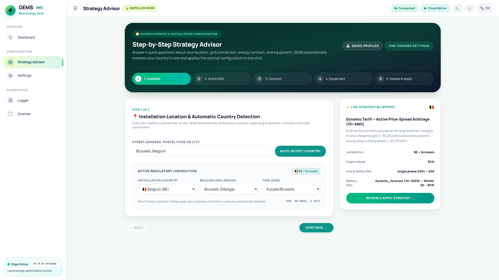
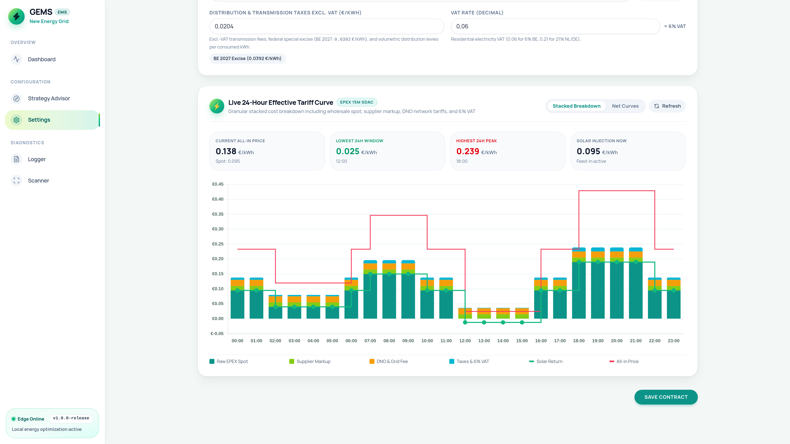

# GEMS : Manuel de Stratégie & d'Optimisation Énergétique

> 🌐 **Langue / Taal / Language:** [English](../strategy_manual.md) | [Nederlands](../nl/strategy_manual.md) | **Français**

Ce manuel détaille la configuration et le fonctionnement du moteur de stratégie de GEMS (Grid Energy Management System). Véritable cerveau de votre installation énergétique, le moteur de stratégie coordonne le réseau électrique, le solaire photovoltaïque, la batterie, les bornes de recharge VE et les relais intelligents afin d'optimiser votre consommation, maximiser l'autoconsommation, éviter les pénalités de pointe capacitaire et réaliser un arbitrage tarifaire rentable.

> [!TIP]
> **Télécharger les Manuels Officiels & Guide des Stratégies (PDF) :**
> - 🧭 **[Guide des Stratégies Optimales par Pays & Installation (PDF)](GRID-EMS-Strategy-Guide-fr.pdf)** (`FR` | [EN](../GRID-EMS-Strategy-Guide.pdf) | [NL](../nl/GRID-EMS-Strategy-Guide-nl.pdf))
> - 📕 **[Manuel Installateur & Mise en Service GEMS (PDF)](../../manuals/fr/gems-installer-manual-fr.pdf)** (5.7 MB)
> - 📗 **[Manuel Utilisateur & Particulier GEMS (PDF)](../../manuals/fr/gems-user-manual-fr.pdf)** (3.5 MB)
> - ☁️ **[Manuel de Connexion Cloud GRID-EMS-SERVER (PDF)](../../manuals/fr/gems-server-connection-manual-fr.pdf)** (1.1 MB)
> - 💻 **[Portail Interactif de Documentation](../../manuals/fr/index.html)**

---

## 1. Vue d'Ensemble du Moteur de Stratégie

Le moteur de stratégie évalue en permanence les flux énergétiques du site depuis une interface graphique unifiée. Aucun fichier YAML ou fichier texte de configuration n'est requis.

La boucle de régulation principale s'exécute chaque seconde :
1. **Lecture de la Télémétrie** : Relève la puissance active des compteurs intelligents (P1/Modbus), onduleurs solaires, systèmes de stockage batterie (BESS) et bornes VE.
2. **Calcul de la Moyenne Glissante Quart-Horaire** : Met à jour le prélèvement moyen sur 15 minutes en cours et enregistre les pointes mensuelles dans SQLite.
3. **Application des Règles Régionales & Locales** : Évalue le mode actif (Éco, Flandre, Pays-Bas), les seuils d'arbitrage batterie et les plages horaires programmées.
4. **Envoi des Consignes Dynamiques** : Transmet de façon non bloquante les consignes Modbus, OCPP ou REST aux onduleurs, bornes VE et relais intelligents.

---

## 2. Optimisation Globale du Site (Modes de Stratégie)

| Conseiller Stratégique Guidé (Configuration 1-Clic) | Aperçu de l'Onglet Stratégie |
| :---: | :---: |
|  |  |

### 2.0 Conseiller Stratégique Guidé (Configurateur Étape par Étape par Pays & Installation)
Afin de garder **Paramètres → Stratégie** clair et épuré, GEMS propose une page dédiée **Conseiller Stratégique** dans la barre latérale (**Configuration → Conseiller Stratégique**, également accessible depuis la bannière en haut de **Paramètres → Stratégie**). Elle guide particuliers et installateurs en quatre étapes rapides et applique l'ensemble des réglages en **un seul clic** :
1. **Localisation & Détection Automatique du Pays :** Saisissez l'adresse ou le code postal + ville pour définir automatiquement le **Pays** (`BE`, `NL`, `DE`, `LU` ou `OTHER`), la **Région GRD** (`flanders`, `wallonia`, `brussels`, `netherlands`, `de-lu`, `luxembourg`, `other`), le **Fuseau Horaire** et les **Coordonnées Solaires Open-Meteo** (en ligne ou hors ligne via le code postal).
2. **Raccordement Physique & Règles Régionales GRD :** Configure la topologie réseau (`1×230V`, `3×400V+N`, `3×230V Delta`) et le disjoncteur principal, tout en affichant uniquement les mécanismes applicables à votre région (*Capaciteitstarief* Fluvius 15 min + GSC flamands, *Tarif Impact* CWaPE wallon `ORES / RESA`, protection du calibre aux Pays-Bas ou modulation allemande `§14a EnWG` *SteuVE*).
3. **Contrat d'Électricité :** Sélectionne **Spot Dynamique (`15m` / `60m`)**, **Fixe / Variable** ou **Bi-Horaire Jour / Nuit**, avec préréglages fournisseurs, politique d'injection néerlandaise (`Zéro Injection Nette` `0 W` vs pénalité par kWh) ou plage `Super-Creux` belge (`01h00–07h00`).
4. **Équipements sur Site & Application en 1 Clic :** Détecte automatiquement les onduleurs/batteries **Solis**, bornes **Raedian**, pompes à chaleur SG-Ready et flottes VE, puis applique tous les paramètres et options matérielles en un clic :
   - **Autoconsommation Solaire Pure (`ÉCO`) :** Sélectionnée sur contrats fixes/variables sans pénalité d'injection (`0 W` de charge réseau payante, `force_discharge_above_euro = 999`).
   - **Pays-Bas Zéro Injection Nette (`Bouclier 0-Export` — `NL`) :** Oriente le surplus vers le VE et la batterie puis bride progressivement l'onduleur PV (`min_profitable_export_price = 999`) pour maintenir `0 W` d'injection.
   - **Flandre Bouclier Capacitaire / Prévision 24h (`Fluvius` — Flandre) :** Protège le plafond quart-horaire (`2,50 kW` + marge `200 W`) avec prise en compte des certificats verts GSC et réserve hivernale.
   - **Wallonie Pilotage `Tarif Impact` (`ORES / RESA` — Wallonie) :** Précharge durant les créneaux `ECO` (`01h00–07h00` & `11h00–17h00`) et couvre la pointe `PIC` (`17h00–22h00`) sur batterie.
   - **Tarif Dynamique — Prévision 24h & Arbitrage Actif des Écarts (`10+ kWh` BESS) :** Combine prévisions solaires Open-Meteo, charge domestique et prix EPEX spot (avec réinjection sur pics extrêmes `> 0,35 €/kWh` pour les grandes batteries).

### 2.1 Mode Éco (Autoconsommation Maximale)
**Objectif :** Maximiser l'autoconsommation directe de la production solaire photovoltaïque et limiter le recours au réseau.
- **Comportement :** Oriente prioritairement le surplus solaire vers la charge de la batterie domestique et la recharge VE avant toute injection sur le réseau. Lorsque l'ensoleillement diminue, la batterie se décharge automatiquement pour couvrir les charges domestiques.
- **Usage recommandé :** Idéal pour les contrats à tarif fixe, bi-horaire classique ou bénéficiant d'un tarif d'injection avantageux.

### 2.2 Mode Flandre (Écrêtage Prédictif de Pointe & Plafond Adaptatif)
**Objectif :** Éviter activement les surcoûts liés au tarif capacitaire flamand (*Capaciteitstarief*) en Belgique en plafonnant les pointes moyennes de prélèvement sur 15 minutes.
- **Mécanisme :**
  - Surveille en continu la projection de la puissance moyenne quart-horaire prélevée sur le réseau pour chaque fenêtre de facturation de 15 minutes.
  - Dès que la projection approche le plafond configuré diminué de la marge de sécurité, GEMS réduit instantanément le courant de charge VE et commande la décharge de la batterie.
- **Plafond Adaptatif Intelligent (*Smart Adaptive Ceiling*) :**
  - GEMS mémorise localement le record mensuel de pointe quart-horaire.
  - Si une pointe domestique inévitable survient au cours du mois (par ex. 4,2 kW dus au four + plaques à induction), GEMS relève automatiquement son plafond opérationnel jusqu'à cette pointe déjà atteinte pour le reste du mois civil.
  - Le propriétaire profite ainsi d'une recharge VE plus rapide sans alourdir sa facture capacitaire mensuelle.
- **Paramètres Clés :**
  - `capacity_peak_limit_kw` : Plafond cible de base sur 15 minutes (par ex. `2.5` kW).
  - `peak_shaving_buffer_w` : Marge de sécurité proactive en watts (par ex. `200` W) retranchée du plafond pour éviter tout dépassement.
  - `peak_shaving_rampup_w` : Pas d'hystérésis en watts (par défaut `500` W) requis avant d'autoriser la remontée en puissance des équipements bridés.

### 2.3 Mode Pays-Bas (Smart Saldering, Bouclier Frais d'Injection & Protection Disjoncteur 3×25A)
**Objectif :** Offrir la stratégie énergétique optimale aux particuliers et PME néerlandais — en protégeant les raccordements résidentiels `3×25A` contre un passage coûteux à la tranche supérieure du gestionnaire de réseau, en évitant les frais d'injection (*terugleverkosten*), en écrêtant les heures EPEX NL négatives et en maximisant l'arbitrage Day-Ahead avant et après la fin du *salderingsregeling*.
- **Pourquoi l'Optimisation Néerlandaise Diffère de la Flandre :**
  - Contrairement à la Flandre (où Fluvius facture la pointe quart-horaire au-dessus de `2,50 kW`), les gestionnaires de réseau néerlandais (**Liander**, **Enexis**, **Stedin**) facturent un abonnement fixe annuel selon le calibre du raccordement (*vastrecht aansluitcapaciteit*). Passer d'un raccordement résidentiel standard **`3×25A`** (`17,25 kW`) à **`3×35A`** ajoute plus de **1 000 € par an** de frais fixes récurrents.
  - La stratégie néerlandaise combine donc quatre piliers sans brider artificiellement l'installation à un plafond quart-horaire de `2,50 kW` :
    1. **Équilibrage Dynamique de Charge (DLB) par Phase `3×25A` :** Surveille en continu les courants `L1`, `L2` et `L3` du compteur DSMR P1 afin que les bornes **Raedian**, le stockage hybride **Solis**, les pompes à chaleur et la cuisson à induction coexistent en toute sécurité sur un disjoncteur `3×25A`.
    2. **Autoconsommation Directe & Absorption Thermique/VE :** Dirige chaque watt solaire excédentaire vers la maison, la batterie **Solis**, la charge solaire 1P/3P **Raedian** et la pompe à chaleur SG-Ready afin de réduire les volumes injectés soumis aux *terugleverkosten*.
    3. **Écrêtement lors des Prix EPEX NL Négatifs (`min_profitable_export_price` & `active_inverter_curtailment`) :** Autorise l'injection uniquement lorsque la rémunération nette est positive, et bride finement la production de l'onduleur à hauteur de la charge domestique dès que le stockage est plein et que le tarif d'injection devient négatif.
    4. **Arbitrage Day-Ahead EPEX NL (`dynamic_forecast`) :** Précharge les batteries et planifie la charge VE pendant les heures EPEX NL les moins chères pour décharger lors des pointes coûteuses du soir (`17:00–21:00`).

### 2.4 Garantie Stricte d'Isolation par Pays & Région
**Objectif :** Garantir que les mécanismes réglementaires propres à un pays n'apparaissent ni n'agissent jamais sur une installation située dans un autre pays.
- **Flandre (`BE` + `flanders`) :** Active exclusivement l'écrêtage quart-horaire du *Capaciteitstarief* (`capacity_peak_limit_kw`, plancher légal `2,50 kW`), le Plafond Adaptatif Intelligent, les alertes de pointe et les certificats verts flamands (*Groenestroomcertificaten* / GSC).
- **Wallonie (`BE` + `wallonia`) :** Active exclusivement la grille officielle CWaPE **`Tarif Impact`** 7j/7 (`ECO` : `01:00–07:00` & `11:00–17:00` ; `MEDIUM` : `07:00–11:00` & `22:00–01:00` ; `PIC` : `17:00–22:00`), déplaçant automatiquement la recharge batterie `dynamic_forecast` et VE vers les créneaux `ECO` tout en déchargeant pendant la pointe `PIC` (`17:00–22:00`).
- **Belgique (`BE` — Flandre, Wallonie, Bruxelles) :** Active exclusivement la synchronisation du mix renouvelable belge Elia, l'optimisation Super-Creux belge (`01:00–07:00`), le préréglage d'accise fédérale belge 2027 (`0,0392 €/kWh` HTVA 6 %) et le télécontrôle GRD IEC 60870-5-104.
- **Pays-Bas (`NL`), Allemagne (`DE`), Luxembourg (`LU`) et Autres Régions :** Le choix d'un pays hors Flandre ou d'un contrat néerlandais désactive et masque automatiquement l'écrêtage *Capaciteitstarief*, remet à zéro la compensation GSC, désactive les services belges Elia/Super-Creux/IEC-104, réserve les frais d'injection post-2027 (`fixed_feed_in_cost_kwh`) et le contrôle du plancher légal `>= 50 %` strictement aux Pays-Bas (`NL`), et réserve la modulation allemande `§14a EnWG` strictement aux installations situées en Allemagne (`DE`).

### 2.5 Protection des Certificats Verts Flamands (GSC — Flandre Uniquement)
**Objectif :** Empêcher tout écrêtement solaire injustifié et préserver les revenus de certificats verts des installations PV flamandes existantes lors des heures à prix spot négatifs.
- **Problématique :** De nombreuses installations historiques perçoivent 90 €, 210 €, 230 €, 250 €, 270 €, 330 €, 350 € ou 450 € par tranche de 1 000 kWh produits. Si le prix spot d'injection descend à -0,10 €/kWh, couper l'onduleur ferait perdre 0,25 €/kWh de certificats verts, soit une perte nette de 0,15 €/kWh !
- **Formule :**
  $$\text{Seuil d'Écrêtement Effectif} = \text{min\_profitable\_export\_price} - \frac{\text{gsc\_value\_eur\_mwh}}{1000.0}$$
- **Comportement :** Avec `gsc_value_eur_mwh: 250` et `min_profitable_export_price: 0.00`, l'injection solaire demeure active et rentable jusqu'à **-250,0 €/MWh (-0,250 €/kWh)**. L'écrêtement ne se déclenche que si la pénalité d'injection dépasse la valeur du certificat.

---

## 3. Arbitrage Dynamique de Batterie & Planifications

GEMS intègre les prix spot Day-Ahead EPEX (récupérés chaque jour à 14h00 CET) et les prévisions d'irradiation solaire Open-Meteo pour piloter intelligemment le stockage batterie.

### 3.1 Stratégies de Charge sur Réseau (`battery_grid_charge_strategy`)
- **`price_only`** : Force la charge batterie depuis le réseau lorsque le prix spot passe sous `force_charge_below_euro` et autorise la décharge vers le réseau au-dessus de `force_discharge_above_euro`.
- **`super_dal_only`** : Limite la charge réseau aux plages super-creuses contractuelles du fournisseur (par ex. Engie Superdal).
- **`hybrid`** : Combine les seuils de prix spot avec l'optimisation des heures super-creuses fournisseur.
- **`dynamic_forecast`** : Calcule une trajectoire optimale sur 24 heures en croisant les prix EPEX horaires/quart-horaires, les prévisions solaires (`solar_forecast_enabled`, `true` par défaut) et des **profils de consommation Semaine vs Week-end** appris sur les 30 derniers jours (avec `home_base_load_w` en repli), réservant l'énergie stockée aux pointes du soir, privilégiant le surplus solaire gratuit et couvrant uniquement la demande locale sauf si `force_discharge_above_euro` est configuré.
- **Limites SoC Batterie Configurables (`min_battery_soc` & `max_battery_soc`)** : La décharge s'arrête automatiquement au plancher `min_battery_soc` (`0 %–80 %`, défaut `10 %`) et la charge respecte le plafond `max_battery_soc` (`50 %–100 %`, défaut `100 %`, avec `min_battery_soc < max_battery_soc`) afin de préserver la durée de vie des cellules et la réserve.

### 3.2 Enveloppes Dynamiques BMS, Marge Solaire & Équilibrage SOC Multi-Batteries
- **Limitation Dynamique BMS & Marge AC Onduleur Hybride** : Le pilotage temps réel comme le solveur prévisionnel 24h interrogent les limites dynamiques de puissance issues du BMS et plafonnent la décharge batterie des onduleurs hybrides à la marge AC restante afin de ne jamais écrêter la production photovoltaïque active.
- **Répartition Multi-Batteries Pondérée par la Marge SOC** : Sur les sites équipés de plusieurs onduleurs hybrides ou unités BESS, GEMS répartit la puissance de charge proportionnellement à la capacité restante à charger ($\text{MaxCap}_i \times (100 - \text{SOC}_i)$) et la décharge proportionnellement à l'énergie disponible au-dessus de la réserve ($\text{MaxCap}_i \times (\text{SOC}_i - \text{MinSOC})$), assurant une convergence équilibrée du SOC.
- **Régulation Amortie en Boucle Fermée** : Lors de la compensation du prélèvement réseau ou de l'écrêtement zéro-export face à un compteur externe, GEMS applique un amortissement de consigne éliminant toute oscillation liée au temps de réponse entre compteur et onduleur.

### 3.3 Fenêtres Programmées & Secours Hivernal / Faible Ensoleillement
- **Fenêtres Programmées Personnalisées** : Possibilité de définir plusieurs plages horaires de charge forcée avec heures de début/fin et SOC cible (par ex. 02:00 – 05:00 jusqu'à 90 % SOC), prioritaires sur l'arbitrage général.
- **Secours Hivernal / Faible Ensoleillement (`winter_fallback_enabled`)** : Lorsque la batterie reste inférieure ou égale à `winter_fallback_trigger_soc` (par défaut `25 %`) par temps couvert prolongé et que la prévision solaire sur 24h ne couvre pas la recharge, GEMS recharge automatiquement la batterie pendant les `winter_fallback_cheapest_hours` (par défaut `2` heures) les moins chères de la journée jusqu'à `winter_fallback_target_soc` (par défaut `65 %`, laissant une marge pour un éclairci diurne), tout en respectant le plafond capacitaire flamand et le calibre par phase du disjoncteur principal.

---

## 4. Recharge Intelligente VE (Modbus TCP Privilégié & OCPP Natif)

GEMS pilote les bornes de recharge VE via **bus de terrain Modbus TCP/RTU (recommandé)** ou via son **serveur WebSocket OCPP 1.6-J natif intégré** (`ws://<EMS-IP>:8887/<ChargePointID>` et `ws://<EMS-IP>:8080/api/ocpp/<ChargePointID>`) :

- **Pourquoi Privilégier Modbus TCP** : L'écriture directe dans les registres Modbus permet une modulation de courant instantanée inférieure à la seconde (6 A à 32 A), indispensable pour l'écrêtage capacitaire flamand et le suivi précis du surplus solaire. Surtout, la borne conserve sa connexion OCPP vers une plateforme externe CPO ou un service de remboursement employeur sans aucune interférence.
- **Serveur OCPP Natif** : Destiné aux bornes dépourvues de Modbus TCP ou aux installations résidentielles autonomes sans cloud externe.
- **`smart_ev_cheapest_hours`** : Analyse automatiquement la courbe EPEX sur 24h et accélère la charge VE durant les $N$ heures les moins chères de la journée.
- **Dynamic Load Balancing & Niveaux de Priorité** : Adapte en permanence le courant de charge VE selon le calibre du disjoncteur principal (`grid_nominal_current_a`) et les courants par phase (`phase_limit_amps`) sur les réseaux `1×230V`, `3×230V` Delta et `3×400V+N`. En mode flotte `Priority Queue`, cinq niveaux stricts s'appliquent (`VIP > Haute > Normale > Basse > Solaire Seul`), où `Basse` cède la priorité aux bornes `Normale` en cas de contrainte réseau tout en conservant l'accès aux heures creuses.

---

## 5. Visualiseur Tarifaire 24h, Contrats Régionaux & Calcul des Économies

| Configuration du Contrat d'Énergie | Courbe Tarifaire sur 24 Heures |
| :---: | :---: |
|  |  |

### 5.1 Préréglages Fournisseurs Belges & Néerlandais
- **Vattenfall Nederland — FlexPrijs (`vattenfall_dynamic`, NL)** : Tarif EPEX Spot NL quart-horaire (`15m`) ou moyen horaire (`60m`) (`1,00×`) + marge d'approvisionnement `0,0211 €/kWh` (*Inkoopvergoeding*), abonnement fixe `95,40 €/an` (*Vastrecht*), préréglages légaux HTVA de l'*Energiebelasting* néerlandaise (**2026 : `0,09161 €/kWh`** / **2027 : `0,08802 €/kWh`** HTVA `21 %`), TVA `21 %` et rémunération d'injection `1,00×` EPEX Spot NL.
- **Eneco Dynamic & Frank Energie Dynamic (`NL` / `BE`)** : Formules spot EPEX NL ou EPEX BE avec granularité de règlement `15m` ou `60m`, TVA automatique (`21 %` NL / `6 %` BE) et taxes réglementaires préconfigurées.
- **TotalEnergies Pixel Dynamic** : Multiplicateur, marge (€/kWh), redevance annuelle et formule d'injection.
- **Mega Smart / Cosy Dynamic** : Formule dynamique transparente avec multiplicateur et marge fournisseur personnalisables.
- **Bolt Dynamisch** : Contrat dynamique 100 % vert local au prix spot réel.
- **Engie Dynamic & Flextime** : Indexation EPEX directe et structure horaire multi-paliers.
- **Luminus Dynamic, Ecopower, Dats 24, Octa+, Trevion, Aspiravi**.
- **Bi-horaire Belge & Contrats Fixes Néerlandais Post-2027** : Grilles jour/nuit avec préréglages GRD, plus les frais d'injection néerlandais post-saldering (`fixed_feed_in_cost_kwh`) et la vérification du plancher légal `>= 50 %` du tarif de fourniture nu.

### 5.2 Préréglages des Gestionnaires de Réseau de Distribution (GRD)
- **Pays-Bas (Liander / Enexis / Stedin)** : Préréglages légaux HTVA de la taxe *Energiebelasting* (**2026 : `0,09161 €/kWh`** / **2027 : `0,08802 €/kWh`**) + TVA `21 %` (protection du raccordement `3×25A` par DLB triphasé).
- **Fluvius (Flandre)** : 0,0204 €/kWh de frais de distribution ou préréglage combiné 2027 incluant l'accise fédérale spéciale (`0,0392 €/kWh` = 39,20 €/MWh) + TVA 6 %.
- **ORES & RESA (Wallonie — Fixe ou CWaPE `Tarif Impact`)** : Préréglages fixes (0,0950 / 0,0920 €/kWh + accise fédérale 2027) ou grille CWaPE **`Tarif Impact`** 7j/7 (`ECO` : `01:00–07:00` & `11:00–17:00`, RESA `0,0252 €` / ORES `0,0284 €` ; `MEDIUM` : `07:00–11:00` & `22:00–01:00`, RESA `0,0755 €` / ORES `0,0812 €` ; `PIC` : `17:00–22:00`, RESA `0,1258 €` / ORES `0,1345 €/kWh` HTVA 6 %).
- **SIBELGA (Bruxelles)** : 0,0820 €/kWh de frais réseau (plus préréglage accise fédérale 2027) + TVA 6 %.

### 5.3 Visualiseur en Direct de la Courbe Tarifaire 24h
- **Décomposition Empilée des Coûts** : Affiche heure par heure les 4 composantes du prix : marché de gros EPEX Spot, marge fournisseur, frais GRD / taxes énergétiques et TVA (`6 %` résidentiel BE / `21 %` NL).
- **Courbe Dynamique de Rémunération Solaire** : Indique le revenu net d'injection et signale les heures à rendement négatif par un **Avis d'Écrêtement Solaire**.

### 5.4 Estimation Financière des Économies Fondée sur la Télémétrie
GEMS calcule en temps réel les **Économies Estimées GRID-EMS** (`Jour`, `Mois`, `Année` et `Total`) directement à partir des mesures vérifiées du compteur communicant, de l'onduleur, de la batterie et de la borne VE associées à votre contrat électrique actif — sans recourir à des estimations théoriques :
- **Autoconsommation Solaire (`solar_savings_eur`)** : Énergie PV consommée ou routée localement valorisée au tarif d'importation évité diminué du éventuel tarif d'injection positif non perçu.
- **Batterie & Arbitrage Tarifaire (`battery_savings_eur`)** : Énergie batterie restituée pendant les heures chères valorisée par rapport au coût réel de recharge de cette énergie stockée.
- **Charge VE & Écrêtement (`smart_dispatch_savings_eur`)** : Gains d'écart tarifaire lors des charges en heures creuses par rapport au tarif moyen journalier, additionnés aux pénalités d'injection négatives évitées grâce à l'écrêtement solaire actif.
- **Écrêtage Capacitaire (`peak_shaving_savings_eur`, Flandre Uniquement)** : Suppléments mensuels *Capaciteitstarief* (kW) évités lorsque l'écrêtage actif batterie/VE maintient la pointe quart-horaire sous la charge brute du site (strictement fixé à `0,00 €` et masqué hors Flandre).

---

## 6. Planificateur Batterie Dynamique 24h, Échéance de Départ VE & Tampon Thermique
- **Planification Batterie 24h Consciente des Pointes & Réserve Solaire Matinale (`solar_hold`)** : Évalue les tarifs effectifs d'importation et d'injection quart-horaires (`15m`) et horaires (`60m`) avec les profils épurés de charge Semaine/Week-end et la prévision solaire orientée toiture. Lorsque l'injection de l'après-midi devient déficitaire ou négative, GEMS préserve de la capacité batterie le matin (`solar_hold`) pendant que l'exportation est rentable afin d'absorber le photovoltaïque de midi avant tout écrêtement.
- **Objectif de Départ Borne VE (`+kWh avant HH:MM`)** : Sélectionne le surplus solaire et les créneaux de 15 minutes les moins coûteux avant `departure_time` dans le respect du plafond capacitaire flamand et des fusibles principaux, avec rattrapage continu sécurisé lorsque le temps restant l'exige.
- **SG-Ready 4 États & Préchauffage Thermique / Délestage Ultime** : Relève la consigne thermique lors de surplus solaires, prix négatifs ou heures creuses pré-pointe (`État 3` / `État 4`) et ne déleste en `État 1` temporisé qu'en tout dernier recours lorsque les bornes VE sont déjà à `0 A` et le soutien batterie au maximum.
