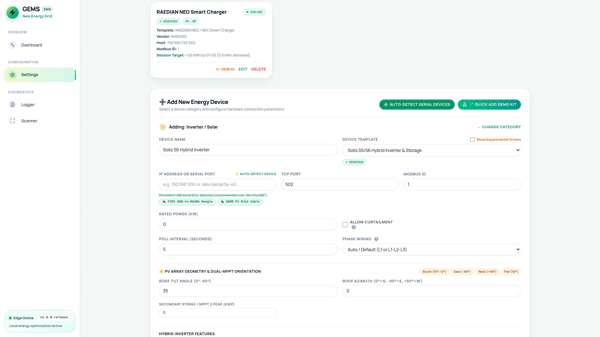
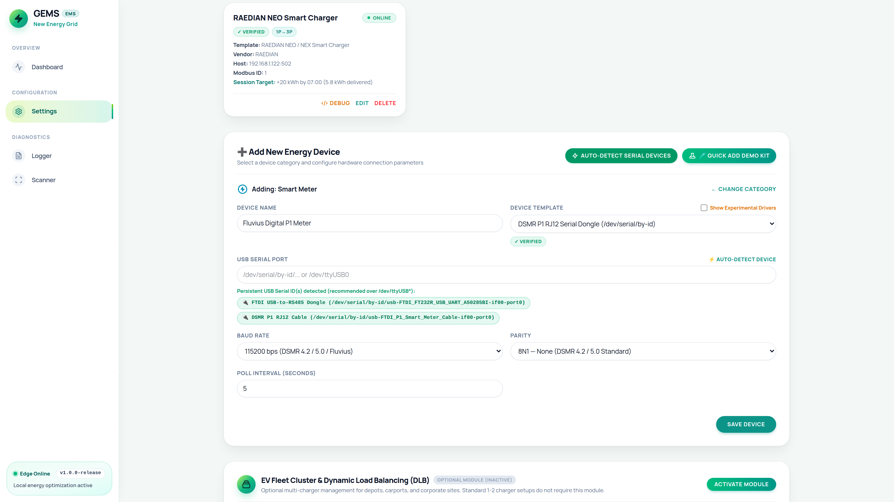
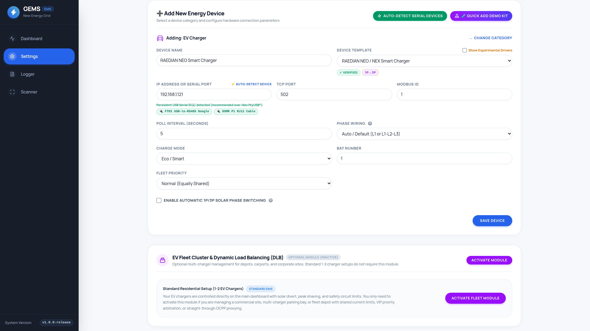

# Manuel Utilisateur GEMS

> 🌐 **Langue / Taal / Language:** [English](../user_manual.md) | [Nederlands](../nl/user_manual.md) | **Français**

Bienvenue dans le manuel utilisateur complet de GEMS (Grid Energy Management System par New Energy Grid). GEMS est un système de gestion de l'énergie léger, ultra-réactif et entièrement piloté par interface web, optimisé pour les contrôleurs basse consommation tels que le Raspberry Pi. Ce manuel détaille l'installation, la configuration et l'optimisation quotidienne de votre écosystème énergétique domestique ou tertiaire.

> [!TIP]
> **Télécharger les Manuels Officiels de Terrain (PDF) :**
> - 📕 **[Manuel Installateur & Mise en Service GEMS (PDF)](../../manuals/fr/gems-installer-manual-fr.pdf)** (5.8 MB)
> - 📗 **[Manuel Utilisateur & Particulier GEMS (PDF)](../../manuals/fr/gems-user-manual-fr.pdf)** (3.6 MB)
> - ☁️ **[Manuel de Connexion Cloud GRID-EMS-SERVER (PDF)](../../manuals/fr/gems-server-connection-manual-fr.pdf)** (1.0 MB)
> - 💻 **[Portail Interactif de Documentation](../../manuals/fr/index.html)**

---

## 1. Introduction & Vue d'Ensemble de l'Architecture

GEMS agit comme le cerveau central de votre installation énergétique en unifiant le Réseau, le Solaire photovoltaïque, la Batterie, la Borne de recharge VE et les Relais intelligents. En surveillant les flux de puissance en temps réel et en exécutant des stratégies d'optimisation précises, il réduit votre facture d'électricité, maximise votre autoconsommation et vous protège contre les tarifs capacitaires élevés.

### Philosophie Fondamentale
* **100 % Piloté par l'Interface Web :** Aucun fichier YAML ou texte à éditer. Chaque appareil matériel et chaque règle d'automatisation se configurent directement depuis le navigateur.
* **180 Modèles Matériels :** Prise en charge native de 174 profils d'équipements physiques (plus 6 profils de simulation intégrés) couvrant les onduleurs solaires, batteries domestiques (BESS), bornes VE (Modbus TCP/RTU, OCPP 1.6-J, REST), compteurs numériques P1 & Modbus, routeurs solaires linéaires, pompes à chaleur SG-Ready et relais intelligents.
* **Architecture Ultra-Réactive :** Un démon backend Go hautement optimisé couplé à SQLite embarqué et à une application Vue 3 SPA garantit un affichage instantané via Server-Sent Events (SSE) et WebSockets.
* **Usure Minimale du Stockage :** Les écritures en base de données sont mises en tampon et groupées en mode SQLite WAL afin de préserver la durée de vie de votre carte SD ou SSD NVMe.
* **Confidentialité Locale :** Toutes les données énergétiques sont traitées et conservées localement chez vous.

---

## 2. Matériel de Référence & Installation

### Plateforme de Référence Officiellement Testée
* **Contrôleur Système :** Raspberry Pi 5 (4 Go ou 8 Go de RAM) avec alimentation officielle 27 W USB-C PD, boîtier métallique en aluminium, refroidisseur actif et carte M.2 NVMe PCIe HAT/Base.
* **Stockage :** SSD M.2 2280 NVMe de 128 Go+ (PCIe Gen 3.0 / Gen 2.0 x4).
* Consultez les [Spécifications du Matériel de Référence (BOM)](hardware_reference.md) pour la nomenclature complète et les brochages.

### Méthode de Déploiement A : SSD M.2 NVMe Haute Vitesse (Recommandée)
Démarrer GEMS sur un SSD M.2 NVMe offre des performances maximales et élimine toute usure de carte SD :
1. **Mettre à jour le chargeur d'amorçage du Pi 5 (une seule fois) :** Utilisez Raspberry Pi Imager pour écrire *Misc utility images* &rarr; *Bootloader* &rarr; *NVMe/PCIe Boot* sur une carte MicroSD. Insérez-la dans le Pi 5 et allumez-le 5 secondes jusqu'à l'écran vert (`BOOT_ORDER=0xf461`, `PCIE_PROBE=1`).
2. **Flasher l'image GEMS :** Écrivez `gems-os-image.img.xz` sur le SSD NVMe.
3. Retirez la carte MicroSD et mettez sous tension. Le système démarre en moins de 8 secondes.
*Pour la procédure détaillée et les commandes terminal, consultez le [Guide de Configuration & Dépannage SSD NVMe](nvme_boot_guide.md).*

### Méthode de Déploiement B : Image OS Personnalisée sur Carte MicroSD
1. Téléchargez `gems-os-image.img.xz` depuis la page des versions GitHub.
2. Flashez l'image sur une carte MicroSD de 8 Go+ avec BalenaEtcher ou Raspberry Pi Imager.
3. Insérez la carte dans le Raspberry Pi et mettez sous tension.
4. Accédez à `http://ems.local` (ou `https://ems.local:9090` pour la console système Cockpit à l'aide de vos identifiants administrateur).
5. Au premier démarrage, l'**Assistant de mise en service initiale** s'ouvre automatiquement pour configurer la langue et le pays (`NL`, `FR`, `EN`), les limites électriques (calibre du disjoncteur principal, topologie réseau, plafond capacitaire flamand), la découverte du compteur, l'ajout des équipements solaires/batterie/VE et le contrat d'énergie.

### Méthode de Déploiement C : Paquet Debian (.deb)
Sur une distribution Debian ou Ubuntu ARM64 existante :
```bash
sudo dpkg -i gems_*_arm64.deb
sudo apt-get install -f
```
Le démon `systemd` `gems.service` démarre automatiquement sur le port `8080`.

---

## 3. Tableau de Bord & Supervision Temps Réel

| Tableau de Bord PowerFlow (Bureau) | Vue Responsive Mobile |
| :---: | :---: |
|  |  |

* **Synoptique Interactif Power Flow :** Représente les nœuds énergétiques actifs (Réseau, Solaire, Batterie, Borne VE, Maison). Les équipements non installés sont automatiquement masqués.
* **Exploration au Clic :** Cliquer sur un nœud du synoptique ouvre ses courbes historiques détaillées, sa répartition énergétique et les sélecteurs de période (Jour, Semaine, Mois, Année).

| Historique Solaire | Fenêtre Télémétrie Batterie |
| :---: | :---: |
|  |  |

| Historique Réseau | Fenêtre Borne VE |
| :---: | :---: |
|  |  |

* **Bilan Énergétique & Économies Estimées GRID-EMS :** Présente une synthèse journalière/mensuelle/annuelle du rendement solaire, des volumes importés/injectés, du taux d'autosuffisance ainsi qu'une carte **Économies Estimées GRID-EMS** détaillant les gains financiers réels entre **Autoconsommation Solaire**, **Batterie & Arbitrage Tarifaire**, **Charge VE & Écrêtement** et (en Flandre uniquement) **Écrêtage Capacitaire**.
* **Isolation Stricte par Pays :** Les jauges quart-horaires du *Capaciteitstarief* flamand et l'indicateur renouvelable belge Elia s'affichent exclusivement sur les sites belges/flamands, tandis que les sites néerlandais (`NL`) présentent la surveillance triphasée `3×25A` et le *Smart Saldering* sans terminologie étrangère.
* **Bandeaux d'Alerte & de Sécurité en Direct :** Les interfaces bureau et mobile affichent immédiatement une bannière d'alerte en cas de perte du compteur réseau (confirmant le courant de repli sécurisé VE), de délestage actif sur surcharge disjoncteur ou de défaut de communication matériel.
* **Rapports Énergétiques PDF Imprimables :** Exportez directement depuis le Tableau de bord des synthèses PDF quotidiennes, hebdomadaires, mensuelles ou annuelles incluant le détail des économies réalisées.

---

## 4. Paramètres Globaux & Configuration

Ouvrez la vue **Paramètres** depuis le menu latéral (réductible via le bouton de la barre supérieure) pour configurer les règles du site et votre contrat électrique.

### 4.1 Optimisation du Site (Mode de Stratégie)

| Aperçu des Paramètres de Stratégie | Modes de Stratégie Opérationnels |
| :---: | :---: |
|  |  |

* **`strategy_mode`** : Définit le mode de pilotage principal du site.
  * **Éco (`eco`) :** Maximise l'autoconsommation solaire en priorisant les charges domestiques, la batterie et la recharge VE avant l'injection réseau.
  * **Flandre (`flanders`) :** Active l'écrêtage prédictif des pointes 15 minutes selon le tarif capacitaire flamand, en modulant bornes VE et batteries pour rester sous `capacity_peak_limit_kw`.
  * **Pays-Bas (`netherlands`) :** Protège le disjoncteur `3×25A` par phase et réduit ou annule l'injection solaire au-delà de `allowed_grid_export_kw` ou lors des prix d'export négatifs.
* **`capacity_peak_limit_kw`** : Plafond moyen maximal autorisé par quart d'heure (par ex. `2.5` kW).
* **`peak_shaving_buffer_w`** : Marge de sécurité appliquée à l'approche du plafond capacitaire (par ex. `200` W).
* **`peak_shaving_rampup_w`** : Pas de reprise de puissance lorsque la capacité se libère (par défaut `500` W).
* **Plafond Adaptatif Intelligent** : Aligne dynamiquement le plafond d'écrêtage sur la plus haute pointe 15 minutes déjà enregistrée durant le mois en cours afin d'accélérer la charge sans surcoût réseau.

### 4.2 Arbitrage Batterie & Planifications

* **`battery_grid_charge_strategy`** :
  * `price_only` : Recharge sur le réseau dès que le prix spot EPEX passe sous `force_charge_below_euro`.
  * `super_dal_only` : Limite la charge réseau aux créneaux super-creux contractuels du fournisseur (par ex. Engie Superdal).
  * `hybrid` : Combine les seuils de prix spot et les plages super-creuses du fournisseur.
  * `dynamic_forecast` : Calcule le programme optimal de charge/décharge selon les prévisions d'ensoleillement et la consommation de base.
* **`force_charge_below_euro`** : Seuil de prix spot (€/kWh) déclenchant la charge réseau forcée.
* **`force_discharge_above_euro`** : Seuil de prix spot (€/kWh) autorisant l'injection batterie lors des fortes pointes tarifaires.

### 4.3 Contrats d'Énergie & Visualiseur Tarifaire 24h

| Configuration du Contrat d'Énergie | Courbe Tarifaire sur 24 Heures |
| :---: | :---: |
|  |  |

* **`contract_type`** : Préréglages natifs pour les contrats dynamiques néerlandais (**Vattenfall Nederland — FlexPrijs, Eneco Dynamic, Frank Energie Dynamic**), les contrats dynamiques belges (**TotalEnergies Pixel Dynamic, Mega Smart/Cosy Dynamic, Bolt Dynamisch, Engie Dynamic / Flextime, Luminus Dynamic, Ecopower, Dats 24, Octa+, Trevion, Aspiravi**), le Bi-horaire belge (Plein/Creux + TVA 6 %), Enovos Dynamic (Luxembourg) et les tarifs fixes/dynamiques génériques.
* **Préréglages GRD & Taxes Légales** : Profils intégrés pour la taxe néerlandaise *Energiebelasting* (`0,1316 €/kWh` + TVA 21 %), Fluvius (Flandre), ORES (Wallonie), RESA (Liège) et SIBELGA (Bruxelles).
* **Visualiseur Tarifaire 24h en Direct** : Courbe horaire empilée détaillant le prix de gros EPEX spot, la marge fournisseur, les frais de distribution GRD / taxes, la TVA (`6 %` BE / `21 %` NL), la rémunération d'injection solaire et les alertes d'écrêtement à prix négatif.

---

## 5. Gestion des Appareils & Intégration Pas à Pas

GEMS embarque **174 modèles matériels physiques natifs** (plus 6 profils de simulation — **180 au total**). L'ajout d'équipements s'effectue intégralement via l'interface web.

| Gestion des Appareils Configurés | Assistant de Catégorie d'Appareil |
| :---: | :---: |
|  |  |

### Processus Universel d'Intégration en 4 Étapes

1. **Analyse du Bus Série & du Sous-Réseau :** Cliquez sur **Scanner** dans le menu latéral (en **Mode installateur certifié**) pour détecter automatiquement le matériel :
   * **Analyser les ports série :** Identifie automatiquement les compteurs communicants P1 DSMR / e-MUCS ainsi que les onduleurs, bornes VE et compteurs d'énergie RS-485 Modbus RTU sur adaptateurs USB `/dev/serial/by-id/*` et ports UART (débit, parité, Slave ID), avec configuration en un clic (**Configurer**) et **Balayage RS-485 avancé** optionnel.
   * **Analyser le sous-réseau :** Identifie automatiquement le contrôleur GEMS (`THIS GEMS CONTROLLER`) et détecte les équipements LAN par adresse IP, nom d'hôte (mDNS/UPnP/NetBIOS), registres MAC OUI IEEE 24/28/36 bits et empreinte protocolaire sur les ports énergétiques ouverts (`502`, `80/443`, `8080`, `8887`) pour Solis, RAEDIAN, Shelly, etc.

   

2. **Préparation Matérielle :**
   * **Onduleurs Modbus :** Activez Modbus TCP ou RS-485 Modbus RTU sur la clé de communication ou le menu de l'onduleur (ex. Solis S5/S6 Hybride, SMA Speedwire / SunSpec, SolarEdge SetApp port 1502).
   * **Bornes de Recharge VE :** Activez Modbus TCP / RTU sur la borne (recommandé pour une régulation sous la seconde et la coexistence avec un CPO externe, ex. RAEDIAN NEO / NEX / Gemini), ou renseignez l'URL OCPP `ws://<GEMS-IP>:8887/<ChargePointID>` dans l'application de la borne.
   * **Compteurs & Relais REST Locaux :** Activez l'API locale sur les compteurs P1 Wi-Fi ou le protocole RPC Gen2 sur les modules Shelly.
   * **Adaptateurs Série P1 & RS485 :** Branchez les câbles RJ12 / USB-RS485 sur le Raspberry Pi et cliquez sur **Détecter les appareils série** (ou sélectionnez la pastille persistante `/dev/serial/by-id/*`) afin d'éviter toute permutation de port au redémarrage.

3. **Ajouter l'Appareil dans l'UI :** Ouvrez **Paramètres &rarr; Appareils** (après avoir déverrouillé le **Mode Installateur** via l'icône cadenas) et cliquez sur **Ajouter un appareil énergétique**. Les modèles commerciaux **Vérifiés** sont affichés par défaut ; cochez **Afficher les pilotes expérimentaux** pour révéler les profils **Expérimentaux** ou en **Lecture seule**. Le module optionnel **Cluster de Flotte VE & Dynamic Load Balancing (DLB)** figure en bas de la page Appareils. Sélectionnez la catégorie, le modèle matériel, saisissez les paramètres et cliquez sur **Enregistrer**.

| Configuration Onduleur Modbus | Configuration Compteur P1 | Configuration Borne VE |
| :---: | :---: | :---: |
|  |  |  |

4. **Vérifier l'État de Marche :** Assurez-vous que la carte de l'appareil affiche <span style="color:#10b981; font-weight:bold;">● En ligne</span> et contrôlez les puissances en direct sur le Tableau de bord.

---

### 5.1 Onduleurs Solaires & Hybrides (40+ Modèles)

| Modèle (`template_id`) | Marque & Série | Protocole | Port par Défaut | Slave ID | Écrêtement & Pilotage BESS |
| :--- | :--- | :--- | :--- | :--- | :--- |
| `solis_hybrid` / `solis_inverter` | **Solis Hybride (S5 / S6 Mono & Triphasé)** *(Référence Principale)* | Modbus TCP | `502` / `8899` | `1` | Oui (Vérifié) |
| `solis_retrofit` | **Onduleur Solis Retrofit (RAI / S6-EA1P Stockage AC)** *(Référence Principale)* | Modbus TCP | `502` / `8899` | `1` | Oui (Vérifié) |
| `huawei_inverter` | Huawei SUN2000 (L1/M1/M2/M3/MB0 + LUNA2000) | Modbus TCP | `502` | `1` (ou `2`) | Oui (Vérifié) |
| `sma_inverter` | SMA Sunny Boy / Tripower / Storage | Modbus TCP | `502` | `126` (ou `3`) | Oui (Vérifié) |
| `fronius_inverter` | Fronius Gen24 Plus / Symo / Primo | Modbus TCP SunSpec | `502` | `1` | Oui (M123 + M124 StorCtl) |
| `solaredge_inverter` / `solaredge_3phase` | SolarEdge Mono & Triphasé (SetApp + StorEdge) | Modbus TCP SunSpec | `1502` (ou `502`) | `1` | Oui (Limite + Remote Storage) |
| `sungrow_inverter` | Sungrow Hybride (SH5.0 - SH10RT / SH25T) | Modbus TCP | `502` | `1` | Oui (Écrêtement + EMS Forcé) |
| `victron_inverter` | Victron Cerbo GX / MultiPlus-II / Venus OS | Modbus TCP | `502` | `100` / `228` | Oui (Consigne ESS + Limite PV) |
| `goodwe_inverter` | GoodWe Hybride (ET / EH / BT / BH) | Modbus TCP | `502` / `8899` | `247` | Oui (Mode Puissance EMS + Écrêtement) |
| `growatt_inverter` | Growatt (SPH / MIN / MOD / MID) | Modbus TCP | `502` | `1` | Oui (Active Rate + Plage EMS) |
| `solax_inverter` | SolaX Hybride (X1 / X3 Gen 3/4) | Modbus TCP | `502` | `1` | Oui (Télécommande Modbus) |
| `sofarsolar_hybrid` | SofarSolar (HYD / G3 / AMASS) | Modbus TCP | `8899` / `502` | `1` | Oui (Mode Passif + Limite Export) |
| `deye_inverter` | Onduleurs Hybrides Deye / Sunsynk | Modbus TCP | `502` / `8899` | `1` | Oui (Sell Power + Charge Distante) |
| `foxess_inverter` | FoxESS Hybride (H1 / H3 / H3-Pro / AC1) | Modbus TCP | `502` | `1` / `247` | Oui (Work Mode + Charge/Décharge) |
| `sigenergy_hybrid` | Sigenergy SigenStor (ESS 5-en-1) | Modbus TCP | `502` | `1` | Oui (Contrôle EMS Distant) |
| `kostal_plenticore` | KOSTAL Plenticore plus / G2 / G3 & BI | Modbus TCP SunSpec | `1502` | `71` | Oui (Charge/Décharge + Limite) |
| `fenecon_fems` | FENECON Home 10/20/30 (FEMS / OpenEMS) | Modbus TCP | `502` | `1` | Oui (Puissance ESS + Limite PV) |
| `hoymiles_dtu` / `apsystems_ez1` | Micro-onduleurs Hoymiles DTU-Pro-S & APsystems EZ1-M | Modbus TCP / REST Local | `502` / `8050` | `1` / — | Oui (Limitation dynamique) |
| `enerlution_inverter` | Onduleur Hybride Enerlution | Modbus TCP | `502` | `1` | Oui |
| `alpha_ess_inverter` | Alpha ESS Storion (SMILE5 / SMILE-T10 / G3) | Modbus TCP | `502` / `8502` | `85` | Oui (Mode Dispatch) |
| `anker_inverter` | Anker SOLIX X1 Hybride | Modbus TCP | `502` | `1` | Oui |
| `abb_fimer_inverter` | ABB / Fimer Solaire & Hybride (UNO-DM/REACT 2) | Modbus SunSpec | `502` | `1` | Oui (M123 + M124 StorCtl) |
| `autarco_inverter` | Onduleurs Autarco Séries SX / MX / LX | Modbus TCP | `502` | `1` | Oui |
| `chisage_ess` | Onduleurs Hybrides Chisage ESS (3kW–50kW) | Modbus TCP | `502` | `1` | Lecture seule (Expérimental) |
| `delta_inverter` | Delta Séries M6A / M8A / M10A / RPI | Modbus SunSpec | `502` | `1` | Oui (SunSpec M123) |
| `hyxipower_inverter` | Onduleurs HYXiPOWER Résidentiels & C&I | Modbus TCP | `502` | `1` | Lecture seule (Expérimental) |
| `kstar_inverter` | Onduleurs Hybrides KSTAR Série BluE | Modbus TCP | `502` | `1` | Oui |
| `saj_hybrid` / `senergy_inverter` | Séries Hybrides SAJ H1/H2/R5 & Senergy SE | Modbus TCP | `502` | `1` | Oui |
| `afore_inverter` / `marstek_storage` | Afore AF/BNT Hybride & Marstek Venus AC BESS | Modbus TCP | `502` | `1` | Oui |
| `solinteg_inverter` | Solinteg Integ M Séries OHT/OMT (3kW–50kW) | Modbus TCP | `502` | `1` | Oui |
| `solplanet_inverter` | Solplanet / AISWEI Mono & Triphasé | Modbus TCP | `502` | `1` | Oui |
| `lg_ess` | LG ESS Home (8 / 10 / 15) | Modbus TCP / REST | `502` / `443` | `1` | Oui |
| `enphase_envoy` | Enphase IQ Gateway / Envoy-S Metered (D5 / D7 / D8) | HTTPS / REST Local (Auto-JWT) | `443` / `80` | — | Lecture seule (Auto JWT Local + 3P V/I) |

---

### 5.2 Bornes de Recharge VE (60+ Modèles)

#### Bornes VE Modbus TCP / RS485 (Recommandées & Privilégiées)
**Modbus TCP / RS485 constitue l'interface de pilotage recommandée pour les bornes VE** :
* **Modulation Inférieure à la Seconde :** L'écriture directe dans les registres ajuste instantanément le courant (6 A à 32 A), essentiel pour le tarif capacitaire flamand et l'adaptation rapide aux passages nuageux.
* **Coexistence avec Facturation CPO Externe :** Si la borne est reliée en OCPP à une plateforme externe de facturation CPO ou de remboursement employeur, GEMS module la puissance localement en Modbus TCP *sans perturber ni couper la connexion de facturation cloud*.
* **Modèles Pris en Charge :**
  * **RAEDIAN NEO / NEX AC Wallbox :** Modèle `raedian_charger`, Port `502`, Slave ID `1` (courant dynamique + bascule 1P/3P).
  * **RAEDIAN Gemini Dual AC Wallbox :** Modèle `raedian_gemini`, Port `502`, Slave ID `1` (double prise et équilibrage dynamique 0–64A).
  * **SolaX Smart EV Charger G2 :** Modèle `solax_evcharger`, Port `502`, Slave ID `1` (précision 0,01 A + bascule 1P/3P).
  * **KEBA KeContact P30 / P40 :** Modèle `keba_charger`, Port `502`, Slave ID `255` (précision 1 mA + commutation de phase S10).
  * **Mennekes AMTRON Xtra / Charge Control / 4You :** Modèle `mennekes_modbus`, Port `502`, Slave ID `1`.
  * **Heidelberg Energy Control / Amperfied connect.home :** Modèle `heidelberg_ampere`, Port `502` ou RS485, Slave ID `1`.
  * **Sungrow AC011E-01 / AC22E-01 & FoxESS Wallbox :** Modèles `sungrow_evcharger`, `foxess_evcharger`, Port `502`, Slave ID `1` / `247`.
  * **Vestel EVC04 Home / Smart Wallbox :** Modèle `vestel_evc04`, Port `502`, Slave ID `255`.
  * **Webasto Next / Live :** Modèle `webasto_charger`, Port `502`, Slave ID `1`.
  * **ABB Terra AC Wallbox :** Modèle `abb_charger`, Port `502`, Slave ID `1`.
  * **Alfen Eve Single / Double Pro-Line :** Modèle `alfen_charger`, Port `502`, Slave ID `1` (avec bascule 1P/3P).
  * **Peblar Home / Business EV Charger :** Modèle `peblar_charger`, Port `502`, Slave ID `1` (avec bascule 1P/3P).
  * **Phoenix Contact EV-CC / CHARX / Veton :** Modèles `phoenix_contact_evcc` / `phoenix_charger` / `veton_charger`, Port `502`, Slave ID `1`.
  * **GoodWe HCA Wallbox / Sigenergy SigenStor EVAC :** Modèles `goodwe_charger` / `sigenergy_evac`.
  * **SolarEdge Home EVSE :** Modèle `solaredge_evse`, Port `502`, Slave ID `1`.

#### Bornes VE OCPP 1.6-J Natives (Direct & Proxy)
Pour les bornes sans Modbus TCP ou les installations résidentielles autonomes sans opérateur CPO tiers :
* Configurez l'URL du système central (*Central System URL*) dans l'application mobile / interface de la borne :
  ```
  ws://<GEMS-IP>:8080/api/ocpp/<ChargePointID>
  ```
* **Modèles Pris en Charge :** Huawei FusionCharge (SCharger-7KS/22KT), Kempower Movable/Station/Satellite (`kempower_charger`), Wallbox Pulsar Plus / Commander (`wallbox_ocpp`), Teltonika TeltoCharge (`teltonika_teltocharge`), EVBox (Elvi/Livo/BusinessLine), Mennekes AMTRON (4You/4Business/ACU), Schneider Electric EVlink (Wallbox/Pro AC), Siemens VersiCharge GEN3, Elli / VW / Skoda / SEAT (ID. Charger Connect/Pro), Alpitronic Hypercharger, Autel MaxiCharger, Hager witty, BMW Wallbox Plus, Mercedes-Benz Wallbox, Porsche Wallbox, Fronius Wattpilot.
* **Dans l'UI GEMS :** Sélectionnez Borne VE &rarr; Modèle : `OCPP Charger` (`ocpp_charger`) &rarr; Saisissez votre `ChargePointID` (ex. `WALLBOX-01`).

#### Bornes VE REST Local & API Cloud
* **go-e Charger Gemini / HOMEfix / PRO :** Modèle `goe_charger`, API HTTP REST v2 locale Port `80` (consigne RAM sans usure flash & bascule 1P/3P).
* **WARP Charger 2 / 3 (Tinkerforge) :** Modèle `warp_charger`, API HTTP locale Port `80` (courant & bascule 1P/3P).
* **openWB Pro :** Modèle `openwb_pro`, API HTTP `connect.php` Port `80` (pas de 0,1 A & bascule 1P/3P).
* **cFos Power Brain Solar / Wallbox :** Modèle `cfos_powerbrain`, API JSON HTTP locale Port `80` (pas de 0,1 A & relais de phase).
* **MyEnergi Zappi v2 / v2.1 :** Modèle `myenergi_zappi`, API Digest Hub/Cloud (courant & modes Fast/Eco+/Stop).
* **Easee Home / Charge / Charge Lite :** Modèle `easee_charger`, API Cloud officielle (`dynamicChargerCurrent` & `phaseMode` 1P/3P).
* **Zaptec Go / Pro :** Modèle `zaptec_charger`, API Cloud OAuth2 officielle (`availableCurrentPhase1..3` & bascule 1P/3P).
* **Wallbox Pulsar Plus / Copper SB / Commander 2 :** Modèle `wallbox_charger`, API REST Cloud officielle (`max_charging_current` & pause/reprise).
* **Volt Time Source / Source Pro :** Modèle `volttime_source`, API Cloud v2 officielle.
* **SmartEVSE v2 / v3 & Generic Local REST EVSE Gateway :** Modèles `smartevse_charger`, `generic_rest_evse`, Port `80`.

---

### 5.3 Compteurs Réseau & Analyseurs d'Énergie (40 Modèles)

* **Compteur Communicant P1 (USB / Série) :** Modèle `p1_serial`. Port série `/dev/serial/by-id/...` (ou `/dev/ttyUSB0`), Débit `115200` (DSMR 4/5) ou `9600` (DSMR 2/3). Branchez la fiche RJ12 sur le compteur et l'USB sur le Raspberry Pi.
* **Compteur Communicant P1 (Passerelle Réseau / TCP) :** Modèle `p1_network`. Adresse IP et Port (ex. `23`, `8088`, `8234`).
* **HomeWizard Wi-Fi P1 Meter :** Modèle `homewizard_meter`. Adresse IP, Port `80` (activez l'*API locale* dans l'application HomeWizard Energy).
* **KOSTAL Smart Energy Meter (KSEM G1 / G2) :** Modèle `kostal_ksem`. Modbus TCP Port `502`, Slave ID `71` (SunSpec + flottants natifs).
* **Huawei EMMA-A02 Energy Management Assistant :** Modèle `huawei_emma`. Modbus TCP Port `502`, Slave ID `1`.
* **Fronius Smart Meter IP / TS :** Modèle `fronius_smartmeter_ip`. Solar API v1 HTTP JSON locale sur Port `80`.
* **Lecteur Optique IR Tasmota SML / OBIS :** Modèle `tasmota_sml`. API JSON HTTP `Status 10` sur Port `80`.
* **YouLess LS120 Impulsions & P1 / Homey Energy Dongle :** Modèles `youless_ls120`, `homey_p1`.
* **Compteur Triphasé Chint DTSU666 / DTSU666-H :** Modèle `chint_dtsu666`. Modbus TCP Port `502`, Slave ID `1`.
* **Shelly 3EM / Pro 3EM / Gen3 3EM-63T :** Modèles `shelly_3em`, `shelly_pro_3em`. Adresse IP, Port `80`.
* **Eastron SDM120 / SDM230 / SDM630 / SDM72D / SMART X96 :** Modèles `eastron_sdm120_230`, `eastron_sdm630`, `eastron_sdm72_x96`. Modbus TCP Port `502`, Slave ID `1`.
* **Carlo Gavazzi EM112 / EM340 / EM540 / EM24 :** Modèles `carlogavazzi_em340`, `carlogavazzi_em24`. Modbus TCP Port `502`, Slave ID `1`.
* **ABB A43 / A44 / B23 / B24, Schneider Acti9 iEM3000, Siemens SENTRON PAC2200, SMA Energy Meter 2.0, Socomec COUNTIS/DIRIS, WAGO 879, Accuenergy Acuvim/AcuRev, Algodue UPM, Hager ECR/ECM, Janitza UMG, Kamstrup OMNIPOWER/382, Landis+Gyr E350/E360/E650, Phoenix Contact EMpro, Weidmüller EM500/EM600, Eltako, Finder, Inepro, Lovato, Acrel, ESPHome, Loxone Miniserver, Niko Home Control.**

---

### 5.4 Relais Intelligents, Routeurs Solaires & Pompes à Chaleur SG-Ready (12 Modèles)

| Gestion des Relais & Commutateurs | Règles d'Automatisation des Relais |
| :---: | :---: |
|  |  |

* **Routeur Solaire Linéaire my-PV AC•THOR / AC•THOR 9s / AC ELWA 2 :** Modèle `mypv_acthor`. Modbus TCP Port `502`. Modulation continue au Watt près (`0–9000 W`) du surplus PV et consigne de température ECS.
* **Thermoplongeur PV Askoma ASKOHEAT+ Modbus TCP :** Modèle `askoheat_diverter`. Modbus TCP Port `502`.
* **Pompe à Chaleur Stiebel Eltron / Tecalor ISG web / ISG plus :** Modèle `stiebel_eltron_isg`. Modbus TCP Port `502`. Pilotage direct des états SG-Ready et relèvement de consigne confort ECS.
* **Pompe à Chaleur NIBE Série S (S1155 / S1255 / S2125 / VVM S320) :** Modèle `nibe_heatpump`. Modbus TCP Port `502`. Adaptation tarifaire intelligente / boost SG-Ready et eau chaude sanitaire.
* **Daikin Altherma 3 / HomeHub (MMI-2) :** Modèle `daikin_altherma`. Modbus TCP Port `502`. Boost Smart Grid énergie gratuite, limitation de puissance et consigne ballon ECS.
* **Prise / Relais Tasmota (Nous A1T / Sonoff POW) :** Modèle `tasmota_relay`. Adresse IP, Port `80` (commutation `Power` + télémesure `ENERGY`).
* **Shelly Plus 1PM / Pro 1PM / Plug S :** Modèle `shelly_plus_1pm`. Adresse IP, Port `80`. Pilote les contacteurs boost SG-Ready et chauffe-eau selon le surplus solaire et les temporisations thermiques.
* **Shelly Plus 1 / Pro 1 (Contact Sec) :** Modèle `shelly_plus_1`. Commutation libre de potentiel pour entrées PAC ou signaux de délestage.
* **Shelly Plus 2PM / Pro 2PM (Double Relais & Compteur) :** Modèle `shelly_plus_2pm`. Double canal indépendant avec mesure de puissance active.
* **Boost Pompe à Chaleur SG-Ready :** Modèle `sgready_heatpump`. Bascule entre l'État 2 (Normal) et l'État 3 (Boost Thermique) lors des surplus solaires ou tarifs spot négatifs.
* **Module Relais E/S Numériques Modbus :** Modèle `modbus_relay`. Commutation industrielle de contacteurs de puissance par bobines Modbus RTU/TCP.
* **Relais HTTP Générique :** Modèle `generic_relay`. URL d'état et de commutation personnalisables pour ESPHome et actionneurs sur mesure.

---

## 6. Diagnostics Système & Mises à Jour

| Identité Système, Réseau & Version | Alertes Webhook & Rapports |
| :---: | :---: |
|  |  |

* **Journal Temps Réel & Diagnostic des Modèles Matériels :** Flux en direct des trames Modbus, lectures de registres, battements WebSocket OCPP et décisions d'optimisation, complété par des sondes **Debug** en un clic dans **Paramètres &rarr; Appareils connectés** (accessibles en Mode Normal) permettant d'inspecter la télémétrie brute et de transmettre un rapport de modèle à **GRID-EMS-SERVER**.
* **Mises à Jour OTA & `.deb` Signées + Redémarrage :** Directement accessibles dans **Paramètres &rarr; Infos système** en Mode Normal, le bouton **Redémarrer le système**, la vérification des versions officielles et le téléversement manuel `.deb` contrôlent systématiquement la signature Ed25519 et l'empreinte SHA-256 de New Energy Grid avant installation.


---

## 7. Plateforme Cloud Centrale & Intelligence Régionale

### 7.1 Intégration GRID-EMS-SERVER (100 % Optionnelle)

GEMS repose sur une **philosophie local-first** : tout l'équilibrage dynamique de charge, la planification batterie, le routage solaire et la protection réseau s'exécutent de manière autonome sur le Raspberry Pi. La connexion cloud reste 100 % facultative.

Si vous ou votre installateur souhaitez superviser l'installation à distance :
* **Portail :** `https://ems.newenergygrid.com`
* **Zéro Configuration Routeur :** Les connexions sortantes TLS 1.3 dispensent de toute ouverture de port, DNS dynamique ou adresse IP publique fixe.
* **Appairage Rapide :** Allez dans **Paramètres &rarr; Serveur Cloud**, saisissez le jeton d'appairage à 16 caractères fourni par votre installateur et cliquez sur **Appairer & Connecter**.
* **Supervision & Télédiagnostic :** Suivez en direct vos flux énergétiques, recevez des alertes proactives et ajustez vos modes de stratégie depuis n'importe quel navigateur ou mobile.

### 7.2 Intelligence Régionale : Pays-Bas vs Belgique

GEMS adapte automatiquement son moteur d'optimisation et son interface selon votre pays et votre contrat d'énergie :
* **🇳🇱 Mode Pays-Bas (`country: 'NL'` / `strategy_mode: 'netherlands'`) :**
  * Optimise les contrats dynamiques Day-Ahead néerlandais sur la zone de marché EPEX Spot NL.
  * Intègre automatiquement la taxe énergétique légale (*Energiebelasting*) et les marges fournisseurs.
  * Protège contre les pénalités d'injection (*terugleverkosten*) et bride l'export PV lors des prix Day-Ahead négatifs.
  * Masque automatiquement les éléments propres à la Belgique (jauges du tarif capacitaire flamand et part renouvelable Elia).
* **🇧🇪 Mode Belgique / Flandre (`country: 'BE'` / `strategy_mode: 'flanders'`) :**
  * Assure l'écrêtage glissant sur 15 minutes du *Capaciteitstarief* afin de réduire les frais mensuels de réseau.
  * Prend en charge les contrats dynamiques belges (TotalEnergies, Mega, Bolt, Engie, etc.) sur la zone EPEX Spot BE.
  * Intègre le boost de synchronisation renouvelable Elia pour favoriser la charge VE et le stockage thermique lorsque la production verte nationale est abondante.
