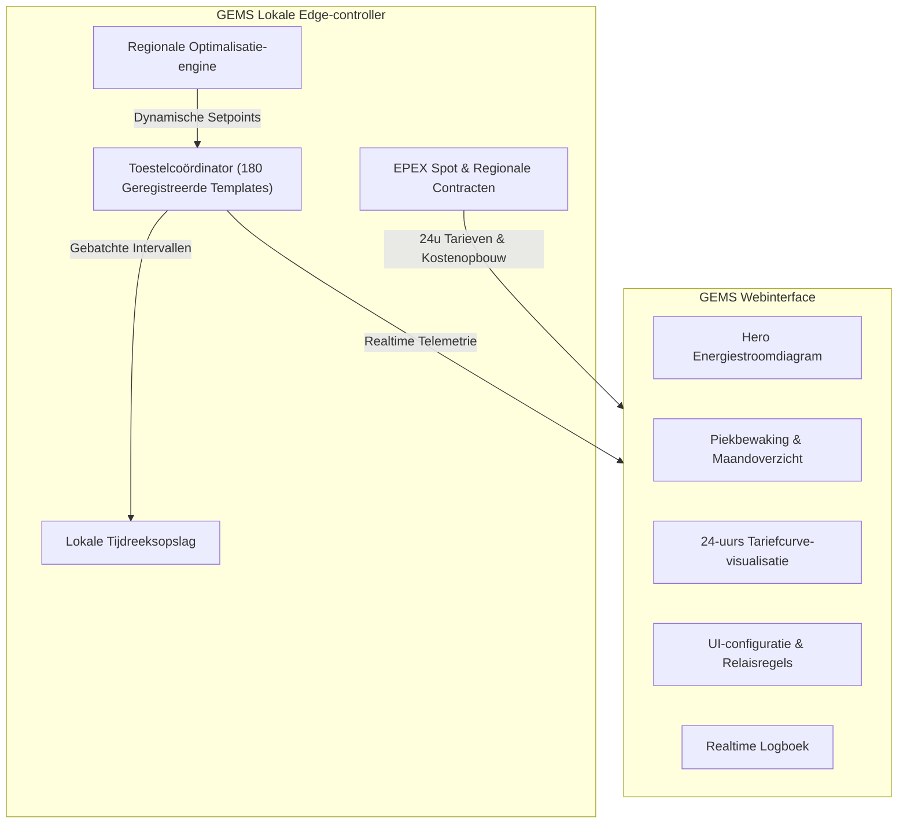
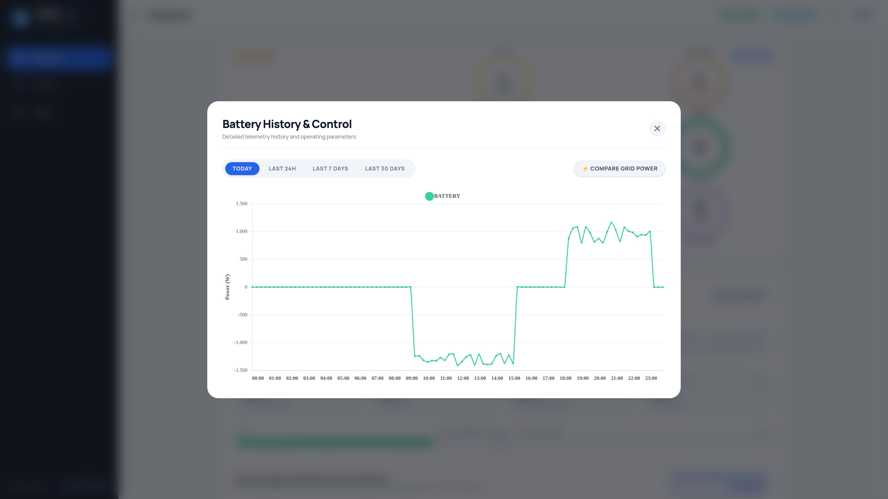
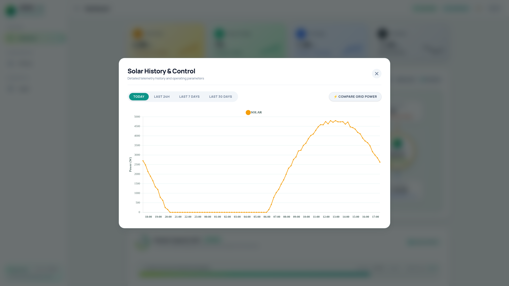
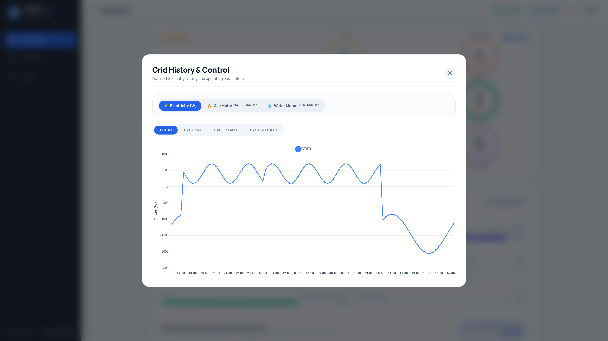
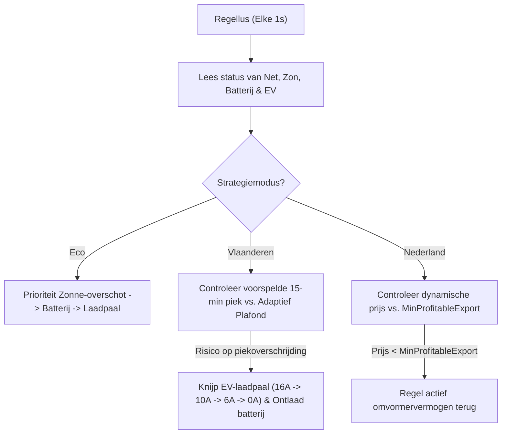
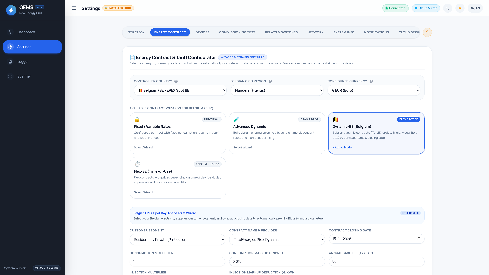
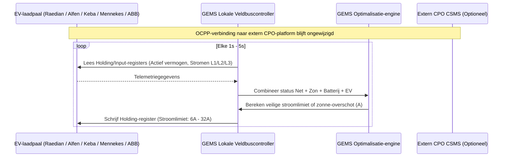
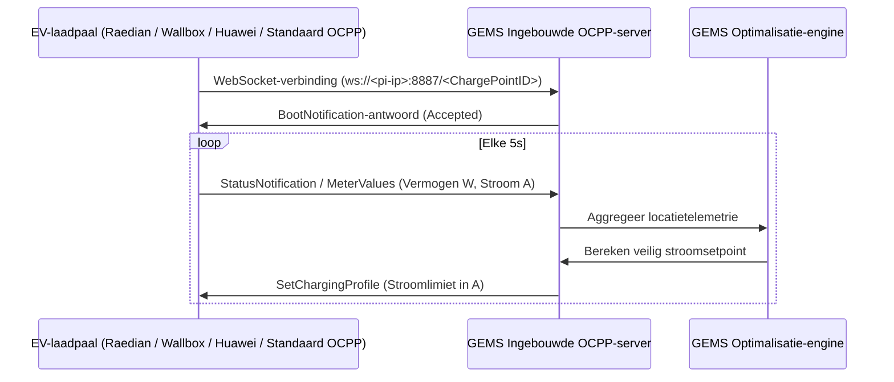

# 📖 GEMS - Geavanceerde Operationele Handleiding

> 🌐 **Taal / Langue / Language:** [English](../advanced_manual.md) | **Nederlands** | [Français](../fr/advanced_manual.md)

Welkom bij de **GEMS Geavanceerde Operationele Handleiding**. Dit document biedt een diepgaande, stapsgewijze uitleg van de werking van elke functie, configuratie-instelling, regionale strategie, automatiseringsregel, dynamische contractformule en diagnostische tool binnen GEMS.

> [!TIP]
> **Download Officiële Veldhandleidingen (PDF):**
> - 📕 **[GEMS Installateurs- & Inbedrijfstellingshandleiding (PDF)](../../manuals/nl/gems-installer-manual-nl.pdf)** (5.7 MB)
> - 📗 **[GEMS Gebruikershandleiding voor Woningeigenaren (PDF)](../../manuals/nl/gems-user-manual-nl.pdf)** (3.5 MB)
> - ☁️ **[GEMS GRID-EMS-SERVER Verbindingshandleiding (PDF)](../../manuals/nl/gems-server-connection-manual-nl.pdf)** (1.1 MB)
> - 💻 **[Interactief Documentatieportaal](../../manuals/nl/index.html)**

---

## 📑 Inhoudsopgave
1. [Architectuur & Systeemoverzicht](#1-architectuur--systeemoverzicht)
2. [Dashboard & Hero Energiestroommonitor](#2-dashboard--hero-energiestroommonitor)
3. [Regionale Strategie-engine](#3-regionale-strategie-engine)
4. [Slimme Relais & SG-Ready Automatisering](#4-slimme-relais--sg-ready-automatisering)
5. [Dynamische Tarieven & Contractberekeningen](#5-dynamische-tarieven--contractberekeningen)
6. [Toestelbeheer & Modbus-diagnose](#6-toestelbeheer--modbus-diagnose)
7. [EV-laden: Modbus TCP & Ingebouwde OCPP-server](#7-ev-laden-modbus-tcp--ingebouwde-ocpp-server)
8. [Systeemonderhoud, Logboek & Updates](#8-systeemonderhoud-logboek--updates)

---

## 1. Architectuur & Systeemoverzicht

GEMS (Grid Energy Management System van New Energy Grid & The Charge Grid) is ontworpen voor een minimaal geheugengebruik en maximale reactiesnelheid op Raspberry Pi-hardware (Debian/Linux ARM64).

> [!NOTE]
> **Optimalisatie voor Raspberry Pi & NVMe-opslag:** GEMS is officieel geverifieerd op de Raspberry Pi 5 met een M.2 NVMe PCIe Base en een high-endurance 128 GB+ M.2 NVMe SSD. Schrijfacties naar de database worden in het RAM-geheugen gebufferd en per minuut in één transactiebatch weggeschreven. SQLite Write-Ahead Logging (`WAL`) en periodieke niet-blokkerende downsampling voorkomen slijtage van opslagmedia en garanderen sub-milliseconde responstijden op NVMe-opslag.

---

## 2. Dashboard & Hero Energiestroommonitor

Het **Dashboard** vormt het centrale bewakingsscherm van GEMS.

| Desktop Energiestroom-dashboard | Mobiele Responsieve Weergave |
| :---: | :---: |
|  |  |

### 2.1 Interactief Hero Energiestroomdiagram
* **Dynamische Knooppuntweergave:** Net, Zonne-omvormer, Thuisbatterij, Laadpaal en Slimme Relais worden **uitsluitend** getoond wanneer ze daadwerkelijk zijn geconfigureerd en actief zijn.
* **Geanimeerde Vermogensstromen:** Bewegende stroomlijnen geven realtime de richting en snelheid van de energiestromen weer.
* **Klik-voor-Historie Venster:** Door op een knooppunt te klikken (bijv. Net, Batterij, Zon, Laadpaal) opent een gedetailleerd historisch grafiekvenster met energietotalen, zelfvoorzieningspercentages en periodefilters (Dag, Week, Maand, Jaar).

| Batterij-telemetrievenster | Zonneproductievenster |
| :---: | :---: |
|  |  |

| Netafname/-injectievenster | EV-laadpaal Historievenster |
| :---: | :---: |
|  |  |

### 2.2 Vlaamse Kwartierpiekmonitor (`capaciteitstarief`)
* **Exacte OBIS 1.6.0 Uitlezing:** Leest rechtstreeks de geregistreerde maandelijkse kwartierpiek van de digitale meter in.
* **Voorspellende Kwartierpiekbewaking:** Berekent continu de verwachte gemiddelde 15-minuten netafname voor het lopende facturatiekwartier op basis van de reeds verbruikte energie en het actuele vermogen.
* **Maandpiekregistratie & Slim Adaptief Plafond:** GEMS houdt de werkelijke maandpiek lokaal bij. Treedt er tijdens de maand een onvermijdelijke huishoudelijke piek op, dan past het plafond zich automatisch aan tot die reeds behaalde piek om sneller te kunnen laden zonder extra capaciteitstariefkosten.
* **Statusindicaties:**
  * **NORMAAL (Groen):** Voorspelde piek $<80\%$ van het ingestelde plafond (`capacity_peak_limit_kw`).
  * **WAARSCHUWING (Oranje):** Voorspelde piek tussen $80\%$ en $99\%$ van het ingestelde plafond.
  * **BEGRENSD (Rood):** Voorspelde piek $\ge 100\%$ van het plafond; actieve terugregeling en batterijbijsprong zijn ingeschakeld.

### 2.3 Visuele PDF-energierapportage
* Genereert direct downloadbare PDF-prestatierapporten vanuit het Dashboard.
* Keuze uit **Laatste 7 dagen (PDF)**, **Laatste 30 dagen (PDF)**, **Huidig jaar (PDF)** en **Volledige historie (PDF)**.

---

## 3. Regionale Strategie-engine

Kies uw actieve operationele strategie onder **Instellingen &rarr; Strategie**:

| Overzicht Strategie-instellingen | Operationele Strategiemodi |
| :---: | :---: |
|  |  |

### 3.1 Eco-strategie (`eco`)
* Maximaliseert direct zelfverbruik van zonne-energie.
* Stuurt overtollige zonnestroom eerst naar de thuisbatterij, vervolgens naar EV-laadpalen en ten slotte naar thermische/slimme relais.

### 3.2 Vlaamse Piekbewakingsstrategie (`flanders`)
* Specifiek ontworpen voor het Vlaamse *Capaciteitstarief*.
* Bewaakt het voortschrijdende 15-minuten gemiddelde van de netafname.
* Regelt dynamisch EV-laadpalen terug en stuurt batterij-ontlading aan zodra het totale woningverbruik de kwartierpiek boven `capacity_peak_limit_kw` dreigt te duwen.
* Hanteert `peak_shaving_buffer_w` en geleidelijke opschaling via `peak_shaving_rampup_w` zodra de belasting stabiliseert.

### 3.3 Nederlandse Slim Salderen & Zero-Export Strategie (`netherlands`)
* Ontworpen voor het Nederlandse elektriciteitsnet, `3×25A` hoofdzekeringbewaking en het vermijden van *terugleverkosten*.
* **Slim Salderen-instelling:** Toetst de realtime EPEX-spotprijs aan `min_profitable_export_price`.
* Wanneer de terugleververgoeding onder de drempel zakt (of negatief wordt), regelt de strategie het actieve vermogen van de zonne-omvormer terug tot het actuele woningverbruik, zodat onrendabele teruglevering volledig wordt voorkomen.

### 3.4 Dynamische Tariefsturing & Batterijslijtagemodel
* Berekent de meest gunstige laadvensters op basis van Day-Ahead EPEX-spotprijzen.
* **Batterijslijtagekost:** Neemt de ingestelde cyclusslijtagekost ($€/\text{kWh}$) mee in de arbitrageberekening, zodat een laad-/ontlaadcyclus alleen wordt uitgevoerd wanneer het prijsverschil ruimschoots opweegt tegen de batterijdegradatie en omzettingsverliezen.

### 3.5 Fasebewuste 3-Fasen Load Balancing
* Bewaakt continu de stromen per fase ($L_1, L_2, L_3$) vanuit 3-fasige P1-/Modbus-slimme meters.
* Handhaaft `phase_limit_amps` (bijv. $25\text{ A}$ per fase). Zodra één enkele fase de limiet van de hoofdzekering nadert, worden EV-laadpalen direct teruggeregeld — ongeacht het totale 3-fasenvermogen.

---

## 4. Slimme Relais & SG-Ready Automatisering

Configureer automatische schakelregels voor warmwaterboilers, warmtepompen en zware verbruikers onder **Instellingen &rarr; Relais & Schakelaars**.

| Beheer Relais & Schakelaars | Relais-automatiseringsregels |
| :---: | :---: |
|  |  |

### 4.1 Parameters voor Automatiseringsregels
* **Voorwaardetypes:**
  * `solar_export_exceeds`: Schakelt in zodra het geïnjecteerde zonne-overschot groter is dan `threshold_watts`.
  * `grid_import_below`: Schakelt in wanneer de netafname onder `threshold_watts` blijft.
  * `price_below`: Schakelt in wanneer de dynamische stroomprijs onder de ingestelde drempelprijs daalt.
* **Beveiligingstimers tegen Pendelen (Anti-Short-Cycling):**
  * `min_run_time_seconds`: Houdt het relais na inschakelen gedurende een minimale looptijd AAN ter bescherming van compressoren en contactoren.
  * `min_off_time_seconds`: Houdt het relais gedurende een minimale rusttijd UIT voordat het opnieuw mag inschakelen.

### 4.2 SG-Ready Warmtepompmodi
GEMS vertaalt relaiscontacten naar de vier standaard SG-Ready bedrijfsmodi voor warmtepompen:
1. **Modus 1 (Netblokkering / EVU-Sperre):** Schakelt de warmtepomp tijdelijk uit tijdens extreme piekmomenten.
2. **Modus 2 (Normaal Bedrijf):** De warmtepomp volgt zijn normale interne thermostaatregeling.
3. **Modus 3 (Zonne-overschot Aanbevolen):** Verhoogt de doeltemperatuur voor tapwater/buffervat om overtollige zonne-energie thermisch op te slaan.
4. **Modus 4 (Geforceerde Opwarming):** Maximaliseert thermische opslag tijdens uren met gratis of negatieve stroomprijzen.

---

## 5. Dynamische Tarieven & Contractberekeningen

GEMS berekent realtime de effectieve elektriciteitsprijs door regionale nettarieven, heffingen en leveranciersformules toe te passen op de Day-Ahead EPEX-spotprijzen.

| Configuratie Energiecontract | 24-uurs Tariefcurve-visualisatie |
| :---: | :---: |
|  |  |

### 5.1 Ondersteunde Regionale Leveranciersprofielen
* **TotalEnergies Pixel Dynamic (BE):** EPEX Spot BE + vermenigvuldigingsfactor + opslag + vaste abonnementskost.
* **Mega Smart / Cosy Dynamic (BE):** Instelbare afnamefactor, leveranciersopslag en injectievergoeding.
* **Bolt Dynamisch (BE):** 100% lokaal groen dynamisch contract met zuivere spotdoorgifte.
* **Engie Dynamic & Flextime (BE):** Spotdoorgifte en meertrapstarieven op basis van tijdsblokken.
* **Luminus, Eneco, Frank Energie, Ecopower, Dats 24, Octa+, Trevion, Aspiravi, Vattenfall FlexPrijs (NL):** Regionale Belgische en Nederlandse contractformules.
* **Belgisch Tweevoudig Tarief (Piek/Dal):** Standaard dag-/nachttarieven met 6% btw en netbeheerderspresets.
* **Enovos (Luxemburg):** Dynamische tariefstructuur inclusief Creos-distributiekosten.

### 5.2 Live 24-uurs Effectieve Tariefcurve
De ingebouwde grafiek splitst de uurprijs van elektriciteit op in 4 gestapelde componenten:
1. **Kale EPEX Spot-groothandelsprijs**
2. **Leveranciersopslag & Vaste Vergoeding**
3. **Netbeheer & Transmissie (Fluvius / ORES / RESA / SIBELGA / Energiebelasting)**
4. **Heffingen & Btw (6% BE / 21% NL)**
Met daarbovenop een getrapte lijn voor de **Netto Terugleververgoeding** inclusief automatische **Waarschuwingen voor Terugregeling bij Negatieve Prijzen**.

---

## 6. Toestelbeheer & Modbus-diagnose

Beheer alle gekoppelde energie-apparatuur via **Instellingen &rarr; Toestellen**.

| Overzicht Geconfigureerde Toestellen | Wizard Nieuw Toestel Toevoegen |
| :---: | :---: |
|  |  |

### 6.1 Seriële Bus- & Lokale Netwerkscanner
* Klik op **Scanner** in de zijbalk om zowel fysieke USB-/RS-485-adapters als netwerktoestellen op uw lokale subnet te ontdekken.
* **Seriële Poort & RS-485 Busscanner:** Herkent automatisch DSMR / e-MUCS P1-slimme meters en RS-485 Modbus RTU-omvormers, laadpalen en energiemeters (inclusief baudrate, pariteit, Slave ID en vaste `/dev/serial/by-id/*`-paden), met één klik op **Configureren** en een **Geavanceerde RS-485 busscan** voor multi-drop Slave ID-bereiken.
* **Lokale Netwerkscanner:** Herkent automatisch de GEMS-controller zelf (`THIS GEMS CONTROLLER`) en vindt zonne-omvormers, thuisbatterijen, slimme meters, relais en EV-laadpalen op het netwerk — zelfs achter generieke Wi-Fi/Ethernet-dongles.

### 6.2 Verbindingstest per Toestel
* Klik op **Testverbinding (Test Connection)** in het instelvenster van elk toestel.
* Voert direct een LAN- of seriële bereikbaarheidstest uit, meet de responstijd ($ms$) en bevestigt de verbinding voordat u opslaat.

---

## 7. EV-laden: Modbus TCP & Ingebouwde OCPP-server

### 7.1 Aansturing via Modbus TCP-veldbus (Aanbevolen & Voorkeursoptie)
**Modbus TCP is de aanbevolen verbindingsmethode voor EV-laadpalen**:
* **Sub-seconde Reactietijd:** Via Modbus-registers leest GEMS fasestromen uit en schrijft het stroomlimieten (6 A tot 32 A) zonder WebSocket-vertraging — onmisbaar voor Vlaamse piekbewaking en nauwkeurig volgen van zonne-overschot.
* **Naadloze Co-existentie met Split-Billing / Externe CPO:** Wanneer uw laadpaal via OCPP verbonden is met een extern CPO-afrekenplatform of werkgeversvergoedingsdienst, regelt GEMS het laadvermogen lokaal via Modbus TCP *zonder de cloud-afrekening te verbreken of te verstoren*.

### 7.2 Ingebouwde OCPP 1.6-J Server & Optionele CSMS Pass-Through Proxy
Voor laadpalen zonder Modbus TCP bevat GEMS een ingebouwde **OCPP 1.6-J Server** zonder externe afhankelijkheden (`ws://<pi-ip>:8887/<ChargePointID>` en `ws://<pi-ip>:8080/api/ocpp/<ChargePointID>`):

> [!IMPORTANT]
> **Lokale Autonomie & Optionele CPO-samenwerking:** EV-laadpalen communiceren rechtstreeks met de lokale GEMS-controller via LAN Modbus TCP of LAN WebSockets, zodat slim laden en Dynamic Load Balancing ongestoord doorwerken tijdens internetstoringen. Voor OCPP-only laadpalen met zakelijke verrekening stuurt de optionele **Upstream OCPP CSMS Pass-Through Proxy** het OCPP-verkeer door naar het externe CSMS terwijl lokale stroomlimieten op de edge worden afgedwongen.

---

## 8. Systeemonderhoud, Logboek & Updates

| Systeemidentiteit & Ondertekende Updates | Webhook-meldingen & Rapportage |
| :---: | :---: |
|  |  |

### 8.1 Realtime Logboek & Technische Export
* Bekijk live systeemgebeurtenissen gefilterd op niveau (`INFO`, `WARN`, `ERROR`, `DEBUG`).
* Exporteer volledige diagnostische logbestanden als gestructureerd `.txt`-bestand.

### 8.2 Snelkoppeling naar Cockpit Webterminal
* Open in de **Gecertificeerde installateursmodus** rechtstreeks de webgebaseerde Linux-terminal en systeembeheeromgeving via de knop **Terminal** in de bovenste navigatiebalk (`https://<pi-ip>:9090`).

### 8.3 Cryptografisch Ondertekende OTA- & Offline Systeemupdates
* Ga naar **Instellingen &rarr; Systeeminformatie** om te controleren op officiële ondertekende releases of upload handmatig een offline `.deb`-updatepakket.
* Klik op **Downloaden & installeren** (of **Updatepakket uploaden & installeren**) om de cryptografische Ed25519-handtekening en SHA-256-hash te verifiëren en het systeem naadloos bij te werken met volledig behoud van uw lokale database en instellingen.

---
*Handleiding Versie 9.2.0 — GEMS Documentatieteam*
