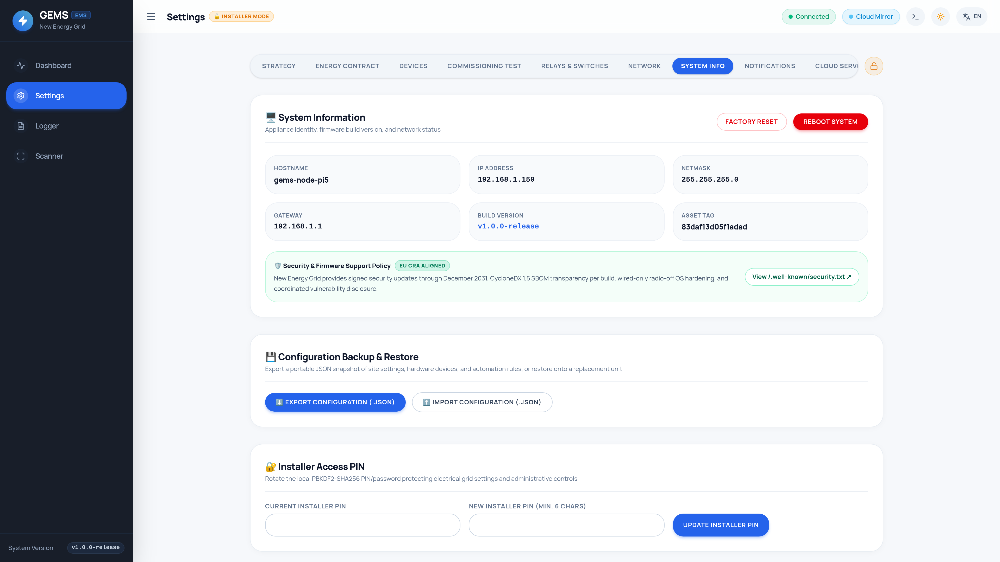
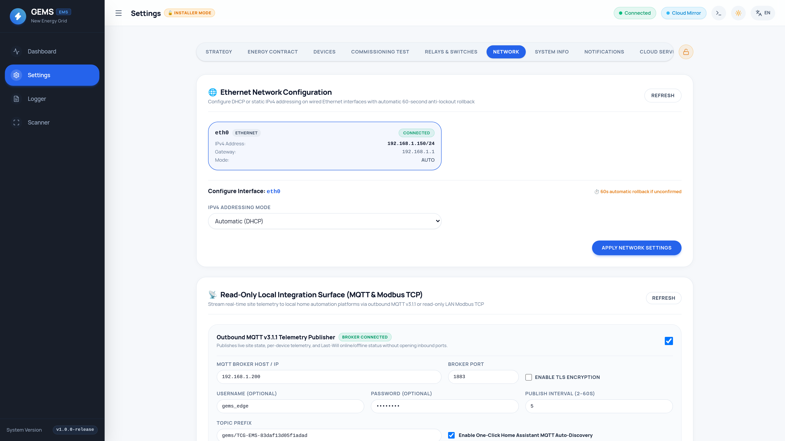

# GEMS: Documentatie Instellingen

> 🌐 **Taal / Langue / Language:** [English](../settings.md) | **Nederlands** | [Français](../fr/settings.md)

Dit document geeft een compleet en gedetailleerd overzicht van alle configuratieparameters binnen GEMS (Grid Energy Management System). Deze instellingen bepalen hoe GEMS uw residentiële of commerciële energie-installatie beheert, optimaliseert en beveiligt.

---

## 1. Site-optimalisatie & Algemene Strategie

Deze groep instellingen bepaalt het kerngedrag van het EMS: hoe het samenwerkt met het elektriciteitsnet, afname en injectie begrenst, en prioriteiten stelt tussen gekoppelde energietoestellen.

| Overzicht Tabblad Strategie | Operationele Strategiemodi |
| :---: | :---: |
|  |  |

* **`country`** & **`region`**
  * **Beschrijving:** Geografisch rechtsgebied (`BE`, `NL`, `DE`, `LU`, `FR`, `AT`, `CH`, `UK`, `ES`, `IT`, `SE`, `DK`) en deelregio (`flanders`, `wallonia`, `brussels`). Dwingt strikte landisolatie af in zowel de gebruikersinterface als de backend-engine: Vlaamse 15-minuten *Capaciteitstarief*-piekbewaking (`capacity_peak_limit_kw`) en *Groenestroomcertificaten* (`gsc_value_eur_mwh`) draaien uitsluitend op `BE` + `flanders`; Belgische Elia hernieuwbare energiemix-synchronisatie, Super-Dal (`01:00–07:00`) en DNB IEC 60870-5-104 telecontrole draaien uitsluitend op `BE`; de Nederlandse modus `netherlands` draait uitsluitend op `NL`; en Duitse `§14a EnWG`-vermogensdimming voor stuurbare verbruikers draait uitsluitend op `DE`.
* **`strategy_mode`**
  * **Beschrijving:** De primaire operationele optimalisatiemodus van het systeem (wordt automatisch gevalideerd tegen het ingestelde `country`/`region`).
  * **Waarden:**
    * `eco`: Geeft maximale voorrang aan eigen zonne-energieverbruik en beperkt netafname (universeel beschikbaar in alle landen).
    * `flanders`: *(Enkel Vlaanderen `BE`)* Activeert voorspellende piekbewaking op basis van het Vlaamse 15-minuten *Capaciteitstarief*, inclusief het Slim Adaptief Plafond.
    * `netherlands`: *(Enkel Nederland `NL`)* Richt zich op per-fase DLB-bewaking voor `3×25A` hoofdzekeringen, vermijden van *terugleverkosten*, minimale rendabele terugleverprijs, actieve omvormer-terugregeling bij negatieve prijzen en EPEX NL dynamische arbitrage.
* **`capacity_peak_limit_kw`**
  * **Beschrijving:** *(Enkel Vlaanderen `BE`)* Het basisdoel voor het gemiddelde 15-minuten netafnameplafond (bijv. `2.5` kW). Wordt buiten Vlaanderen automatisch uitgeschakeld (`0.0` kW) en verborgen zodat niet-Vlaamse installaties nooit onnodig op een kwartierpiek worden geknepen.
* **`peak_shaving_buffer_w`**
  * **Beschrijving:** Veiligheidsmarge in watt (bijv. 200 W) die van het piekplafond wordt afgetrokken om tijdig te beginnen met terugregelen voordat het kwartierplafond wordt bereikt.
* **`peak_shaving_rampup_w`**
  * **Beschrijving:** Vermogenshysterese in watt (standaard `500` W) die beschikbaar moet komen voordat geknepen EV-laadpalen weer opschalen of de batterij-ontlading afneemt.
* **`active_inverter_curtailment`**
  * **Beschrijving:** Geeft het EMS toestemming om het actieve uitgangsvermogen van zonne-omvormers via Modbus-registers terug te regelen tot het eigen woningverbruik wanneer de netto terugleververgoeding negatief en onrendabel is. Beschikbaar in alle strategiemodi.
* **`min_profitable_export_price`**
  * **Beschrijving:** Basisdrempel voor rendabele teruglevering (€/kWh). Injectie naar het net is toegestaan zolang de realtime vergoeding groter of gelijk is aan deze drempel min eventuele GSC-compensatie. Daaronder wordt overschot opgeslagen in batterij/EV, en worden omvormers teruggeregeld zodra de opslag vol is.
* **`gsc_value_eur_mwh`**
  * **Beschrijving:** Gegarandeerde waarde van Vlaamse/Belgische Groenestroomcertificaten (GSC) in € per certificaat of €/MWh (bijv. 250, 350, 450). Zonneproductie en injectie blijven rendabel bij negatieve spotprijzen zolang de negatieve prijs niet groter is dan de GSC-waarde. Terugregeling treedt pas op onder `min_profitable_export_price - (gsc_value_eur_mwh / 1000.0)` (bijv. pas bij -251 €/MWh bij een GSC van 250 €/MWh).
* **`battery_grid_charge_strategy`**
  * **Beschrijving:** Bepaalt hoe de thuisbatterij stroom uit het net gebruikt voor opladen en tariefsturing.
  * **Waarden:**
    * `price_only`: Laadt/ontlaadt strikt op basis van EPEX-spotprijsdrempels (`force_charge_below_euro` / `force_discharge_above_euro`).
    * `super_dal_only`: Beperkt netladen tot superdal-uren van het leverancierscontract (bijv. Engie Superdal).
    * `hybrid`: Combineert prijsdrempels met superdal-vensters van de leverancier.
    * `dynamic_forecast`: Berekent een kostenoptimale 24-uurs laad-/ontlaadcurve op basis van Open-Meteo zonneprognoses en het basisverbruik van de woning.
* **`force_charge_below_euro`**
  * **Beschrijving:** Spotprijsdrempel (€/kWh) waaronder de batterij geforceerd vanuit het net wordt opgeladen.
* **`force_discharge_above_euro`**
  * **Beschrijving:** Spotprijsdrempel (€/kWh) waarboven de batterij naar het net mag ontladen tijdens piektarieven.
* **`smart_ev_cheapest_hours`**
  * **Beschrijving:** Selecteert automatisch het opgegeven aantal goedkoopste uren van de dag (bijv. 3) om uw elektrische wagen op te laden.
* **`grid_nominal_current_a`**
  * **Beschrijving:** De nominale stroomsterkte van uw hoofdzekering in ampère (bijv. 25, 32, 40). GEMS knijpt laadpalen dynamisch om het uitvallen van de hoofdzekering te voorkomen.
* **`phase_limit_amps`**
  * **Beschrijving:** De maximaal toegestane stroom per individuele fase ($L_1, L_2, L_3$) voor fasebewuste load balancing.
* **`grid_system`**
  * **Beschrijving:** Fysieke elektrische netaansluiting van het pand.
  * **Waarden:** `single_phase_230v`, `three_phase_400v` (3×400V + N), of `three_phase_230v_delta` (Belgisch 3×230V zonder nulgeleider).
* **`allowed_grid_import_kw`**
  * **Beschrijving:** Continue harde bovengrens op het afnamevermogen uit het net in kW.
* **`allowed_grid_export_kw`**
  * **Beschrijving:** Continue harde bovengrens op teruglevering aan het net in kW (stel in op `0.0` voor strikte zero-export).

---

## 2. Systeeminformatie en Locatie

Instellingen voor de fysieke locatie, tijdsynchronisatie en algemene systeemdiagnose.

* **`timezone`**
  * **Beschrijving:** Tijdzone van de installatie (bijv. `Europe/Brussels`, `Europe/Amsterdam`), essentieel voor exacte synchronisatie van day-ahead prijzen en kwartiergrenzen.
* **`address`**
  * **Beschrijving:** Straatadres van de installatie.
* **`latitude`** & **`longitude`**
  * **Beschrijving:** GPS-coördinaten automatisch bepaald via OpenStreetMap Nominatim-geocodering, gebruikt voor Open-Meteo zonnestralingsprognoses.
* **`log_level`**
  * **Beschrijving:** Bepaalt het detailniveau van diagnostische systeemlogboeken (`INFO`, `DEBUG`, `WARN`, `ERROR`).
* **`language`**
  * **Beschrijving:** Taal van de gebruikersinterface (`nl`, `fr`, `en`).
* **`commissioning_completed`**
  * **Beschrijving:** Houdt bij of de begeleide 5-staps **Inbedrijfstellingswizard** is afgerond. Installateurs kunnen de wizard op elk moment opnieuw openen via **Instellingen &rarr; Systeeminformatie**.
* **Installateurs-toegangscode & Overzichtelijke Gebruikersmodus (`Instellingen -> Systeeminformatie`)**
  * **Beschrijving:** In de dagelijkse **Normale Modus** (vergrendeld) toont **Instellingen** een overzichtelijk scherm met **Verbonden Toestellen** (inclusief live **Debug**-diagnose en verzending van templaterapporten met één klik naar **GRID-EMS-SERVER**) en **Systeeminformatie** (inclusief **Systeem herstarten** en cryptografisch geverifieerde **Software-update**), naast het live **Dashboard**, de keuzeknop voor de **EV-laadmodus** en het alleen-lezen **Logboek**. Technische en beheerdersfuncties — zoals de Netwerkscanner, de snelkoppeling naar de Cockpit Terminal (`:9090`), de tabbladen Strategie/Energiecontract/Relais & Schakelaars/Netwerk/Meldingen/Cloudserver, het toevoegen/bewerken/verwijderen van toestellen, beheer van Lokale CA & SSL-certificaat, configuratieback-ups en fabrieksinstellingen — blijven afgeschermd tot op het hangsloticoon in de kopbalk van **Instellingen** wordt geklikt en de lokale **Installateurs-PIN/wachtwoord** wordt ingevoerd (ingesteld tijdens Stap 1 van de Inbedrijfstellingswizard en wijzigbaar onder **Instellingen &rarr; Systeeminformatie &rarr; Installateurs-toegangscode**). Hiermee ontgrendelt u de volledige 8-tabbladen tellende **Gecertificeerde installateursmodus** (beveiligd tegen brute-force na 5 foutieve pogingen).
* **Configuratie Back-up, Herstel & Fabrieksinstellingen (Installateursmodus)**
  * **Beschrijving:** Zodra de **Installateursmodus** via het hangsloticoon is ontgrendeld, kunt u een draagbare JSON-back-up exporteren (locatieparameters, toestellen, relaisregels en batterijregels), een back-up atomair terugzetten op vervangende hardware, of een bevestigde reset naar **Fabrieksinstellingen** uitvoeren waarmee lokale telemetrie, toegangsgegevens en toestellen schoon worden gewist.

---

## 2.1 Netwerkconfiguratie van de Controller (`Instellingen -> Netwerk`)

* **Bekabeld Ethernetbeheer:** Schakel bekabelde Ethernet-interfaces (`eth0`) rechtstreeks vanuit de browser zonder SSH tussen **Automatisch (DHCP)** en **Statisch IPv4 (Handmatig)** (`IPv4/CIDR`, `Gateway`, `DNS`). Draadloze (`wlan*`) interfaces zijn uitgesloten om deterministische industriële LAN-betrouwbaarheid te garanderen.
* **Automatische 60-seconden Terugvalbeveiliging:** Bij het toepassen van nieuwe netwerkinstellingen start een veiligheidstimer van 60 seconden. Als u niet binnen de afteltijd op **Bevestigen & behouden** klikt in de browser, zet GEMS NetworkManager automatisch terug naar het vorige werkende IP-profiel om buitensluiting op locatie te voorkomen.

---

## 3. Energiecontract & Regionale Dynamische Tarieven

Configureert uw leveranciersformule om realtime netto afnamekosten en terugleververgoedingen te berekenen.

| Configuratie Energiecontract | 24-uurs Tariefcurve-visualisatie |
| :---: | :---: |
|  |  |

### 3.1 Contracttypes (`contract_type`)
* `vattenfall_dynamic`: **Vattenfall Nederland — FlexPrijs** (Nederland EPEX Spot NL `1,00×` doorgifte + `€ 0,0211/kWh` inkoopvergoeding, `€ 95,40/jr` vastrecht, `€ 0,1316/kWh` Nederlandse *Energiebelasting*, `21%` btw en `1,00×` EPEX Spot NL terugleververgoeding).
* `eneco_dynamic`: Eneco Dynamisch (Nederland / België).
* `frank_energie_dynamic`: Frank Energie Dynamisch (NL / BE).
* `totalenergies_dynamic`: TotalEnergies Pixel Dynamic (België EPEX Spot BE doorgifte).
* `mega_dynamic`: Mega Smart / Cosy Dynamic (België).
* `bolt_dynamic`: Bolt Dynamisch (België 100% lokaal groene doorgifte).
* `engie_dynamic`: Engie Dynamic Day-Ahead (België).
* `engie_flextime`: Engie Flextime Time-of-Use tariefstructuur (België).
* `luminus_dynamic`: Luminus Dynamic (België).
* `ecopower_dynamic`: Ecopower Dynamisch (België).
* `dats24_dynamic`: Dats 24 Dynamisch (België).
* `octa_dynamic`: Octa+ Dynamic (België).
* `trevion_dynamic`: Trevion Dynamisch (België).
* `aspiravi_dynamic`: Aspiravi Dynamisch (België).
* `belgian_dual_tariff`: Belgisch Vast Tweevoudig Uurtarief (Piek/Dal + 6% btw).
* `fixed`: Generiek Vast Tarief.
* `dynamic`: Generiek EPEX Dynamisch Tarief.
* `enovos_dynamic`: Enovos Dynamic (Luxemburg).

### 3.2 Parameters Dynamische Tariefformule
Voor Belgische en Nederlandse dynamische contracten wordt de effectieve afnameprijs berekend als:
$$\text{Prijs}_{\text{afname}} = \left( (\text{EPEX} \times \text{Multiplier}) + \text{Markup} + \frac{\text{BaseFee}}{8760} + \text{DNO}_{\text{tax}} \right) \times (1 + \text{VAT})$$

En de dynamische terugleververgoeding voor zonne-energie:
$$\text{Prijs}_{\text{injectie}} = (\text{EPEX} \times \text{InjectMultiplier}) - \text{InjectMarkup}$$

* **`tax_kwh`**: Distributienettarieven en wettelijke energieheffingen per verbruikte kWh (bijv. `0.1316` €/kWh Nederlandse *Energiebelasting*, `0.0204` €/kWh voor Fluvius Vlaanderen, `0.0950` €/kWh voor ORES Wallonië).
* **`vat_rate`**: Btw-tarief ingevoerd als decimaal getal (bijv. `0.21` voor 21% btw in Nederland, `0.06` voor 6% residentiële btw in België).
* **Leveranciersfactoren & Opslagen**: Specifieke parameters per energieleverancier (bijv. `vattenfall_multiplier`, `vattenfall_markup`, `vattenfall_base_fee`, `vattenfall_inject_multiplier`, `vattenfall_inject_markup`, `totalenergies_multiplier`, `totalenergies_markup`, `totalenergies_base_fee`, `totalenergies_inject_multiplier`, `totalenergies_inject_markup`).

---

## 4. Aangepaste Tijdschema's & Optimalisatie

Handmatige tijdvensters en geplande laadmogelijkheden.

* **`custom_charge_schedule`**
  * **Beschrijving:** Een JSON-reeks met geforceerde batterijlaadvensters inclusief starttijd, eindtijd en gewenste laadtoestand (SOC), bijv. `[{"start":"02:00","end":"05:00","target_soc":90}]`.
* **`superdal_optimization_enabled`**
  * **Beschrijving:** Schakelt doel-SOC-optimalisatie tijdens superdal-uren van de leverancier in (zoals Engie Superdal).
* **`superdal_target_soc`**
  * **Beschrijving:** Gewenste laadtoestand (SOC %) aan het einde van het superdal-venster.
* **`home_base_load_w`**
  * **Beschrijving:** Gemiddeld sluimer-/basisverbruik van de woning (watt), gebruikt door de dynamische prognose-oplosser om de ontlaadsnelheid te voorspellen.

---

## 5. Software-update & Diagnose op Afstand

Configuratie voor geautomatiseerde OTA-updates, cryptografisch geverifieerde `.deb`-pakketuploads en versiebeheer.

* **Ondertekende Software-updates (OTA & Handmatige `.deb`-upload)**
  * **Beschrijving:** Rechtstreeks beschikbaar onder **Instellingen &rarr; Systeeminformatie** in zowel de **Normale Modus** als de **Gecertificeerde installateursmodus** (evenals op afstand via **GRID-EMS-SERVER** `OTA_UPDATE`), controleren online OTA-updates en handmatige `.deb`-browseruploads vóór installatie zowel de semantische versievolgorde als de ingebouwde Ed25519 cryptografische handtekening en SHA-256 pakket-hash van New Energy Grid. Geverifieerde pakketten worden geïnstalleerd via een door `systemd` beheerde achtergrondservice (`gems-updater.path` / `gems-updater.service`), die stap-voor-stap voortgangsberichten naar het systeemlogboek streamt alvorens het systeem veilig te herstarten. *(Opmerking: Controllers op versie `v9.35.1`–`v9.36.2` vereisen een eenmalige `.deb`-upgrade via SSH of de Cockpit Webterminal op poort `9090` om de bijgewerkte servicerechten te activeren.)*
* **Systeem Herstarten & Live Toestel-/Templatediagnose**
  * **Beschrijving:** Woningeigenaren en installateurs kunnen de controller veilig herstarten (**Systeem herstarten**) via **Instellingen &rarr; Systeeminformatie** en live **Debug**-tests uitvoeren op geconfigureerde toestellen onder **Instellingen &rarr; Verbonden Toestellen** om meetwaarden te controleren en diagnostische templaterapporten rechtstreeks naar **GRID-EMS-SERVER** te sturen zonder de installateursmodus te hoeven ontgrendelen.
* **`github_token`**
  * **Beschrijving:** Optioneel GitHub Personal Access Token (classic) om IP-rate-limiting te vermijden bij het opvragen van nieuwe GEMS-versies; als een verlopen of ingetrokken token is ingesteld, schakelt GEMS automatisch terug naar onbeveiligde publieke controle zodat updatechecks altijd blijven werken.

---

## 6. Meldingen & Webhook-waarschuwingen

Configuratie voor externe webhook-meldingen en piekwaarschuwingen.

* **`alert_webhook_url`**
  * **Beschrijving:** HTTP(S) Webhook-URL (bijv. Discord, Slack of eigen automatiserings-endpoints) waarnaar GEMS directe meldingen stuurt bij offline toestellen, opeenvolgende uitleesfouten of wanneer de 15-minuten capaciteitspiek 90% van het plafond nadert.
* **`weekly_report_enabled`**
  * **Beschrijving:** Schakelt het automatisch genereren en e-mailen van wekelijkse PDF-energierapporten in of uit.
* **`report_email`**
  * **Beschrijving:** Bestemmingsadres voor geautomatiseerde e-mailrapporten.
* **SMTP-instellingen (`smtp_host`, `smtp_port`, `smtp_username`, `smtp_password`, `smtp_sender`)**
  * **Beschrijving:** Uitgaande mailservergegevens voor het verzenden van energierapporten.

---

## 7. Relais & Schakelaars

Configuratie voor contactoren, SG-Ready warmtepompen en elektrische boilers.

| Beheer Relais & Schakelaars | Relais-automatiseringsregels |
| :---: | :---: |
|  |  |

* **Relais-automatiseringsengine**: Instelbare triggercondities (`excess_solar`, `negative_spot_price`, `time_schedule`), drempelwaarden, minimale in-/uitschakeltijden (`min_run_time`, `min_off_time`) en automatische schakelacties (`turn_on`, `turn_off`).

---

## 9. Opleveringstest & Hardware-aansturingscontrole

Beschikbaar in de **Gecertificeerde installateursmodus** (`Instellingen -> Opleveringstest`) én op afstand via **GRID-EMS-SERVER** (`/installer/device/{id}`), valideert deze interactieve testsuite de volledige communicatie en closed-loop aansturing van **Omvormer**, **Thuisbatterij** en **Laadpaal**:

* **5-Stappen Verificatie per Toestel**: Controleert (1) Configuratie- & Aansturingsgereedheid, (2) Transport- & Busbereikbaarheid (Modbus TCP, RS-485 Serieel, OCPP 1.6-J of Lokale REST), (3) Live Telemetrie & Elektrische Plausibiliteit, (4) Actieve Stuuropdracht & Terugmelding (80% terugregelpuls op omvormer, veilige laad-/ontlaadmodulatie op batterij en 6,0 A stroomsetpoint op EV-laadpaal) en (5) Veilig Herstel naar Autonome Werking.
* **Begeleid Herstel van Aandachtspunten**: Detecteert configuratiefouten of busproblemen (zoals uitgeschakelde omvormer-terugregeling, ontbrekende batterijcapaciteit, laadpaal vergrendeld in `Off`-modus of uitgeschakelde communicatie-automaten) en biedt een directe **Herstellen & Opnieuw Testen**-knop zowel lokaal als vanuit het cloudportaal.
* **Officieel Opleveringscertificaat**: Genereert een downloadbaar A4 PDF-opleveringsrapport (**PDF-Rapport Downloaden**) en een machineleesbaar JSON-verificatiearchief, terwijl de live voortgang stap voor stap naar **GRID-EMS-SERVER** wordt gestreamd.
