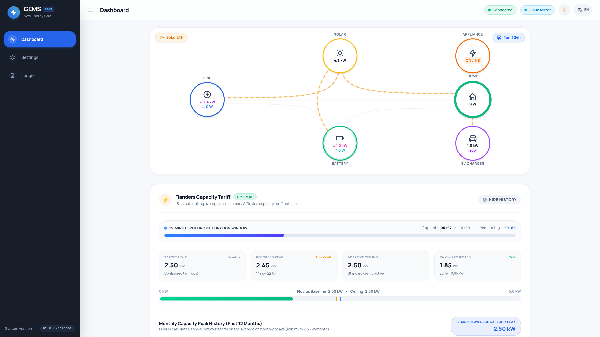
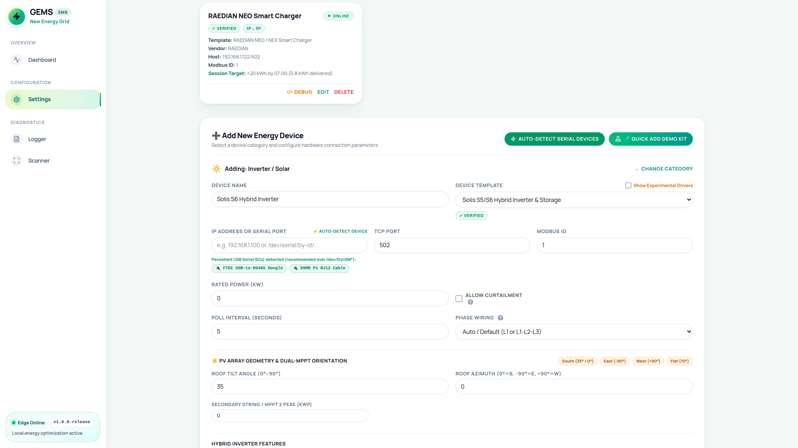
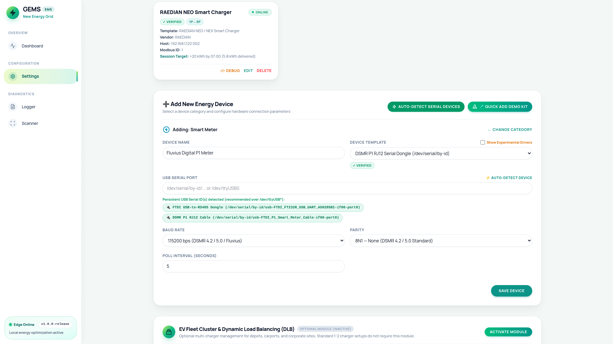
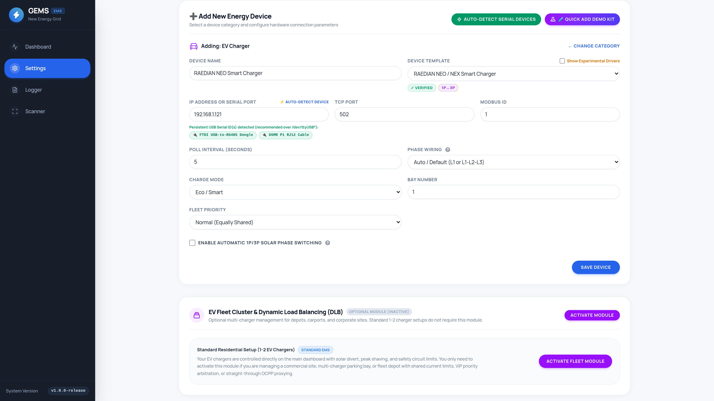
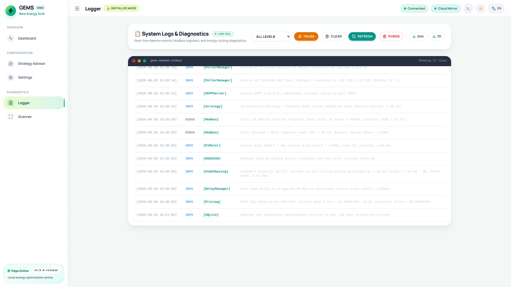

# GEMS Gebruikershandleiding

> 🌐 **Taal / Langue / Language:** [English](../user_manual.md) | **Nederlands** | [Français](../fr/user_manual.md)

Welkom bij de uitgebreide gebruikershandleiding van GEMS (Grid Energy Management System van New Energy Grid). GEMS is een lichtgewicht, uiterst responsief en volledig UI-gestuurd Energy Management System geoptimaliseerd voor energiezuinige edge-hardware zoals de Raspberry Pi. Deze handleiding beschrijft stap voor stap hoe u uw slimme energie-installatie instelt, configureert en optimaliseert.

> [!TIP]
> **Download Officiële Veldhandleidingen (PDF):**
> - 📕 **[GEMS Installateurs- & Inbedrijfstellingshandleiding (PDF)](../../manuals/nl/gems-installer-manual-nl.pdf)** (5.8 MB)
> - 📗 **[GEMS Gebruikershandleiding voor Woningeigenaren (PDF)](../../manuals/nl/gems-user-manual-nl.pdf)** (3.6 MB)
> - ☁️ **[GEMS GRID-EMS-SERVER Verbindingshandleiding (PDF)](../../manuals/nl/gems-server-connection-manual-nl.pdf)** (1.0 MB)
> - 💻 **[Interactief Documentatieportaal](../../manuals/nl/index.html)**

---

## 1. Introductie & Architectuuroverzicht

GEMS vormt het centrale brein van uw energie-ecosysteem en verbindt het elektriciteitsnet, zonnepanelen, thuisbatterij, EV-laadpaal en slimme relais tot één samenwerkend geheel. Door realtime alle vermogensstromen te bewaken en slimme optimalisatiestrategieën toe te passen, verlaagt GEMS uw energiefactuur, verhoogt het uw zelfverbruik en beschermt het uw aansluiting tegen hoge capaciteitstarieven en overbelasting.

### Kernfilosofie
* **Volledig UI-gestuurd:** U hoeft nooit YAML- of tekstbestanden te bewerken. Elk energietoestel en elke optimalisatieregel wordt rechtstreeks vanuit de webinterface geconfigureerd.
* **180 Hardwaretemplates:** Directe ondersteuning voor 174 fysieke toestelprofielen (plus 6 ingebouwde simulatieprofielen) voor zonne-omvormers, thuisbatterijen (BESS), EV-laadpalen (Modbus TCP/RTU, OCPP 1.6-J, REST), digitale P1- & Modbus-meters, lineaire zonneboilers, SG-Ready warmtepompen en slimme relais.
* **Responsieve Architectuur:** Een geoptimaliseerde Go-backend gekoppeld aan een embedded SQLite-database en een moderne Vue 3 SPA levert directe live updates via Server-Sent Events (SSE) en WebSockets.
* **Minimale Opslagslijtage:** Schrijfacties naar de database worden gebufferd en gebatcht met SQLite WAL-modus voor een maximale levensduur van uw SD-kaart of NVMe SSD.
* **Privacy Eerst:** Alle meetgegevens worden lokaal in uw eigen woning of bedrijfspand verwerkt en opgeslagen.

---

## 2. Referentiehardware & Installatie

### Officieel Getest Referentieplatform
* **Systeemcontroller:** Raspberry Pi 5 (4 GB of 8 GB RAM) met officiële 27W USB-C PD-voeding, aluminium behuizing, actieve koeler en M.2 NVMe PCIe HAT/Base.
* **Opslag:** 128 GB+ M.2 2280 NVMe SSD (PCIe Gen 3.0 / Gen 2.0 x4).
* Raadpleeg de [Specificaties Referentiehardware (BOM)](hardware_reference.md) voor alle details en pinbezettingen.

### Installatiemethode A: Snelle M.2 NVMe SSD (Aanbevolen)
Opstarten vanaf een M.2 NVMe SSD levert maximale snelheid en voorkomt elke vorm van SD-kaartslijtage:
1. **Update de Pi 5 Bootloader (eenmalig):** Schrijf met Raspberry Pi Imager *Misc utility images* &rarr; *Bootloader* &rarr; *NVMe/PCIe Boot* naar een MicroSD-kaart. Plaats deze in de Pi 5 en schakel 5 seconden in tot het scherm groen kleurt (`BOOT_ORDER=0xf461`, `PCIE_PROBE=1`).
2. **Flash het GEMS-image:** Schrijf `gems-os-image.img.xz` naar de NVMe SSD.
3. Verwijder de MicroSD-kaart en schakel de stroom in. Het systeem start in minder dan 8 seconden op.
*Zie voor alle stappen en terminalcommando's de [NVMe Opstart- & Probleemoplossingshandleiding](nvme_boot_guide.md).*

### Installatiemethode B: Aangepast OS-image op MicroSD-kaart
1. Download `gems-os-image.img.xz` vanaf de GitHub-releasepagina.
2. Flash het bestand naar een MicroSD-kaart van 8 GB+ met BalenaEtcher of Raspberry Pi Imager.
3. Plaats de kaart in de Raspberry Pi en start op.
4. Open `http://ems.local` (of `https://ems.local:9090` voor de Cockpit-systeemconsole met uw beheerdersgegevens).
5. Bij de eerste keer opstarten opent automatisch de **Inbedrijfstellingswizard**, die u stap voor stap begeleidt bij taal- en locatiekeuze (`NL`, `FR`, `EN`), elektrische netlimieten (hoofdzekering, netaansluiting, Vlaams capaciteitstarief piekplafond), detectie van de slimme meter, toevoegen van omvormer/batterij/laadpaal en het instellen van uw energiecontract.

### Installatiemethode C: Debian-pakket (.deb)
Op een bestaande 64-bit Debian- of Ubuntu ARM64-installatie:
```bash
sudo dpkg -i gems_*_arm64.deb
sudo apt-get install -f
```
De `gems.service` systemd-service start automatisch op poort `8080`.

---

## 3. Dashboard & Realtime Monitoring

| Desktop Energiestroom-dashboard | Mobiele Responsieve Weergave |
| :---: | :---: |
|  |  |

* **Interactief Energiestroomdiagram:** Toont de actieve energieknooppunten (Net, Zon, Batterij, Laadpaal, Woning). Niet-geconfigureerde onderdelen worden automatisch verborgen.
* **Klik-voor-Detail:** Klik op elk knooppunt in het energiestroomdiagram om gedetailleerde lijngrafieken, energiebalansen en tijdsbereiken (Dag, Week, Maand, Jaar) te openen.

| Zonneproductie Historie | Batterij-telemetrievenster |
| :---: | :---: |
|  |  |

| Net Historievenster | EV-laadpaal Venster |
| :---: | :---: |
|  |  |

* **Energieoverzicht & Geschatte GRID-EMS Besparing:** Biedt een dagelijks/maandelijks/jaarlijks overzicht van zonne-opbrengst, netafname/-injectie, zelfvoorzieningsgraad én een kaart **Geschatte GRID-EMS Besparing** die de gerealiseerde besparing in euro's uitsplitst over **Zon-zelfverbruik**, **Batterij & Tariefsturing**, **Slim EV-laden & Terugregeling** en (uitsluitend in Vlaanderen) **Capaciteitspiek-besparing**.
* **Strikte Landspecifieke Weergave:** Vlaamse 15-minuten *Capaciteitstarief*-meters en Belgische Elia groene-energiemix-badges verschijnen uitsluitend op Belgische/Vlaamse locaties, terwijl Nederlandse (`NL`) installaties een zuiver overzicht van `3×25A` fasestromen en *Slim Salderen* tonen zonder buitenlandse tarieftermen.
* **Live Veiligheids- & Statusmeldingen:** Zowel op desktop als mobiel verschijnen duidelijke waarschuwingsbanners zodra de netmeter uitvalt (met veilige terugvalstroom voor EV-laden), de hoofdzekeringsbewaking actief ingrijpt of een energietoestel offline raakt.
* **Afdrukbare PDF-energierapporten:** Exporteer dag-, week-, maand- of jaarrapporten in PDF-formaat (inclusief financiële besparingsspecificatie) rechtstreeks vanuit het Dashboard.

---

## 4. Globale Instellingen & Configuratie

Open **Instellingen** via de navigatiezijbalk (in- of uitklapbaar met de menuknop in de bovenbalk) om locatiebrede regels en energiecontracten in te stellen.

### 4.1 Site-optimalisatie (Strategiemodus)

| Overzicht Strategie-instellingen | Operationele Strategiemodi |
| :---: | :---: |
|  |  |

* **`strategy_mode`**: Bepaalt het primaire regelgedrag van het systeem.
  * **Eco:** Maximaliseert eigen verbruik van zonne-energie. Geeft voorrang aan woningverbruik, thuisbatterij en EV-laden op zonne-overschot vóór injectie naar het net.
  * **Vlaanderen (`flanders`):** Activeert voorspellende piekbewaking voor het Vlaamse *Capaciteitstarief*. Berekent continu het geprojecteerde kwartiergemiddelde en stuurt EV-laadpalen en thuisbatterijen bij om onder `capacity_peak_limit_kw` te blijven.
  * **Nederland (`netherlands`):** Richt zich op `3×25A` hoofdzekeringbewaking per fase, vermijden van *terugleverkosten* en actieve terugregeling van omvormers wanneer `allowed_grid_export_kw` wordt bereikt of de terugleververgoeding negatief is.
* **`capacity_peak_limit_kw`**: Het ingestelde maximale kwartiergemiddelde voor netafname (bijv. `2.5` kW).
* **`peak_shaving_buffer_w`**: Veiligheidsmarge bij het naderen van het piekplafond (bijv. `200` W).
* **`peak_shaving_rampup_w`**: Opschaalstap wanneer weer vrije capaciteit ontstaat (standaard `500` W).
* **Slim Adaptief Plafond**: Past het piekplafond dynamisch aan op de hoogste reeds gemeten 15-minuten piek van de lopende maand, voor maximale laadsnelheid zonder hogere netfactuur.

### 4.2 Batterij-arbitrage & Laadschema's

* **`battery_grid_charge_strategy`**:
  * `price_only`: Laadt op uit het net wanneer de EPEX-spotprijs onder `force_charge_below_euro` zakt.
  * `super_dal_only`: Beperkt netladen tot superdal-vensters van de energieleverancier (bijv. Engie Superdal).
  * `hybrid`: Combineert spotprijsdrempels met superdal-contractvensters.
  * `dynamic_forecast`: Berekent optimale laad-/ontlaadschema's op basis van zonneprognoses en het verbruiksprofiel van de woning.
* **`force_charge_below_euro`**: Spotprijsdrempel (€/kWh) voor geforceerd netladen.
* **`force_discharge_above_euro`**: Spotprijsdrempel (€/kWh) waarboven batterij-injectie naar het net wordt toegestaan.

### 4.3 Energiecontracten & 24-uurs Tariefcurve

| Configuratie Energiecontract | 24-uurs Tariefcurve-visualisatie |
| :---: | :---: |
|  |  |

* **`contract_type`**: Ingebouwde profielen voor Nederlandse dynamische contracten (**Vattenfall Nederland — FlexPrijs, Eneco Dynamisch, Frank Energie Dynamisch**), Belgische dynamische contracten (**TotalEnergies Pixel Dynamic, Mega Smart/Cosy Dynamic, Bolt Dynamisch, Engie Dynamic / Flextime, Luminus Dynamic, Ecopower, Dats 24, Octa+, Trevion, Aspiravi**), Belgisch Tweevoudig Tarief (Piek/Dal + 6% btw), Enovos Dynamic (Luxemburg) en generieke vaste/dynamische tarieven.
* **Netbeheerder- & Belastingprofielen**: Ingebouwde regionale presets voor Nederlandse *Energiebelasting* (`€ 0,1316/kWh` + 21% btw), Fluvius (Vlaanderen), ORES (Wallonië), RESA (Luik) en SIBELGA (Brussel).
* **Live 24-uurs Tariefvisualisatie**: Gestapelde uurprijscurve met kale EPEX-spotprijs, leveranciersopslag, netbeheer-/belastingcomponent, btw (`6%` BE / `21%` NL), dynamische terugleververgoeding en waarschuwingen bij negatieve prijzen.

---

## 5. Toestelbeheer & Stapsgewijze Inbedrijfstelling

GEMS bevat **174 ingebouwde fysieke hardwaretemplates** (plus 6 simulatieprofielen — **180 in totaal**). Toestellen toevoegen verloopt 100% via de gebruikersinterface.

| Beheer Geconfigureerde Toestellen | Categoriekeuze Nieuw Toestel |
| :---: | :---: |
|  |  |

### Universeel 4-Stappenplan voor Koppeling

1. **Seriële Bus- & Subnetscan:** Klik op **Scanner** in de zijbalk (in de **Gecertificeerde installateursmodus**) om hardware automatisch te vinden:
   * **Seriële poorten scannen:** Detecteert automatisch DSMR / e-MUCS P1-slimme meters en RS-485 Modbus RTU-omvormers, laadpalen en energiemeters op vaste `/dev/serial/by-id/*` USB-adapters en onboard UART-poorten (inclusief baudrate, pariteit en Slave ID), met één klik op **Configureren** en een optionele **Geavanceerde RS-485 busscan**.
   * **Subnet scannen:** Herkent automatisch de GEMS-controller zelf (`THIS GEMS CONTROLLER`) en identificeert netwerktoestellen op IP-adres, hostnaam (mDNS/UPnP/NetBIOS), 24/28/36-bit IEEE MAC OUI-fabrikantcodes en open energiepoorten (`502`, `80/443`, `8080`, `8887`) voor onder meer Solis, RAEDIAN en Shelly.

   

2. **Hardware Voorbereiden:**
   * **Modbus-omvormers:** Schakel Modbus TCP of RS-485 Modbus RTU in via de dongle of het menu van uw omvormer (bijv. Solis S5/S6 Hybride, SMA Speedwire / SunSpec, SolarEdge SetApp poort 1502).
   * **EV-laadpalen:** Schakel Modbus TCP / RTU in op uw laadpaal (aanbevolen voor sub-seconde regeling & behoud van externe CPO-afrekening, bijv. RAEDIAN NEO / NEX / Gemini), of stel de OCPP Central System-URL in de laadpaal-app in op `ws://<GEMS-IP>:8887/<ChargePointID>`.
   * **Lokale REST-meters & Relais:** Activeer de *Lokale API* op netwerk-P1-meters of Gen2 RPC op Shelly-modules.
   * **Seriële P1- & RS485-kabels:** Sluit de RJ12- / USB-RS485-kabels aan op de Raspberry Pi en klik op **Seriële toestellen detecteren** (of kies de voorgestelde `/dev/serial/by-id/*`-knop) zodat poortnamen nooit wisselen na een herstart.

3. **Toestel Toevoegen in de UI:** Ga naar **Instellingen &rarr; Toestellen** (ontgrendel eerst de **Installateursmodus** via het hangsloticoon bovenaan) en klik op **Nieuw energietoestel toevoegen**. Standaard worden alle **Geverifieerde** commerciële templates getoond; schakel **Experimentele drivers tonen** in wanneer u **Experimentele** of **Enkel uitlezing**-templates wilt weergeven. Onderaan de toestellenpagina vindt u tevens de module **EV-Laadcluster & Dynamic Load Balancing (DLB)**. Kies de categorie, selecteer de hardwaretemplate, vul de verbindingsparameters in en klik op **Opslaan**.

| Instellen Modbus-omvormer | Instellen Slimme Meter P1 | Instellen EV-laadpaal |
| :---: | :---: | :---: |
|  |  |  |

4. **Status Controleren:** Controleer dat de toestelkaart op <span style="color:#10b981; font-weight:bold;">● Online</span> springt en verifieer de live vermogens op het Dashboard.

---

### 5.1 Zonne- & Hybride Omvormers (40+ Templates)

| Template | Merk & Serie | Protocol | Standaardpoort | Slave ID | Terugregeling & Batterijsturing |
| :--- | :--- | :--- | :--- | :--- | :--- |
| `solis_hybrid` / `solis_inverter` | **Solis Hybride (S5 / S6 1- & 3-fasig)** *(Primair Referentieplatform)* | Modbus TCP | `502` / `8899` | `1` | Ja (Geverifieerd) |
| `solis_retrofit` | **Solis Retrofit Omvormer (RAI / S6-EA1P AC-opslag)** *(Primair Referentieplatform)* | Modbus TCP | `502` / `8899` | `1` | Ja (Geverifieerd) |
| `huawei_inverter` | Huawei SUN2000 (L1/M1/M2/M3/MB0 + LUNA2000) | Modbus TCP | `502` | `1` (of `2`) | Ja (Geverifieerd) |
| `sma_inverter` | SMA Sunny Boy / Tripower / Storage | Modbus TCP | `502` | `126` (of `3`) | Ja (Geverifieerd) |
| `fronius_inverter` | Fronius Gen24 Plus / Symo / Primo | Modbus TCP SunSpec | `502` | `1` | Ja (M123 + M124 StorCtl) |
| `solaredge_inverter` / `solaredge_3phase` | SolarEdge 1- & 3-fasig (SetApp + StorEdge) | Modbus TCP SunSpec | `1502` (of `502`) | `1` | Ja (Limiet + Remote Storage) |
| `sungrow_inverter` | Sungrow Hybride (SH5.0 - SH10RT / SH25T) | Modbus TCP | `502` | `1` | Ja (Terugregeling + EMS Forced) |
| `victron_inverter` | Victron Cerbo GX / MultiPlus-II / Venus OS | Modbus TCP | `502` | `100` / `228` | Ja (ESS Grid Setpoint + PV-limiet) |
| `goodwe_inverter` | GoodWe Hybride (ET / EH / BT / BH) | Modbus TCP | `502` / `8899` | `247` | Ja (EMS Power Mode + Terugregeling) |
| `growatt_inverter` | Growatt (SPH / MIN / MOD / MID) | Modbus TCP | `502` | `1` | Ja (Active Rate + EMS Tijdslot) |
| `solax_inverter` | SolaX Hybride (X1 / X3 Gen 3/4) | Modbus TCP | `502` | `1` | Ja (Modbus Remote Control) |
| `sofarsolar_hybrid` | SofarSolar (HYD / G3 / AMASS) | Modbus TCP | `8899` / `502` | `1` | Ja (Passieve modus + Exportlimiet) |
| `deye_inverter` | Deye / Sunsynk Hybride Omvormers | Modbus TCP | `502` / `8899` | `1` | Ja (Sell Power + Remote Charge) |
| `foxess_inverter` | FoxESS Hybride (H1 / H3 / H3-Pro / AC1) | Modbus TCP | `502` | `1` / `247` | Ja (Work Mode + Laden/Ontladen) |
| `sigenergy_hybrid` | Sigenergy SigenStor (5-in-1 ESS) | Modbus TCP | `502` | `1` | Ja (Plant Remote EMS Control) |
| `kostal_plenticore` | KOSTAL Plenticore plus / G2 / G3 & BI | Modbus TCP SunSpec | `1502` | `71` | Ja (Batterij Laden/Ontladen + Limiet) |
| `fenecon_fems` | FENECON Home 10/20/30 (FEMS / OpenEMS) | Modbus TCP | `502` | `1` | Ja (ESS Actief Vermogen + PV-limiet) |
| `hoymiles_dtu` / `apsystems_ez1` | Hoymiles DTU-Pro-S & APsystems EZ1-M Micro-omvormers | Modbus TCP / Lokale REST | `502` / `8050` | `1` / — | Ja (Dynamische vermogenslimiet) |
| `enerlution_inverter` | Enerlution Hybride Omvormer | Modbus TCP | `502` | `1` | Ja |
| `alpha_ess_inverter` | Alpha ESS Storion (SMILE5 / SMILE-T10 / G3) | Modbus TCP | `502` / `8502` | `85` | Ja (Dispatch Mode) |
| `anker_inverter` | Anker SOLIX X1 Hybride | Modbus TCP | `502` | `1` | Ja |
| `abb_fimer_inverter` | ABB / Fimer Solar & Hybride (UNO-DM/REACT 2) | Modbus SunSpec | `502` | `1` | Ja (M123 + M124 StorCtl) |
| `autarco_inverter` | Autarco SX / MX / LX-serie Omvormers | Modbus TCP | `502` | `1` | Ja |
| `chisage_ess` | Chisage ESS Hybride Omvormers (3kW–50kW) | Modbus TCP | `502` | `1` | Enkel uitlezing (Experimenteel) |
| `delta_inverter` | Delta M6A / M8A / M10A / RPI-serie | Modbus SunSpec | `502` | `1` | Ja (SunSpec M123) |
| `hyxipower_inverter` | HYXiPOWER Residentiële & C&I Omvormers | Modbus TCP | `502` | `1` | Enkel uitlezing (Experimenteel) |
| `kstar_inverter` | KSTAR BluE-serie Hybride Omvormers | Modbus TCP | `502` | `1` | Ja |
| `saj_hybrid` / `senergy_inverter` | SAJ H1/H2/R5 & Senergy SE Hybride-serie | Modbus TCP | `502` | `1` | Ja |
| `afore_inverter` / `marstek_storage` | Afore AF/BNT Hybride & Marstek Venus AC BESS | Modbus TCP | `502` | `1` | Ja |
| `solinteg_inverter` | Solinteg Integ M OHT/OMT-serie (3kW–50kW) | Modbus TCP | `502` | `1` | Ja |
| `solplanet_inverter` | Solplanet / AISWEI 1- & 3-fasig | Modbus TCP | `502` | `1` | Ja |
| `lg_ess` | LG ESS Home (8 / 10 / 15) | Modbus TCP / REST | `502` / `443` | `1` | Ja |
| `enphase_envoy` | Enphase IQ Gateway / Envoy-S Metered (D5 / D7 / D8) | Lokale HTTPS / REST (Auto-JWT) | `443` / `80` | — | Enkel uitlezing (Auto Local JWT + 3F V/I) |

---

### 5.2 EV-laadpalen & Wallboxen (60+ Templates)

#### Modbus TCP / RS485 EV-laadpalen (Aanbevolen & Voorkeursoptie)
**Modbus TCP / RS485 heeft de voorkeur voor het aansturen van EV-laadpalen**:
* **Sub-seconde Regeling:** Directe register-writes passen de laadstroom onmiddellijk aan (6 A tot 32 A), cruciaal voor het Vlaamse capaciteitstarief en snel reageren op bewolking.
* **Behoud van Externe CPO-afrekening:** Is uw laadpaal via OCPP gekoppeld aan een werkgeversvergoedingsdienst of extern CPO-platform, dan regelt GEMS het vermogen lokaal via Modbus TCP *zonder uw zakelijke laadsessie of cloudverbinding te verstoren*.
* **Ondersteunde Modellen:**
  * **RAEDIAN NEO / NEX AC Wallbox:** Template `raedian_charger`, Poort `502`, Slave ID `1` (dynamische stroom + 1F/3F omschakeling).
  * **RAEDIAN Gemini Dual AC Wallbox:** Template `raedian_gemini`, Poort `502`, Slave ID `1` (dubbele aansluiting en dynamische 0–64A load balancing).
  * **SolaX Smart EV Charger G2:** Template `solax_evcharger`, Poort `502`, Slave ID `1` (0,01 A resolutie + 1F/3F omschakeling).
  * **KEBA KeContact P30 / P40:** Template `keba_charger`, Poort `502`, Slave ID `255` (1 mA nauwkeurigheid + S10 fase-omschakeling).
  * **Mennekes AMTRON Xtra / Charge Control / 4You:** Template `mennekes_modbus`, Poort `502`, Slave ID `1`.
  * **Heidelberg Energy Control / Amperfied connect.home:** Template `heidelberg_ampere`, Poort `502` of RS485, Slave ID `1`.
  * **Sungrow AC011E-01 / AC22E-01 & FoxESS Wallbox:** Templates `sungrow_evcharger`, `foxess_evcharger`, Poort `502`, Slave ID `1` / `247`.
  * **Vestel EVC04 Home / Smart Wallbox:** Template `vestel_evc04`, Poort `502`, Slave ID `255`.
  * **Webasto Next / Live:** Template `webasto_charger`, Poort `502`, Slave ID `1`.
  * **ABB Terra AC Wallbox:** Template `abb_charger`, Poort `502`, Slave ID `1`.
  * **Alfen Eve Single / Double Pro-Line:** Template `alfen_charger`, Poort `502`, Slave ID `1` (inclusief 1F/3F omschakeling).
  * **Peblar Home / Business EV Charger:** Template `peblar_charger`, Poort `502`, Slave ID `1` (inclusief 1F/3F omschakeling).
  * **Phoenix Contact EV-CC / CHARX / Veton:** Template `phoenix_contact_evcc` / `phoenix_charger` / `veton_charger`, Poort `502`, Slave ID `1`.
  * **GoodWe HCA Wallbox / Sigenergy SigenStor EVAC:** Template `goodwe_charger` / `sigenergy_evac`.
  * **SolarEdge Home EVSE:** Template `solaredge_evse`, Poort `502`, Slave ID `1`.

#### Ingebouwde OCPP 1.6-J EV-laadpalen (Direct & Proxy)
Voor laadpalen zonder Modbus TCP of zelfstandige residentiële installaties zonder externe CPO-afrekening:
* Stel de Central System-URL in uw laadpaal-app of webinterface in op:
  ```
  ws://<GEMS-IP>:8080/api/ocpp/<ChargePointID>
  ```
* **Ondersteunde Modellen:** Huawei FusionCharge (SCharger-7KS/22KT), Kempower Movable/Station/Satellite (`kempower_charger`), Wallbox Pulsar Plus / Commander (`wallbox_ocpp`), Teltonika TeltoCharge (`teltonika_teltocharge`), EVBox (Elvi/Livo/BusinessLine), Mennekes AMTRON (4You/4Business/ACU), Schneider Electric EVlink (Wallbox/Pro AC), Siemens VersiCharge GEN3, Elli / VW / Skoda / SEAT (ID. Charger Connect/Pro), Alpitronic Hypercharger, Autel MaxiCharger, Hager witty, BMW Wallbox Plus, Mercedes-Benz Wallbox, Porsche Wallbox, Fronius Wattpilot.
* **In de GEMS UI:** Kies EV-laadpaal &rarr; Selecteer Template: `OCPP Charger` (`ocpp_charger`) &rarr; Voer uw `ChargePointID` in (bijv. `WALLBOX-01`).

#### Lokale REST- & Cloud-API EV-laadpalen
* **go-e Charger Gemini / HOMEfix / PRO:** Template `goe_charger`, Lokale HTTP REST v2 Poort `80` (RAM-veilige stroomsturing & 1F/3F omschakeling).
* **WARP Charger 2 / 3 (Tinkerforge):** Template `warp_charger`, Lokale HTTP API Poort `80` (stroomregeling & 1F/3F omschakeling).
* **openWB Pro:** Template `openwb_pro`, Lokale HTTP `connect.php` API Poort `80` (0,1 A stroomsturing & 1F/3F omschakeling).
* **cFos Power Brain Solar / Wallbox:** Template `cfos_powerbrain`, Lokale HTTP JSON API Poort `80` (0,1 A stroomsturing & faserelais).
* **MyEnergi Zappi v2 / v2.1:** Template `myenergi_zappi`, Lokale Hub/Cloud Digest API (stroomsturing & Fast/Eco+/Stop).
* **Easee Home / Charge / Charge Lite:** Template `easee_charger`, Officiële Cloud API (`dynamicChargerCurrent` & 1F/3F `phaseMode`).
* **Zaptec Go / Pro:** Template `zaptec_charger`, Officiële OAuth2 Cloud API (`availableCurrentPhase1..3` & 1F/3F omschakeling).
* **Wallbox Pulsar Plus / Copper SB / Commander 2:** Template `wallbox_charger`, Officiële Cloud REST API (`max_charging_current` & pauze/hervatten).
* **Volt Time Source / Source Pro:** Template `volttime_source`, Officiële Cloud v2 API.
* **SmartEVSE v2 / v3 & Generic Local REST EVSE Gateway:** Templates `smartevse_charger`, `generic_rest_evse`, Poort `80`.

---

### 5.3 Net- & Slimme Energiemeters (40 Templates)

* **P1 Slimme Meter (USB / Serieel):** Template `p1_serial`. Seriële poort `/dev/serial/by-id/...` (of `/dev/ttyUSB0`), Baudrate `115200` (DSMR 4/5) of `9600` (DSMR 2/3). Steek de RJ12-stekker in de digitale meter en de USB-stekker in de Raspberry Pi.
* **P1 Slimme Meter (Netwerk / TCP-bridge):** Template `p1_network`. Host-IP en Poort (bijv. `23`, `8088`, `8234`).
* **HomeWizard Wi-Fi P1 Meter:** Template `homewizard_meter`. Host-IP, Poort `80` (activeer *Lokale API* in de HomeWizard Energy-app).
* **KOSTAL Smart Energy Meter (KSEM G1 / G2):** Template `kostal_ksem`. Modbus TCP Poort `502`, Slave ID `71` (SunSpec + float-registers).
* **Huawei EMMA-A02 Energy Management Assistant:** Template `huawei_emma`. Modbus TCP Poort `502`, Slave ID `1`.
* **Fronius Smart Meter IP / TS:** Template `fronius_smartmeter_ip`. Lokale Solar API v1 HTTP JSON op Poort `80`.
* **Tasmota SML / OBIS Optische IR-lezer:** Template `tasmota_sml`. Lokale HTTP `Status 10` JSON API op Poort `80`.
* **YouLess LS120 Puls- & P1-meter / Homey Energy Dongle:** Templates `youless_ls120`, `homey_p1`.
* **Chint DTSU666 / DTSU666-H 3-Fasemeter:** Template `chint_dtsu666`. Modbus TCP Poort `502`, Slave ID `1`.
* **Shelly 3EM / Pro 3EM / Gen3 3EM-63T:** Templates `shelly_3em`, `shelly_pro_3em`. Host-IP, Poort `80`.
* **Eastron SDM120 / SDM230 / SDM630 / SDM72D / SMART X96:** Templates `eastron_sdm120_230`, `eastron_sdm630`, `eastron_sdm72_x96`. Modbus TCP Poort `502`, Slave ID `1`.
* **Carlo Gavazzi EM112 / EM340 / EM540 / EM24:** Templates `carlogavazzi_em340`, `carlogavazzi_em24`. Modbus TCP Poort `502`, Slave ID `1`.
* **ABB A43 / A44 / B23 / B24, Schneider Acti9 iEM3000, Siemens SENTRON PAC2200, SMA Energy Meter 2.0, Socomec COUNTIS/DIRIS, WAGO 879, Accuenergy Acuvim/AcuRev, Algodue UPM, Hager ECR/ECM, Janitza UMG, Kamstrup OMNIPOWER/382, Landis+Gyr E350/E360/E650, Phoenix Contact EMpro, Weidmüller EM500/EM600, Eltako, Finder, Inepro, Lovato, Acrel, ESPHome, Loxone Miniserver, Niko Home Control.**

---

### 5.4 Slimme Relais, Zonneboilers & SG-Ready Warmtepompen (12 Templates)

| Beheer Relais & Schakelaars | Relais-automatiseringsregels |
| :---: | :---: |
|  |  |

* **my-PV AC•THOR / AC•THOR 9s / AC ELWA 2 Lineaire PV-diverter:** Template `mypv_acthor`. Modbus TCP Poort `502`. Traploze sturing van zonne-overschot op 1 Watt nauwkeurig (`0–9000 W`) en warmwater-doeltemperatuur.
* **Askoma ASKOHEAT+ Modbus TCP PV-weerstand:** Template `askoheat_diverter`. Modbus TCP Poort `502`.
* **Stiebel Eltron / Tecalor ISG web / ISG plus Warmtepomp:** Template `stiebel_eltron_isg`. Modbus TCP Poort `502`. Directe SG-Ready bedrijfsstandsturing en verhoging van tapwatercomfort.
* **NIBE S-serie Warmtepomp (S1155 / S1255 / S2125 / VVM S320):** Template `nibe_heatpump`. Modbus TCP Poort `502`. Smart Price Adaption / SG-Ready boost en warmwatervraag.
* **Daikin Altherma 3 / HomeHub (MMI-2):** Template `daikin_altherma`. Modbus TCP Poort `502`. Smart Grid gratis-energie-boost, vermogenslimiet en boiler-doeltemperatuur.
* **Tasmota Slimme Stekker / Relais (Nous A1T / Sonoff POW):** Template `tasmota_relay`. Host-IP, Poort `80` (`Power`-schakeling + live `ENERGY`-vermogensmeting).
* **Shelly Plus 1PM / Pro 1PM / Plug S:** Template `shelly_plus_1pm`. Host-IP, Poort `80`. Schakelt SG-Ready boostcontacten en elektrische boilers op basis van zonne-overschot en anti-pendeltimers.
* **Shelly Plus 1 / Pro 1 (Potentiaalvrij Contact):** Template `shelly_plus_1`. Potentiaalvrij schakelen van warmtepompingangen of externe vrijgavesignalen.
* **Shelly Plus 2PM / Pro 2PM (Dubbel Relais & Meter):** Template `shelly_plus_2pm`. Twee onafhankelijke schakelkanalen met actieve vermogensmeting.
* **SG-Ready Warmtepomp Boost:** Template `sgready_heatpump`. Schakelt tussen Stand 2 (Normaal) en Stand 3 (Thermische Boost) tijdens zonne-overschot of negatieve spotprijzen.
* **Modbus Digitale I/O-relaismodule:** Template `modbus_relay`. Industriële contactoraansturing via Modbus RTU/TCP-coils voor zware verbruikers.
* **Generic HTTP Relay:** Template `generic_relay`. Instelbare status- en schakel-URL's voor ESPHome en maatwerkactuatoren.

---

## 6. Systeemdiagnose & Software-updates

| Systeemidentiteit, Netwerk & Versie | Webhook-meldingen & Rapportage |
| :---: | :---: |
|  |  |

* **Realtime Logboek & Toestel-templatediagnose:** Live diagnostische weergave van Modbus-pakketten, registeruitlezingen, OCPP-heartbeats en stuurbeslissingen, aangevuld met directe **Debug**-tests onder **Instellingen &rarr; Verbonden Toestellen** (beschikbaar in Normale Modus) om live meetwaarden te bekijken en diagnostische rapporten met één klik naar **GRID-EMS-SERVER** te verzenden.
* **Cryptografisch Geverifieerde OTA- & Handmatige `.deb`-updates + Herstarten:** Rechtstreeks toegankelijk onder **Instellingen &rarr; Systeeminformatie** in Normale Modus biedt GEMS een bevestigde knop **Systeem herstarten**, automatische controle op officiële releases én handmatige `.deb`-uploads — inclusief controle van de Ed25519-handtekening en SHA-256-hash van New Energy Grid met live voortgangsweergave.



---

## 7. Centraal Cloudplatform & Regionale Intelligentie

### 7.1 GRID-EMS-SERVER Integratie (100% Optioneel)

GEMS werkt volgens een strikte **local-first filosofie**: alle dynamic load balancing, batterijschema's, zonne-sturing en netbeveiligingen draaien volledig autonoom op de lokale Raspberry Pi. Cloudkoppeling is 100% optioneel.

Wilt u of uw installateur de installatie op afstand beheren:
* **Portaal:** `https://ems.newenergygrid.com`
* **Geen Routerconfiguratie Nodig:** Uitsluitend uitgaande TLS 1.3-verbindingen maken port forwarding, dynamische DNS of een vast extern IP-adres overbodig.
* **Eenvoudig Koppelen:** Ga naar **Instellingen &rarr; Cloudserver**, vul het koppelingstoken van 16 tekens in en klik op **Koppelen & Verbinden**.
* **Vlootbeheer & Diagnose:** Bekijk op afstand live energiestromen, ontvang meldingen en pas strategiemodi aan vanaf elke browser of smartphone.

### 7.2 Regionale Intelligentie: Nederland vs. België

GEMS stemt zowel de rekenkern als de gebruikersinterface automatisch af op uw land en energiecontract:
* **🇳🇱 Nederland-modus (`country: 'NL'` / `strategy_mode: 'netherlands'`):**
  * Optimaliseert voor Nederlandse Day-Ahead dynamische energiecontracten op basis van de EPEX Spot NL-prijszone.
  * Neemt automatisch de Nederlandse *Energiebelasting* en leveranciersopslagen op in alle berekeningen.
  * Beschermt tegen *terugleverkosten* en regelt zonne-omvormers terug tijdens negatieve Day-Ahead prijzen.
  * Verbergt automatisch Belgisch-specifieke onderdelen (zoals het Vlaamse Capaciteitstarief en het Elia groene-stroomaandeel).
* **🇧🇪 België / Vlaanderen-modus (`country: 'BE'` / `strategy_mode: 'flanders'`):**
  * Bewaakt het rollende 15-minuten gemiddelde voor het Vlaamse *Capaciteitstarief* om maandelijkse netkosten te minimaliseren.
  * Ondersteunt Belgische dynamische contracten (TotalEnergies, Mega, Bolt, Engie, enz.) via de EPEX Spot BE-prijszone.
  * Bevat de Elia Groene Stroom Sync Boost om EV-laden en thermische opslag te stimuleren wanneer er veel hernieuwbare energie op het Belgische net beschikbaar is.
