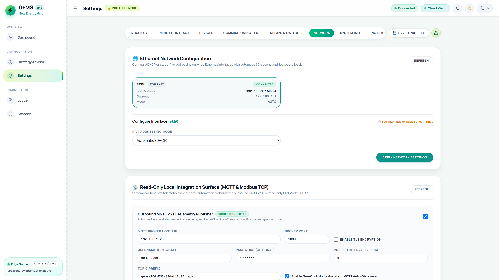
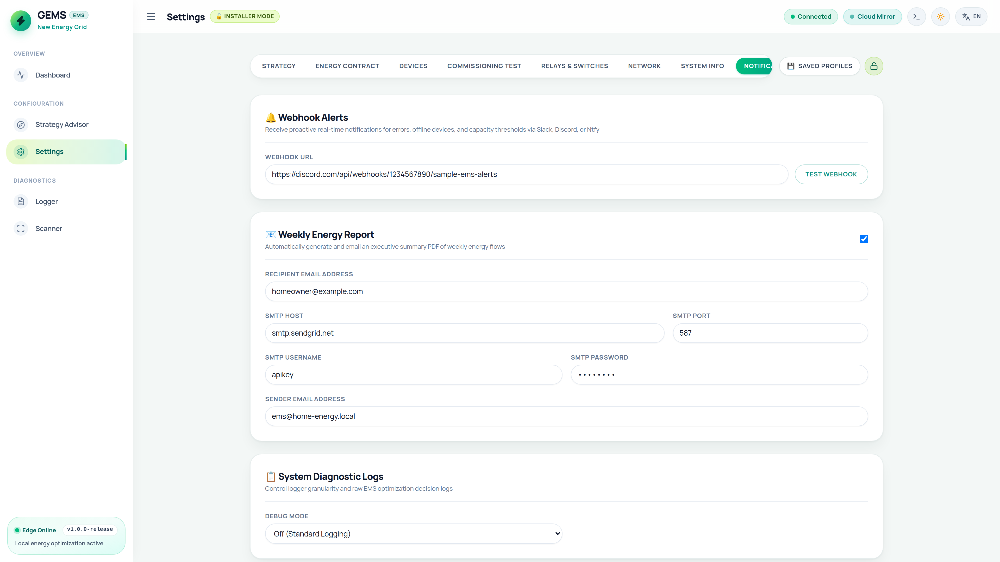
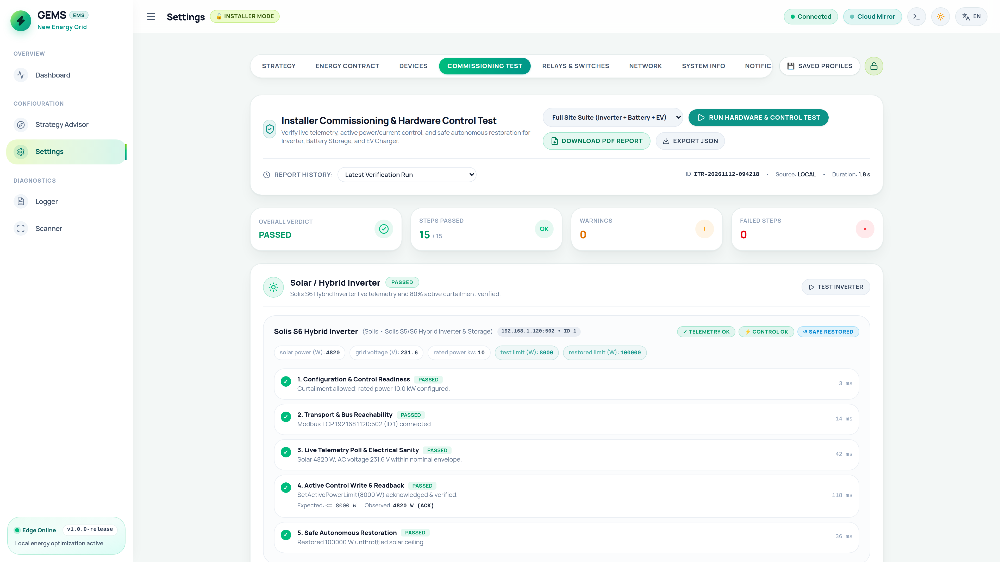

# GEMS: Settings Documentation

> 🌐 **Language / Taal / Langue:** **English** | [Nederlands](nl/settings.md) | [Français](fr/settings.md)

This document provides a comprehensive and detailed explanation of all configuration parameters within GEMS (Grid Energy Management System). These settings govern how GEMS manages, optimizes, and protects your home or commercial energy installation.

---

## 1. Site Optimization & General Strategy

This group of settings defines the core behavior of the EMS, governing how it interacts with the grid, limits import/export, and prioritizes energy distribution among devices.

| Strategy Tab Overview | Operational Strategy Modes |
| :---: | :---: |
|  |  |

* **`country`** & **`region`**
  * **Description:** Geographic jurisdiction (`BE`, `NL`, `DE`, `LU`, `FR`, `AT`, `CH`, `UK`, `ES`, `IT`, `SE`, `DK`) and sub-region (`flanders`, `wallonia`, `brussels`). Enforces strict country isolation across both the UI and backend engine: Flemish *Capaciteitstarief* 15-minute peak shaving (`capacity_peak_limit_kw`) and *Groenestroomcertificaten* (`gsc_value_eur_mwh`) run strictly on `BE` + `flanders`; Belgian Elia renewable sync, Super-Dal (`01:00–07:00`), and DSO IEC 60870-5-104 telecontrol run strictly on `BE`; Dutch `netherlands` mode runs strictly on `NL`; and German `§14a EnWG` controllable-load dimming runs strictly on `DE`.
* **`strategy_mode`**
  * **Description:** The primary operational optimization mode of the system (automatically sanitized to match the configured `country`/`region`).
  * **Values:**
    * `eco`: Prioritizes self-consumption of solar energy and limits reliance on the grid (universal across all countries).
    * `flanders`: *(Flanders `BE` only)* Activates predictive Peak Shaving based on the Flemish 15-minute *Capaciteitstarief* model, capping rolling quarter-hour grid import with Smart Adaptive Ceiling support.
    * `netherlands`: *(Netherlands `NL` only)* Focuses on `3×25A` main-fuse per-phase DLB protection, *terugleverkosten* avoidance, minimum profitable export pricing, active negative-price inverter curtailment, and EPEX NL dynamic arbitrage.
* **`capacity_peak_limit_kw`**
  * **Description:** *(Flanders `BE` only)* The base target 15-minute average grid import ceiling (e.g. `2.5` kW). Automatically disabled (`0.0` kW) and hidden outside Flanders so non-Flemish installations are never artificially throttled by Flemish quarter-hour rules.
* **`peak_shaving_buffer_w`**
  * **Description:** Safety margin in Watts (e.g. 200 W) subtracted from the capacity limit to trigger proactive throttling before breaching the quarter-hour ceiling.
* **`peak_shaving_rampup_w`**
  * **Description:** Power hysteresis step (default `500` W) required before re-accelerating throttled EV chargers or reducing battery discharge when capacity frees up.
* **`active_inverter_curtailment`**
  * **Description:** Allows the EMS to actively throttle solar inverter active power output via Modbus registers to match house load when dynamic market export return is negative and unprofitable. Available across all strategy modes.
* **`min_profitable_export_price`**
  * **Description:** Base threshold for profitable solar export (€/kWh). Export is permitted when real-time return is at or above this threshold minus GSC compensation. When below, excess power is sunk into battery/EV storage, and inverters are curtailed if storage is full. On Dutch (`NL`) installations, setting `min_profitable_export_price >= 99` (e.g. `999` via the **Netherlands Zero Net Export** profile) with `active_inverter_curtailment: true` enforces strict `0 W` net grid injection across both fixed/variable and dynamic contracts.
* **`gsc_value_eur_mwh`**
  * **Description:** Guaranteed value of Flemish/Belgian Groenestroomcertificaten (GSC) in € per certificate or €/MWh (e.g. 250, 350, 450). Solar generation and injection remain profitable during negative spot price hours as long as the negative price does not outweigh the GSC value. Curtailment only activates when the export price drops below `min_profitable_export_price - (gsc_value_eur_mwh / 1000.0)` (e.g. at -251 €/MWh for a 250 €/MWh GSC).
* **`battery_grid_charge_strategy`**
  * **Description:** Controls how the home battery utilizes grid power for charging and arbitrage.
  * **Values:**
    * `price_only`: Charges/discharges based strictly on EPEX spot price thresholds (`force_charge_below_euro` / `force_discharge_above_euro`).
    * `price_and_solar`: Combines Open-Meteo solar headroom protection with strict price-ceiling charging (`force_charge_below_euro`).
    * `super_dal_only`: Restricts grid charging to supplier off-peak contract windows (e.g. Engie Superdal).
    * `hybrid`: Combines price-based threshold charging with supplier off-peak windows.
    * `dynamic_forecast`: Solves a 24-hour cost-optimal charge/discharge curve using Open-Meteo solar forecasts and adaptive household load, reserving stored capacity for peak tariffs and supplying local demand without forced grid export.
* **`force_charge_below_euro`**
  * **Description:** Effective price threshold (€/kWh, default `0.0`) to trigger forced grid battery charging.
* **`force_discharge_above_euro`**
  * **Description:** Explicit price spike threshold (€/kWh, default `999.0` = disabled) above which the battery injects stored energy into the grid. When disabled (`999.0`), the battery covers local site demand only.
* **`min_battery_soc`**
  * **Description:** Minimum battery reserve State of Charge floor (`0`–`80%`, default `10%`, strictly less than `max_battery_soc`). Discharging stops once the battery reaches this floor to preserve backup reserve and cycle life.
* **`max_battery_soc`**
  * **Description:** Maximum battery charge ceiling (`50`–`100%`, default `100%`, strictly greater than `min_battery_soc`) to limit upper-end cell stress when a lower daily charge ceiling is preferred.
* **`solar_forecast_enabled`**
  * **Description:** Enables or disables 24-hour Open-Meteo solar irradiance forecasting (`true` by default) for dynamic battery planning and morning negative-price solar headroom reservation (`solar_hold`).
* **`smart_ev_cheapest_hours`**
  * **Description:** Automatically identifies the specified number of cheapest hours of the day (e.g. 3) to charge your EV.
* **`grid_nominal_current_a`**
  * **Description:** Your household's main incoming grid connection amperage (e.g., 25, 32, 40). GEMS throttles chargers to protect the main fuse from tripping.
* **`phase_limit_amps`**
  * **Description:** The maximum current allowed per individual phase ($L_1, L_2, L_3$) for phase load balancing.
* **`grid_system`**
  * **Description:** Physical electrical grid wiring type.
  * **Values:** `single_phase_230v`, `three_phase_400v` (400V + Neutral), or `three_phase_230v_delta` (Belgian 3x230V without Neutral).
* **`allowed_grid_import_kw`**
  * **Description:** A continuous hard cap on grid import power in kW.
* **`allowed_grid_export_kw`**
  * **Description:** A continuous hard cap on solar grid feed-in in kW (set to `0.0` for strict zero-export).

---

## 2. System Information and Location

Settings related to the physical location, time synchronization, and general system diagnostics.

* **`timezone`**
  * **Description:** Installation timezone (e.g., `Europe/Brussels`, `Europe/Amsterdam`), critical for accurate day-ahead price synchronization and quarter-hour billing boundaries.
* **`address`**
  * **Description:** Street address of the installation.
* **`latitude`** & **`longitude`**
  * **Description:** GPS coordinates automatically resolved via OpenStreetMap Nominatim geocoding, used for Open-Meteo solar irradiance forecasting.
* **`log_level`**
  * **Description:** Controls backend diagnostic logging verbosity (`INFO`, `DEBUG`, `WARN`, `ERROR`).
* **`language`**
  * **Description:** UI language (`nl`, `fr`, `en`).
* **`commissioning_completed`**
  * **Description:** Tracks completion of the guided 5-step First-Boot Commissioning Wizard. Installers can re-launch the Commissioning Wizard at any time from **Settings &rarr; System Info**.
* **Installer Access PIN & Clean Homeowner Mode (`Settings -> System Info`)**
  * **Description:** In everyday **Normal Mode** (locked), Settings presents clean **Connected Devices** (with live **Debug** diagnostics and one-click report submission to **GRID-EMS-SERVER**) and **System Info** (including **Reboot System** and cryptographically verified **Software Update**) alongside the live **Dashboard**, **EV charging mode** switcher, and read-only **Logger**. Engineering and administrative controls—such as the Network Scanner, Cockpit Terminal (`:9090`) shortcut, Strategy/Contract/Relays/Network/Notifications/Cloud tabs, hardware onboarding/editing/deletion controls, Local CA & SSL Certificate management, configuration backups, and factory reset—remain hidden until the discreet padlock icon in the Settings header is clicked and the local **Installer PIN/password** (created during Step 1 of the Commissioning Wizard and rotatable under **Settings &rarr; System Info &rarr; Installer Access PIN**) is entered to unlock the full 8-tab **Certified Installer Mode** workspace (protected by 5-attempt lockout defense).
* **Configuration Backup, Restore & Factory Reset (Installer Mode)**
  * **Description:** Once **Installer Mode** is unlocked via the padlock icon, export a portable JSON site configuration backup (site parameters, devices, relay rules, and battery cost rules), restore a backup atomically onto replacement hardware, or perform a confirmed **Factory Reset** that wipes local telemetry, credentials, and devices cleanly.

---

## 2.1 Appliance Network Settings (`Settings -> Network`)

* **Wired Ethernet Management:** Configure wired Ethernet (`eth0`) interfaces between **DHCP (Automatic)** and **Static IPv4** (`IPv4/CIDR`, `Gateway`, `DNS`) directly from the browser without SSH access. Wireless (`wlan*`) interfaces are excluded to ensure deterministic industrial LAN reliability.
* **60-Second Automatic Connectivity Rollback:** Applying a network change arms a 60-second safety timer. Unless you click **Confirm & Keep Network Settings** from the browser before the countdown expires, GEMS automatically reverts NetworkManager to the previous working IP profile to prevent accidental field lockouts.
* **Automatic LAN Hardware IP Self-Healing & Cloud Endpoint Recovery:** While static router DHCP reservations remain recommended for local inverters, meters, and wallboxes, GEMS automatically records each online LAN device's MAC address and hardware serial number and safely updates its local IPv4 endpoint (without disturbing active Modbus TCP dongles) if a router restart assigns a new DHCP lease—while immediately refreshing GEMS's own local IP address in **GRID-EMS-SERVER** whenever the controller receives a new LAN IP.

---

## 3. Energy Contract & Regional Dynamic Pricing

Configures your supplier contract formula to calculate real-time net import and export costs.

| Energy Contract Configuration | 24-Hour Tariff Visualizer Curve |
| :---: | :---: |
|  |  |

### 3.1 Contract Types (`contract_type`)
* `vattenfall_dynamic`: **Vattenfall Nederland — FlexPrijs** (Netherlands EPEX Spot NL `1.00×` pass-through + `€0.0211/kWh` procurement markup, `€95.40/yr` fixed subscription, statutory excl.-VAT Dutch *Energiebelasting* presets for **2026 (`€0.09161/kWh` excl. 21% BTW)** and **2027 (`€0.08802/kWh` excl. 21% BTW)**, `21%` BTW, and `1.00×` EPEX Spot NL feed-in return).
* `eneco_dynamic`: Eneco Dynamic (Netherlands / Belgium).
* `frank_energie_dynamic`: Frank Energie Dynamic (NL / BE).
* `totalenergies_dynamic`: TotalEnergies Pixel Dynamic (Belgium EPEX Spot BE pass-through).
* `mega_dynamic`: Mega Smart / Cosy Dynamic (Belgium).
* `bolt_dynamic`: Bolt Dynamisch (Belgium 100% local green pass-through).
* `engie_dynamic`: Engie Dynamic Day-Ahead (Belgium).
* `engie_flextime`: Engie Flextime Time-of-Use structure (Belgium).
* `luminus_dynamic`: Luminus Dynamic (Belgium).
* `ecopower_dynamic`: Ecopower Dynamic (Belgium).
* `dats24_dynamic`: Dats 24 Dynamisch (Belgium).
* `octa_dynamic`: Octa+ Dynamic (Belgium).
* `trevion_dynamic`: Trevion Dynamisch (Belgium).
* `aspiravi_dynamic`: Aspiravi Dynamisch (Belgium).
* `belgium_dual_tariff`: Belgian Fixed Peak/Off-Peak (Piek/Dal + 6% BTW).
* `fixed`: Fixed / Variable Rate structure (including optional Dutch post-2027 *terugleverkosten* `fixed_feed_in_cost_kwh` and statutory `>= 50%` bare-supply export floor check on `NL` sites).
* `dynamic`: Generic EPEX Dynamic structure.
* `enovos_dynamic`: Enovos Dynamic (Luxembourg).

### 3.2 Dynamic Formula, Settlement Granularity & Regional DNO Parameters
For Belgian and Dutch dynamic contracts, the effective import price is calculated as:
$$\text{Price}_{\text{import}} = \left( (\text{EPEX} \times \text{Multiplier}) + \text{Markup} + \frac{\text{BaseFee}}{8760} + \text{DNO}_{\text{tax}} \right) \times (1 + \text{VAT})$$

And dynamic solar export return:
$$\text{Price}_{\text{export}} = (\text{EPEX} \times \text{InjectMultiplier}) - \text{InjectMarkup}$$

* **`spot_settlement_granularity`**: Selects `"15m"` (native 15-minute EPEX SDAC quarter-hour settlement, default) or `"60m"` (averages each clock hour's four 15-minute spot prices into a single hourly billing price for suppliers settling on hourly averages). In the Netherlands, `EnergyZeroProvider` natively ingests 15-minute curves with automatic fallback to hourly curves.
* **`tax_kwh`**: Excl.-VAT distribution grid & statutory energy taxes per consumed kWh — including selectable **2026 (`0.09161` €/kWh)** and **2027 (`0.08802` €/kWh)** Dutch *Energiebelasting* presets (excl. 21% BTW), **2027 Belgian federal special excise (`0.0392` €/kWh = €39.20/MWh excl. 6% BTW)**, and DNO presets for Fluvius Flanders, ORES/RESA Wallonia, and SIBELGA Brussels. Custom saved values are always preserved on upgrade.
* **`fixed_feed_in_cost_kwh`** *(Netherlands `NL` Fixed/Variable Only)*: Optional per-kWh feed-in surcharge (*terugleverkosten*) subtracted from `fixed_inject_price_kwh` when computing net solar export return and `min_profitable_export_price` curtailment after the 1 January 2027 *salderingsregeling* abolition, paired with a live validation check for the statutory 2027–2029 minimum export floor (`>= 50%` of bare supply tariff excl. taxes and BTW).
* **`dno_tariff_mode`, `dno_impact_eco_kwh`, `dno_impact_medium_kwh`, `dno_impact_pic_kwh`** *(Belgium `BE` + `wallonia` Only)*: Configures the official CWaPE 7-days/week **`Tarif Impact`** distribution schedule (`"flat"` default | `"wallonia_impact"`): **`ECO`** (`01:00–07:00` & `11:00–17:00`, e.g. RESA `0.0252` / ORES `0.0284` €/kWh), **`MEDIUM`** (`07:00–11:00` & `22:00–01:00`, e.g. RESA `0.0755` / ORES `0.0812` €/kWh), and **`PIC`** (`17:00–22:00`, e.g. RESA `0.1258` / ORES `0.1345` €/kWh).
* **`vat_rate`**: Value Added Tax rate entered as a decimal (e.g., `0.21` for 21% BTW in the Netherlands, `0.06` for 6% residential BTW in Belgium).
* **Provider Multipliers & Markups**: Dedicated parameters for each supplier (e.g. `vattenfall_multiplier`, `vattenfall_markup`, `vattenfall_base_fee`, `vattenfall_inject_multiplier`, `vattenfall_inject_markup`, `totalenergies_multiplier`, `totalenergies_markup`, `totalenergies_base_fee`, `totalenergies_inject_multiplier`, `totalenergies_inject_markup`).

---

## 4. Custom Schedules & Optimization

Manual overrides and scheduled charging windows.

* **`custom_charge_schedule`**
  * **Description:** A JSON string defining forced battery charging intervals with start time, end time, and target State of Charge (SOC) (e.g. `[{"start":"02:00","end":"05:00","target_soc":90}]`).
* **`superdal_optimization_enabled`**
  * **Description:** Enables provider off-peak target optimization (like Engie Superdal).
* **`superdal_target_soc`**
  * **Description:** Target State of Charge (SOC %) to achieve by the end of the off-peak window.
* **`home_base_load_w`**
  * **Description:** Household background base consumption (Watts), used by the dynamic forecast solver to predict battery depletion.

---

## 5. System Update & Remote Diagnostics

Configuration for automated OTA updates, cryptographically verified `.deb` package uploads, and release tracking.

* **Signed Software Updates (Cloud-Proxied OTA & Manual `.deb` Upload)**
  * **Description:** Available directly under **Settings &rarr; System Info** in both **Normal Mode** and **Certified Installer Mode** (as well as remotely via **GRID-EMS-SERVER** `OTA_UPDATE` dispatch), cloud-paired controllers automatically query and download firmware updates through **GRID-EMS-SERVER**—allowing the upstream `GRID-EMS-RELEASE` repository to remain private without storing GitHub tokens on site (with automatic direct GitHub fallback). Both OTA updates and single-file manual `.deb` browser uploads verify semantic version progression alongside New Energy Grid's embedded Ed25519 cryptographic release signature and SHA-256 package digest prior to installation through a dedicated `systemd`-supervised background updater (`gems-updater.path` / `gems-updater.service`). *(Note: Appliances running `v9.35.1`–`v9.36.2` require a one-time `.deb` upgrade via SSH or the Cockpit Web Terminal on port `9090` to activate the updated service permissions.)*
* **System Reboot & Live Device/Template Diagnostics**
  * **Description:** Homeowners and installers can safely reboot the appliance (**Reboot System**) from **Settings &rarr; System Info** and run live **Debug** probes on configured devices under **Settings &rarr; Connected Devices** to inspect telemetry and submit diagnostic template reports directly to **GRID-EMS-SERVER** without unlocking Certified Installer Mode.
* **`github_token`**
  * **Description:** Optional GitHub Personal Access Token for standalone (unpaired) controllers accessing private or rate-limited GitHub Releases API assets; cloud-paired controllers receive firmware updates directly via **GRID-EMS-SERVER** without requiring a local GitHub token.
* **EU Cyber Resilience Act (CRA) Security Policy & Vulnerability Disclosure (`/.well-known/security.txt`)**
  * **Description:** **Settings &rarr; System Info** displays the New Energy Grid **Security & Firmware Support Policy** badge (Ed25519-signed firmware verification, CycloneDX 1.5 SBOM release provenance, and coordinated vulnerability disclosure via `/.well-known/security.txt`), while strictly omitting CPU load, RAM, or hardware telemetry and deriving build numbers dynamically from `git describe --tags --always`.

---

## 6. Alerts & Webhook Notifications

Configuration for external webhook alerts and capacity threshold warnings.

* **`alert_webhook_url`**
  * **Description:** HTTP(S) Webhook URL (e.g. Discord, Slack, or custom automation endpoints) where GEMS posts instant notifications for device offline events, consecutive poll failures, or when the 15-minute capacity peak approaches 90% of the limit.
* **`weekly_report_enabled`**
  * **Description:** Toggles automatic generation and delivery of weekly PDF energy summaries.
* **`report_email`**
  * **Description:** Destination email address for automated reports.
* **SMTP Settings (`smtp_host`, `smtp_port`, `smtp_username`, `smtp_password`, `smtp_sender`)**
  * **Description:** Outbound mail server credentials for report delivery.

---

## 7. Smart Relays & Actuators

Configuration for contactors, SG-Ready heat pumps, and electric water heaters.

| Smart Relays Management | Relay Automation Rules |
| :---: | :---: |
|  |  |

* **Relay Rules Engine**: Configurable trigger conditions (`excess_solar`, `negative_spot_price`, `time_schedule`), threshold values, hysteresis delays (`min_run_time`, `min_off_time`), and automated actions (`turn_on`, `turn_off`).

---

## 9. Commissioning & Hardware Control Test Suite

Available in **Certified Installer Mode** (`Settings -> Commissioning Test`) and remotely via **GRID-EMS-SERVER** (`/installer/device/{id}`), this interactive diagnostic suite validates end-to-end communication and closed-loop control across **Inverter**, **Battery Storage**, and **EV Charger** subsystems:

* **5-Step Per-Device Verification**: Checks (1) Configuration & Control Readiness, (2) Transport & Bus Reachability (Modbus TCP, RS-485 Serial, OCPP 1.6-J, or Local REST), (3) Live Telemetry Poll & Electrical Sanity, (4) Active Control Write & Readback (80% rated inverter curtailment pulse, sustained 2-minute active battery charge and 2-minute active battery discharge with live BMS readback, and 6.0 A EV charger setpoint modulation), and (5) Safe Autonomous Restoration.
* **Guided Issue Remediation**: Detects misconfigurations or offline buses (such as disabled inverter curtailment, unconfigured hybrid battery capacity, EV charger locked in `Off` mode, or tripped communication circuit breakers) and provides one-click **Apply Fix & Re-Test** actions locally and from the cloud portal.
* **Official Verification Report**: Generates a downloadable A4 PDF Commissioning Certificate and machine-readable JSON verification archive, while streaming live step-by-step progress to **GRID-EMS-SERVER**.

---

## 10. Roof PV Geometry, EV Departure Targets, Custom Modbus & Local Read-Only Integration

* **Dual-Orientation Roof PV Geometry (`Settings -> Devices -> Inverter`)**: Configure primary MPPT 1 DC peak power (`pv_string1_kwp`, `0` = match inverter `Rated Power (kW)` or enter actual DC panel kWp independently from AC inverter rating), roof tilt (`pv_tilt_deg`, default `35°`), and azimuth (`pv_azimuth_deg`, `0°` South, `-90°` East, `+90°` West), plus optional secondary MPPT string capacity, tilt, and azimuth (`pv_string2_*`) on inverters such as **Solis** for plane-of-array solar forecasting with automatic roof-shading calibration.
* **Charger-Side EV Departure Target (`Settings -> Devices -> EV Charger` & Dashboard Modal)**: Configure an optional session energy target (`target_session_energy_kwh`, e.g. `+20 kWh`) and departure time (`departure_time`, e.g. `07:00`) on wallboxes such as **RAEDIAN**—tracked strictly via the charger's own meter with zero vehicle APIs.
* **EV Fleet Priority Tiers (`Settings -> Devices -> EV Charger` & `Fleet`):** Assign each charger bay a priority tier in `Priority Queue` DLB mode: **`vip`** (`VIP`), **`high`** (`High`), **`normal`** (`Normal`), **`low`** (`Low`), or **`solar_only`** (`Solar Only`)—ordered strictly `VIP > High > Normal > Low > Solar Only`. `Low` stations continue grid/off-peak charging after `Normal` bays are served, whereas `Solar Only` pauses whenever no PV surplus is available.
* **4-State Dual-Relay SG-Ready & Weather-Aware Thermal Pre-Heating (`Settings -> Relays` & `Settings -> Strategy`)**: Bind two relay channels (`sgready_relay1_id` + `sgready_relay2_id`) into a unified 4-state SG-Ready heat pump controller (`State 1` Lockout, `State 2` Normal, `State 3` Solar/Cheap Recommended, `State 4` Negative-Price Boost), configure thermal comfort pre-heating (`thermal_preheat_enabled`, `thermal_preheat_offset_c`), and enable Open-Meteo `temperature_2m` weather-aware cold-snap pre-heating (`thermal_weather_aware_enabled`, `thermal_cold_snap_threshold_c`, default `3.0°C`).
* **Custom Modbus Profile Builder (`Settings -> Devices`, Certified Installer Mode)**: Onboard non-catalog Modbus TCP/RTU meters, inverters, batteries, and EV chargers using UI-mapped `FC03`/`FC04` telemetry registers, optional `FC06`/`FC16` setpoints with watchdog/fallback safety, live **Read / Test Register**, and JSON profile import/export.
* **Read-Only Local Integration Surface (`Settings -> Network`)**: Enable outbound MQTT v3.1.1 telemetry publishing (`mqtt_enabled`, optional TLS, credentials, and one-click Home Assistant MQTT Auto-Discovery) and/or the opt-in LAN-only Read-Only Modbus TCP server (`local_modbus_tcp_enabled`, default port `1502`, `FC03`/`FC04` only, rejecting external write commands).
* **External Aggregator / VPP Flexibility Envelope (`Settings -> Strategy`)**: Optional authenticated interface (`vpp_dispatch_enabled`, `vpp_api_token`, `vpp_max_power_kw`, `vpp_reserve_soc_pct`, `vpp_max_soc_pct`, and Flanders-isolated `vpp_allow_peak_override`) accepting time-bounded (`15–900s` deadman lease) `±kW` setpoints from licensed external BRP/BSP aggregators strictly subordinate to GEMS local safety rails.
* **Cloud Multi-Site Physical Energy Sharing (`Settings -> Cloud`)**: Synchronizes cluster participation and executes bounded surplus-sharing commands (`CLUSTER_BOOST_EV`, `CLUSTER_CHARGE_BATTERY`, `CLUSTER_DISCHARGE_BATTERY`, `CLUSTER_REVERT_LOCAL`) coordinated by **GRID-EMS-SERVER** while enforcing 30-second heartbeat deadman fail-safes and local main-fuse/capacity-peak priority.

