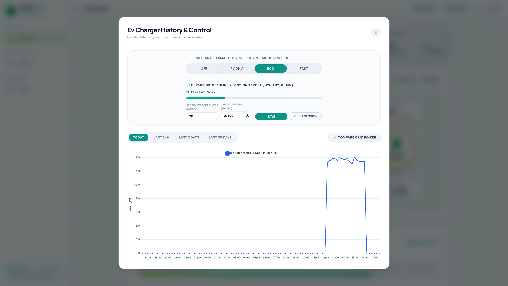
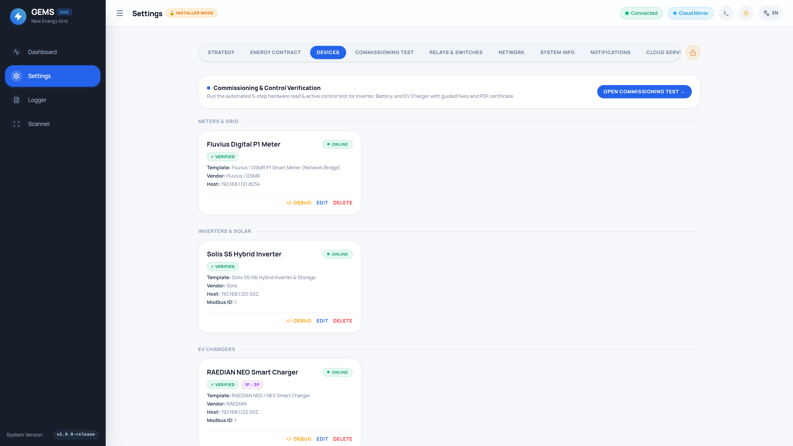
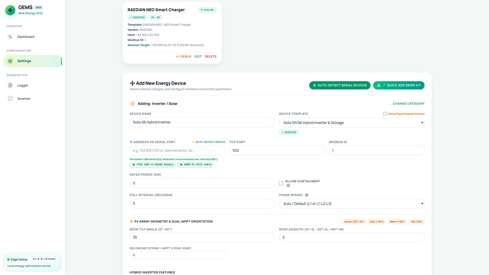
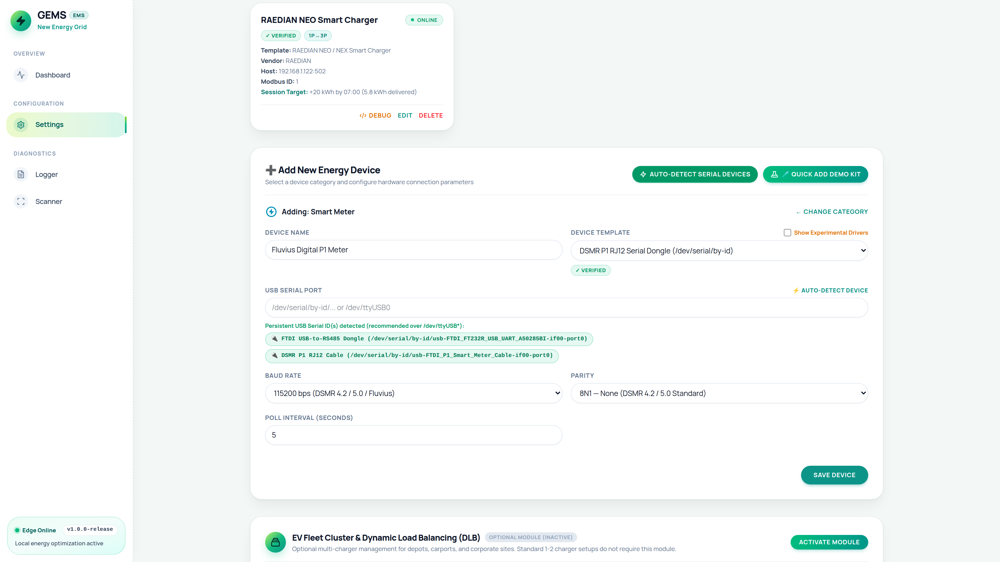
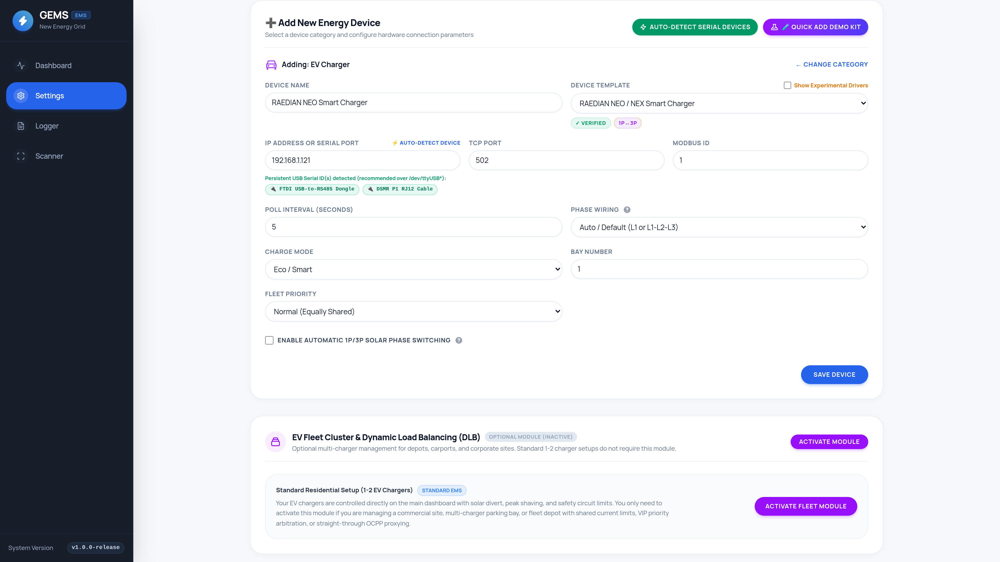

# GEMS User Manual

> 🌐 **Language / Taal / Langue:** **English** | [Nederlands](nl/user_manual.md) | [Français](fr/user_manual.md)

Welcome to the comprehensive user manual for GEMS (Grid Energy Management System by New Energy Grid). GEMS is a lightweight, highly responsive, and fully UI-driven Energy Management System optimized for low-power devices like the Raspberry Pi. This manual details how to set up, configure, and optimize your smart home energy usage using the available features and parameters.

> [!TIP]
> **Download Official Field Manuals (PDF):**
> - 📕 **[GEMS Installer & Commissioning Manual (PDF)](../manuals/gems-installer-manual.pdf)** (5.8 MB)
> - 📗 **[GEMS Homeowner & User Manual (PDF)](../manuals/gems-user-manual.pdf)** (3.6 MB)
> - ☁️ **[GEMS GRID-EMS-SERVER Connection Manual (PDF)](../manuals/gems-server-connection-manual.pdf)** (1.0 MB)
> - 💻 **[Interactive Documentation Hub](../manuals/index.html)**


---

## 1. Introduction & Architecture Overview

GEMS serves as the central brain of your home energy ecosystem, integrating Grid, Solar, Battery, EV Charger, and Smart Relay hardware. By seamlessly monitoring real-time power usage and acting upon defined optimization strategies, it helps reduce electricity costs, maximize self-consumption, and protect you from high capacity grid tariffs.

### Core Philosophy
* **Fully UI-Driven:** Zero YAML or text configuration file editing is required. Every hardware device and optimization rule is configured straight from the frontend interface.
* **180 Hardware Templates:** Out-of-the-box support for 174 physical hardware profiles (plus 6 built-in simulation profiles) across Solar Inverters, Home Batteries (BESS), EV Chargers (Modbus TCP/RTU, OCPP 1.6-J, REST), Digital P1 & Modbus Meters, Linear Solar Diverters, SG-Ready Heat Pumps, and Smart Relays.
* **Responsive Architecture:** A highly optimized Go backend paired with an embedded SQLite database and a modern Vue 3 SPA guarantees snappy updates using Server-Sent Events (SSE) and WebSockets.
* **Minimal Wear:** Database writes are batched and buffered with SQLite WAL mode to maximize the lifespan of your device's SD Card or NVMe SSD.
* **Privacy First:** All data is processed and stored locally inside your home.

---

## 2. Reference Hardware & Installation

### Official Tested Reference Platform
* **System Controller:** Raspberry Pi 5 (4GB or 8GB RAM) with official 27W USB-C PD power supply, aluminum metal case, active cooler, and M.2 NVMe PCIe HAT/Base.
* **Storage:** 128GB+ M.2 2280 NVMe SSD (PCIe Gen 3.0 / Gen 2.0 x4).
* See [Hardware Reference BOM](hardware_reference.md) for full specs and pinouts.

### Deployment Method A: High-Speed NVMe M.2 SSD (Recommended)
Booting GEMS from an M.2 NVMe SSD delivers maximum speed and eliminates SD card wear:
1. **Update Pi 5 Bootloader (1-time):** Use Raspberry Pi Imager to write *Misc utility images* &rarr; *Bootloader* &rarr; *NVMe/PCIe Boot* onto a MicroSD card. Insert into the Pi 5 and power on for 5 seconds until the screen turns green (`BOOT_ORDER=0xf461`, `PCIE_PROBE=1`).
2. **Flash GEMS Image:** Flash `gems-os-image.img.xz` to the NVMe SSD.
3. Remove the MicroSD card and power on. System boots in under 8 seconds.
*For step-by-step instructions and terminal commands, see the dedicated [NVMe Boot & Setup Manual](nvme_boot_guide.md).*

### Deployment Method B: Custom OS Image on MicroSD Card
1. Download `gems-os-image.img.xz` from the GitHub releases page.
2. Flash it to an 8GB+ MicroSD card using BalenaEtcher or Raspberry Pi Imager.
3. Insert into the Raspberry Pi and boot.
4. Access `http://ems.local` (or `https://ems.local:9090` for the Cockpit administration console using your provisioned system credentials).
5. On initial boot, the **Guided Commissioning Wizard** opens automatically to walk you through language & location selection (`NL`, `FR`, `EN`), electrical grid limits (main breaker rating, wiring topology, Flanders capacity ceiling), grid meter discovery, solar/battery/EV hardware onboarding, and energy contract setup.

### Deployment Method C: Debian Package (.deb)
If running an existing Debian or Ubuntu ARM64 installation:
```bash
sudo dpkg -i gems_*_arm64.deb
sudo apt-get install -f
```
The `gems.service` systemd daemon will start automatically on port `8080`.

---

## 3. Dashboard & Real-Time Monitoring

| Desktop PowerFlow Dashboard | Mobile Responsive View |
| :---: | :---: |
|  |  |

* **Power Flow Interactive Graphic:** Displays active power nodes (Grid, Solar, Battery, Charger, Home). Nodes are intelligently hidden if not configured or inactive.
* **Click-to-Reveal:** Clicking any individual node in the power flow diagram reveals detailed historical line charts, energy breakdown metrics, and time-range selections (Day, Week, Month, Year).

| Solar History Modal | Battery Telemetry Modal |
| :---: | :---: |
|  |  |

| Grid History Modal | EV Charger Modal |
| :---: | :---: |
|  |  |

* **Metrics Board & Estimated GRID-EMS Savings:** Provides an aggregated daily/monthly/yearly view of solar yield, grid import/export totals, self-consumption ratios, and a live **Estimated GRID-EMS Savings** card attributing real euro savings across **Solar Self-Consumption**, **Battery Arbitrage**, **Smart Off-Peak Dispatch & Negative-Export Shield**, and (on Flemish sites only) **Capacity Peak Shaving**.
* **Strict Country-Isolated Views:** Flemish 15-minute *Capaciteitstarief* trackers and Belgian Elia renewable mix badges appear strictly on Belgian/Flemish sites, whereas Dutch (`NL`) sites display clean per-phase main-fuse (`3×25A`) and *Smart Saldering* metrics with zero foreign tariff terminology.
* **Live Safety & Status Banners:** Both desktop and mobile dashboards surface prominent, real-time warning banners whenever the primary grid meter goes offline (confirming safe EV current fallback), live telemetry becomes stale or devices drop offline (automatically excluding offline devices from live power totals), main circuit breaker protection actively throttles loads across `1×230V`, `3×230V` Delta, or `3×400V+N` supplies, or a connected device reports communication faults.
* **24-Hour Peak-Aware Battery Forecast & EV Departure Target:** Click the Battery card on the Dashboard to inspect the 24-hour forecast schedule (including morning **Solar Headroom Hold** `solar_hold` ahead of negative-price afternoons), and configure optional per-wallbox **Target Session Energy (`+kWh`)** and **Departure Time (`HH:MM`)** on EV chargers such as **RAEDIAN** (tracked strictly from the charger meter with zero vehicle APIs).
* **Automatic P1 M-Bus Gas (`m³`) & Water (`m³` / `L`) Sub-Metering:** Whenever a digital gas meter (`0-n:24.1.0(003)`) or drinking water meter (`0-n:24.1.0(007)`) is paired to your P1 smart meter—or read via HomeWizard, YouLess, ESPHome, or Custom Modbus—the Dashboard, PowerFlow quick-launch badges, and **Grid History Modal** automatically reveal **Utility Sub-Meters (P1 M-Bus)** cards with daily/monthly/yearly consumption, cumulative meter indices, and interactive bar charts (hidden automatically on electricity-only sites).
* **Printable PDF Performance Reports:** Export Daily, Weekly, Monthly, or Yearly formatted PDF energy summaries (including itemized financial savings and Gas/Water sub-meter totals) directly from the Dashboard.

---

## 4. Global Settings & Configurations

Access the **Settings** view from the navigation sidebar (which can be collapsed or expanded via the menu button in the main top bar) to configure system-wide rules and energy contracts.

### 4.1 Site Optimization (Strategy Mode)

| Strategy Settings Overview | Operational Strategy Modes |
| :---: | :---: |
|  |  |

* **`strategy_mode`**: Selects the primary operational behavior of the system.
  * **Eco:** Maximizes self-consumption of solar energy. Prioritizes home loads, battery charging, and EV charging with solar excess before grid export.
  * **Flanders:** Activates predictive Peak Shaving based on the Belgian/Flanders capacity tariff model. Calculates rolling 15-minute projected quarter peaks and dynamically throttles EV chargers and batteries to keep the peak under `capacity_peak_limit_kw`.
  * **Netherlands:** Focuses on minimizing or completely eliminating solar feed-in to the grid (zero-export), actively curtailing inverters if export reaches `allowed_grid_export_kw` or if feed-in pricing is negative.
* **`capacity_peak_limit_kw`**: The base maximum allowed average quarter-hour grid import (e.g. `2.5` kW).
* **`peak_shaving_buffer_w`**: The safety buffer applied when nearing the capacity peak limit (e.g. `200` W).
* **`peak_shaving_rampup_w`**: Ramp-up step power when capacity frees up (default `500` W).
* **Smart Adaptive Ceiling**: Dynamically adapts the peak shaving ceiling to the highest 15-minute peak already incurred in the current calendar month, maximizing charging speed without increasing your capacity tariff bill.

### 4.2 Battery Arbitrage & Schedules

* **`battery_grid_charge_strategy`**:
  * `price_only`: Charges from grid when EPEX spot price drops below `force_charge_below_euro`.
  * `super_dal_only`: Restricts grid charging to specific provider off-peak contract windows (e.g. Engie Superdal).
  * `hybrid`: Combines spot price thresholds with provider contract windows.
  * `dynamic_forecast`: Solves optimal charge/discharge schedules based on solar forecasts and baseline consumption.
* **`force_charge_below_euro`**: Spot price threshold (€/kWh) to trigger forced grid charging.
* **`force_discharge_above_euro`**: Spot price threshold (€/kWh) to allow battery feed-in during peak pricing.
* **`min_battery_soc` & `max_battery_soc`**: Configurable battery reserve floor (`0%–80%`, default `10%`) and upper charge ceiling (`50%–100%`, default `100%`) to protect battery health and reserve capacity.
* **`solar_forecast_enabled`**: Enables or disables 24-hour solar irradiance forecasting and morning solar headroom reservation (`solar_hold`).
* **EV Fleet Priority Tiers (`fleet_priority`)**: In multi-charger `Priority Queue` mode, stations follow five ordered tiers (`VIP > High > Normal > Low > Solar Only`).

### 4.3 Energy Contracts & 24-Hour Tariff Visualizer

| Energy Contract Configuration | 24-Hour Tariff Visualizer Curve |
| :---: | :---: |
|  |  |

* **`contract_type`**: Native presets for Dutch dynamic contracts (**Vattenfall Nederland — FlexPrijs, Eneco Dynamic, Frank Energie Dynamic**), Belgian dynamic contracts (**TotalEnergies Pixel Dynamic, Mega Smart/Cosy Dynamic, Bolt Dynamisch, Engie Dynamic / Flextime, Luminus Dynamic, Ecopower, Dats 24, Octa+, Trevion, Aspiravi**), Belgian Dual-Tariff (Piek/Dal + 6% BTW), Enovos Dynamic (Luxembourg), and generic fixed/dynamic rates (including Dutch post-2027 *saldering* feed-in cost `fixed_feed_in_cost_kwh` and `>= 50%` bare-supply export floor advisory, plus `15m` vs `60m` dynamic spot settlement granularity).
* **DNO Distribution & Statutory Tax Presets**: Built-in regional presets for statutory excl.-VAT Dutch *Energiebelasting* (**2026: `€0.09161/kWh`** / **2027: `€0.08802/kWh`** + 21% BTW), Fluvius (Flanders), ORES & RESA (Wallonia flat or CWaPE 7-days/week **`Tarif Impact`** `ECO`/`MEDIUM`/`PIC`), SIBELGA (Brussels), and 2027 Belgian federal special excise (`€0.0392/kWh` excl. 6% BTW).
* **Live 24-Hour Tariff Visualizer**: Real-time `15m` / `60m` stacked cost breakdown curve displaying wholesale EPEX spot price, supplier markup, DNO network / energy tax fees (color-coded by `ECO`/`MEDIUM`/`PIC` band in Wallonia), VAT (`6%` BE / `21%` NL), dynamic solar injection price, and negative price curtailment warnings.

---

## 5. Device Management & Step-by-Step Onboarding

GEMS includes **174 native hardware templates** (plus 6 built-in simulation profiles — **180 total**). Adding hardware is 100% UI-driven.

| Configured Devices Management | Add Device Category Wizard |
| :---: | :---: |
|  |  |

### Universal 4-Step Onboarding Process

1. **Serial Bus & Subnet Scan:** Click **Scanner** in the sidebar (in **Certified Installer Mode**) to automatically discover hardware:
   * **Scan Serial Ports:** Automatically detects DSMR / e-MUCS P1 smart meters and RS-485 Modbus RTU inverters, EV wallboxes, and energy meters across persistent `/dev/serial/by-id/*` USB adapters and onboard UART ports (including baud rate, parity, and Slave ID), with one-click **+ Configure** onboarding and an optional **Advanced RS-485 Bus Sweep**.
   * **Scan Subnet:** Automatically recognizes the GEMS controller itself (`THIS GEMS CONTROLLER`) and identifies LAN devices by IP, hostname (mDNS/UPnP/NetBIOS), 24/28/36-bit IEEE MAC OUI registries, and protocol fingerprinting across open energy ports (`502`, `80/443`, `8080`, `8887`) for Solis, RAEDIAN, Shelly, and other energy devices.
   
   

2. **Hardware Preparation:**
   * **Modbus Inverters:** Enable Modbus TCP or RS-485 Modbus RTU in your inverter dongle or menu (e.g. Solis S5/S6 Hybrid, SMA Speedwire / SunSpec, SolarEdge SetApp Port 1502).
   * **EV Chargers:** Enable Modbus TCP / RTU in your charger (preferred for sub-second throttling & external CPO billing coexistence, e.g. RAEDIAN NEO / NEX / Gemini), or set the Central System URL in your charger app to `ws://<GEMS-IP>:8887/<ChargePointID>` for native OCPP.
   * **Local REST Meters/Relays:** Enable Local API on local network P1 meters, or enable Gen2 RPC in Shelly devices.
   * **Serial P1 & RS485 Adapters:** Plug RJ12 / USB-RS485 cables into the Raspberry Pi and click **Auto-Detect Serial Devices** (or select the persistent `/dev/serial/by-id/*` quick-select pill) so port assignments never swap across reboots.

3. **Add Device in UI:** Click **Settings &rarr; Devices** (unlocking **Installer Mode** via the discreet padlock icon in the Settings header) and click **+ Add Device**. Verified commercial templates are displayed by default; toggle **Show Experimental Drivers** if you need to reveal **Experimental** or **Monitor-Only** hardware templates. The optional **EV Fleet Cluster & Dynamic Load Balancing (DLB)** module card is positioned at the bottom of the Devices page below individual device management. Choose category, select template, enter parameters, and click **Save Device**.

| Inverter Modbus Setup | Smart Meter P1 Setup | EV Charger Setup |
| :---: | :---: | :---: |
|  |  |  |

4. **Verify Health:** Confirm the device card shows <span style="color:#10b981; font-weight:bold;">● Online</span> and verify live power on the Dashboard.

---

### 5.1 Solar & Hybrid Inverters (40 Templates)

| Template | Brand & Series | Protocol | Default Port | Slave ID | Curtailment & BESS Control |
| :--- | :--- | :--- | :--- | :--- | :--- |
| `solis_hybrid` / `solis_inverter` | **Solis Hybrid (S5 / S6 Single & 3-Phase)** *(Primary Reference)* | Modbus TCP | `502` / `8899` | `1` | Yes (Verified) |
| `solis_retrofit` | **Solis Retrofit Inverter (RAI / S6-EA1P AC Storage)** *(Primary Reference)* | Modbus TCP | `502` / `8899` | `1` | Yes (Verified) |
| `huawei_inverter` | Huawei SUN2000 (L1/M1/M2/M3/MB0 + LUNA2000) | Modbus TCP | `502` | `1` (or `2`) | Yes (Verified) |
| `sma_inverter` | SMA Sunny Boy / Tripower / Storage | Modbus TCP | `502` | `126` (or `3`) | Yes (Verified) |
| `fronius_inverter` | Fronius Gen24 Plus / Symo / Primo | Modbus TCP SunSpec | `502` | `1` | Yes (M123 + M124 StorCtl) |
| `solaredge_inverter` / `solaredge_3phase` | SolarEdge Single & 3-Phase (SetApp + StorEdge) | Modbus TCP SunSpec | `1502` (or `502`) | `1` | Yes (Limit + Remote Storage) |
| `sungrow_inverter` | Sungrow Hybrid (SH5.0 - SH10RT / SH25T) | Modbus TCP | `502` | `1` | Yes (Curtailment + EMS Forced) |
| `victron_inverter` | Victron Cerbo GX / MultiPlus-II / Venus OS | Modbus TCP | `502` | `100` / `228` | Yes (ESS Grid Setpoint + PV Limit) |
| `goodwe_inverter` | GoodWe Hybrid (ET / EH / BT / BH) | Modbus TCP | `502` / `8899` | `247` | Yes (EMS Power Mode + Curtailment) |
| `growatt_inverter` | Growatt (SPH / MIN / MOD / MID) | Modbus TCP | `502` | `1` | Yes (Active Rate + EMS Time-Slot) |
| `solax_inverter` | SolaX Hybrid (X1 / X3 Gen 3/4) | Modbus TCP | `502` | `1` | Yes (Modbus Remote Control) |
| `sofarsolar_hybrid` | SofarSolar (HYD / G3 / AMASS) | Modbus TCP | `8899` / `502` | `1` | Yes (Passive Mode + Export Limit) |
| `deye_inverter` | Deye / Sunsynk Hybrid Inverters | Modbus TCP | `502` / `8899` | `1` | Yes (Sell Power + Remote Charge) |
| `foxess_inverter` | FoxESS Hybrid (H1 / H3 / H3-Pro / AC1) | Modbus TCP | `502` | `1` / `247` | Yes (Work Mode + Charge/Discharge) |
| `sigenergy_hybrid` | Sigenergy SigenStor (5-in-1 ESS) | Modbus TCP | `502` | `1` | Yes (Plant Remote EMS Control) |
| `kostal_plenticore` | KOSTAL Plenticore plus / G2 / G3 & BI | Modbus TCP SunSpec | `1502` | `71` | Yes (Battery Charge/Discharge + Limit) |
| `fenecon_fems` | FENECON Home 10/20/30 (FEMS / OpenEMS) | Modbus TCP | `502` | `1` | Yes (ESS Active Power + PV Limit) |
| `hoymiles_dtu` / `apsystems_ez1` | Hoymiles DTU-Pro-S & APsystems EZ1-M Microinverters | Modbus TCP / Local REST | `502` / `8050` | `1` / — | Yes (Dynamic Power Limit) |
| `enerlution_inverter` | Enerlution Hybrid Inverter | Modbus TCP | `502` | `1` | Yes |
| `alpha_ess_inverter` | Alpha ESS Storion (SMILE5 / SMILE-T10 / G3) | Modbus TCP | `502` / `8502` | `85` | Yes (Dispatch Mode) |
| `anker_inverter` | Anker SOLIX X1 Hybrid | Modbus TCP | `502` | `1` | Yes |
| `abb_fimer_inverter` | ABB / Fimer Solar & Hybrid (UNO-DM/REACT 2) | Modbus SunSpec | `502` | `1` | Yes (M123 + M124 StorCtl) |
| `autarco_inverter` | Autarco SX / MX / LX Series Inverters | Modbus TCP | `502` | `1` | Yes |
| `chisage_ess` | Chisage ESS Hybrid Inverters (3kW–50kW) | Modbus TCP | `502` | `1` | Yes |
| `delta_inverter` | Delta M6A / M8A / M10A / RPI Series | Modbus SunSpec | `502` | `1` | Yes (SunSpec M123) |
| `hyxipower_inverter` | HYXiPOWER Residential & C&I Inverters | Modbus TCP | `502` | `1` | Yes |
| `kstar_inverter` | KSTAR BluE Series Hybrid Inverters | Modbus TCP | `502` | `1` | Yes |
| `saj_inverter` / `senergy_inverter` | SAJ H1/H2/R5 & Senergy SE Hybrid Series | Modbus TCP | `502` | `1` | Yes |
| `afore_inverter` / `marstek_venus` | Afore AF/BNT Hybrid & Marstek Venus AC BESS | Modbus TCP | `502` | `1` | Yes |
| `solinteg_inverter` | Solinteg Integ M OHT/OMT Series (3kW–50kW) | Modbus TCP | `502` | `1` | Yes |
| `solplanet_inverter` | Solplanet / AISWEI Single & 3-Phase | Modbus TCP | `502` | `1` | Yes |
| `lg_ess` | LG ESS Home (8 / 10 / 15) | Modbus TCP / REST | `502` / `443` | `1` | Yes |
| `enphase_envoy` | Enphase IQ Gateway / Envoy-S Metered (D5 / D7 / D8) | Local HTTPS / REST (Auto-JWT) | `443` / `80` | — | Monitor Only (Auto Local JWT + 3P V/I) |

---

### 5.2 EV Charging Stations (60 Templates)

#### Modbus TCP / RS485 EV Chargers (Recommended & Preferred)
**Modbus TCP / RS485 is the preferred connection option for EV chargers**:
* **Sub-Second Throttling:** Direct register writes allow instantaneous current adjustments (6A to 32A), critical for Flanders capacity tariff peak shaving and rapid solar curtailment.
* **CPO / Billing Coexistence:** If your charger connects to an employer billing reimbursement platform or external CPO via OCPP, GEMS controls charging power locally over Modbus TCP *without interfering with or disconnecting your cloud billing service*.
* **Supported Models:**
  * **RAEDIAN NEO / NEX AC Wallbox:** Template `raedian_charger`, Port `502`, Slave ID `1` (dynamic current + 1P/3P switching).
  * **RAEDIAN Gemini Dual AC Wallbox:** Template `raedian_gemini`, Port `502`, Slave ID `1` (dual sockets and dynamic 0–64A load balancing; enable *Load management with EMS* in Gemini WebConfig to activate Modbus TCP current control).
  * **SolaX Smart EV Charger G2:** Template `solax_evcharger`, Port `502`, Slave ID `1` (0.01A current control + 1P/3P phase switching).
  * **KEBA KeContact P30 / P40:** Template `keba_charger`, Port `502`, Slave ID `255` (1mA precision + S10 phase switching).
  * **Mennekes AMTRON Xtra / Charge Control / 4You:** Template `mennekes_modbus`, Port `502`, Slave ID `1`.
  * **Heidelberg Energy Control / Amperfied connect.home:** Template `heidelberg_ampere`, Port `502` or RS485, Slave ID `1`.
  * **Sungrow AC011E-01 / AC22E-01 & FoxESS Wallbox:** Templates `sungrow_evcharger`, `foxess_evcharger`, Port `502`, Slave ID `1` / `247`.
  * **Vestel EVC04 Home / Smart Wallbox:** Template `vestel_evc04`, Port `502`, Slave ID `255`.
  * **Webasto Next / Live:** Template `webasto_charger`, Port `502`, Slave ID `1`.
  * **ABB Terra AC Wallbox:** Template `abb_charger`, Port `502`, Slave ID `1`.
  * **Alfen Eve Single / Double Pro-Line:** Template `alfen_charger`, Port `502`, Slave ID `1` (including 1P/3P switching).
  * **Peblar Home / Business EV Charger:** Template `peblar_charger`, Port `502`, Slave ID `1` (including 1P/3P switching).
  * **Phoenix Contact EV-CC / CHARX / Veton:** Template `phoenix_contact_evcc` / `phoenix_charx` / `veton_charger`, Port `502`, Slave ID `1`.
  * **GoodWe HCA Wallbox / Sigenergy SigenStor EVAC:** Template `goodwe_charger` / `sigenergy_evac`.
  * **SolarEdge Home EVSE:** Template `solaredge_evse`, Port `502`, Slave ID `1`.

#### Native OCPP 1.6-J EV Chargers (Direct & Proxy)
For chargers without Modbus TCP or standalone residential setups without third-party CPO billing platforms:
* Set the Central System URL in your charger mobile app / web console to:
  ```
  ws://<GEMS-IP>:8080/api/ocpp/<ChargePointID>
  ```
* **Supported Models:** Huawei FusionCharge (SCharger-7KS/22KT), Kempower Movable/Station/Satellite (`kempower_charger`), Wallbox Pulsar Plus / Commander (`wallbox_ocpp`), Teltonika TeltoCharge (`teltonika_teltocharge`), EVBox (Elvi/Livo/BusinessLine), Mennekes AMTRON (4You/4Business/ACU), Schneider Electric EVlink (Wallbox/Pro AC), Siemens VersiCharge GEN3, Elli / VW / Skoda / SEAT (ID. Charger Connect/Pro), Alpitronic Hypercharger, Autel MaxiCharger, Hager witty, BMW Wallbox Plus, Mercedes-Benz Wallbox, Porsche Wallbox, Fronius Wattpilot.
* **In GEMS UI:** Select EV Chargers &rarr; Choose Template: `OCPP 1.6J Smart EV Charger` &rarr; Enter your `ChargePointID` (e.g. `WALLBOX-01`).

#### Local REST & Cloud API EV Chargers
* **go-e Charger Gemini / HOMEfix / PRO:** Template `goe_charger`, Local HTTP REST v2 Port `80` (RAM-safe current & 1P/3P switching).
* **WARP Charger 2 / 3 (Tinkerforge):** Template `warp_charger`, Local HTTP API Port `80` (current control & 1P/3P phase switching).
* **openWB Pro:** Template `openwb_pro`, Local HTTP `connect.php` API Port `80` (0.1A current control & 1P/3P phase switching).
* **cFos Power Brain Solar / Wallbox:** Template `cfos_powerbrain`, Local HTTP JSON API Port `80` (0.1A current control & solar phase relay switching).
* **MyEnergi Zappi v2 / v2.1:** Template `myenergi_zappi`, Local Hub/Cloud Digest API (current control & Fast/Eco+/Stop switching).
* **Easee Home / Charge / Charge Lite:** Template `easee_charger`, Official Cloud API (`dynamicChargerCurrent` & 1P/3P `phaseMode`).
* **Zaptec Go / Pro:** Template `zaptec_charger`, Official OAuth2 Cloud API (`availableCurrentPhase1..3` & 1P/3P switching).
* **Wallbox Pulsar Plus / Copper SB / Commander 2:** Template `wallbox_pulsar`, Official Cloud REST API (`max_charging_current` & pause/resume).
* **Volt Time Source / Source Pro:** Template `volttime_source`, Official Cloud v2 API.
* **SmartEVSE v2 / v3 & Generic Local REST EVSE Gateway:** Templates `smartevse_charger`, `generic_rest_evse`, Port `80`.

---

### 5.3 Grid & Smart Meters (40 Templates)

* **P1 Smart Meter (USB / Serial):** Template `p1_serial`. Serial port `/dev/ttyUSB0`, Baud `115200` (DSMR 4/5) or `9600` (DSMR 2/3). Plug RJ12 cable into meter and USB into Raspberry Pi.
* **P1 Smart Meter (Network / TCP Bridge):** Template `p1_network`. Host IP and Port (e.g. `23`, `8088`, `8234`).
* **HomeWizard Wi-Fi P1 Meter:** Template `homewizard_meter`. Host IP, Port `80`. (Enable *Local API* in HomeWizard Energy app).
* **KOSTAL Smart Energy Meter (KSEM G1 / G2):** Template `kostal_ksem`. Modbus TCP Port `502`, Slave ID `71` (SunSpec + native float telemetry).
* **Huawei EMMA-A02 Energy Management Assistant:** Template `huawei_emma`. Modbus TCP Port `502`, Slave ID `1`.
* **Fronius Smart Meter IP / TS:** Template `fronius_smartmeter_ip`. Local Solar API v1 HTTP JSON on Port `80`.
* **Tasmota SML / OBIS Smart Meter IR Reader:** Template `tasmota_sml`. Local HTTP `Status 10` JSON API on Port `80`.
* **YouLess LS120 Pulse & P1 Meter / Homey Energy Dongle:** Templates `youless_ls120`, `homey_p1`.
* **Chint DTSU666 / DTSU666-H 3-Phase Meter:** Template `chint_dtsu666`. Modbus TCP Port `502`, Slave ID `1`.
* **Shelly 3EM / Pro 3EM / Gen3 3EM-63T:** Templates `shelly_3em`, `shelly_pro_3em`. Host IP, Port `80`.
* **Eastron SDM120 / SDM230 / SDM630 / SDM72D / SMART X96:** Templates `eastron_sdm120_230`, `eastron_sdm630`, `eastron_sdm72_x96`. Modbus TCP Port `502`, Slave ID `1`.
* **Carlo Gavazzi EM112 / EM340 / EM540 / EM24:** Templates `carlogavazzi_em340`, `carlogavazzi_em24`. Modbus TCP Port `502`, Slave ID `1`.
* **ABB A43 / A44 / B23 / B24, Schneider Acti9 iEM3000, Siemens SENTRON PAC2200, SMA Energy Meter 2.0, Socomec COUNTIS/DIRIS, WAGO 879, Accuenergy Acuvim/AcuRev, Algodue UPM, Hager ECR/ECM, Janitza UMG, Kamstrup OMNIPOWER/382, Landis+Gyr E350/E360/E650, Phoenix Contact EMpro, Weidmüller EM500/EM600, Eltako, Finder, Inepro, Lovato, Acrel, ESPHome, Loxone Miniserver, Niko Home Control.**

---

### 5.4 Smart Relays, Solar Diverters & SG-Ready Heat Pumps (11 Templates)

| Smart Relays Management | Relay Automation Rules |
| :---: | :---: |
|  |  |

* **my-PV AC•THOR / AC•THOR 9s / AC ELWA 2 Linear Solar Diverter:** Template `mypv_acthor`. Modbus TCP Port `502`. Stepless 1-Watt resolution excess PV routing (`0–9000 W`) and domestic hot water target temperature control.
* **Stiebel Eltron / Tecalor ISG web / ISG plus Heat Pump:** Template `stiebel_eltron_isg`. Modbus TCP Port `502`. Direct SG-Ready operating state control and DHW comfort setpoint boost.
* **NIBE S-Series Heat Pump (S1155 / S1255 / S2125 / VVM S320):** Template `nibe_heatpump`. Modbus TCP Port `502`. Smart Price Adaption / SG-Ready boost and hot water demand control.
* **Daikin Altherma 3 / HomeHub (MMI-2):** Template `daikin_altherma`. Modbus TCP Port `502`. Smart Grid free-energy boost, electrical power limit, and DHW tank setpoint control.
* **Tasmota Smart Plug / Relay (Nous A1T / Sonoff POW):** Template `tasmota_relay`. Host IP, Port `80` (`Power` switching + live `ENERGY` wattmeter telemetry).
* **Shelly Plus 1PM / Pro 1PM / Plug S:** Template `shelly_plus_1pm`. Host IP, Port `80`. Controls SG-Ready heat pump boost contactors and electric boilers based on solar excess threshold and thermal hysteresis timers.
* **Shelly Plus 1 / Pro 1 (Dry Contact):** Template `shelly_plus_1`. Potential-free contact switching for heat pump inputs, gate triggers, or external lock signals.
* **Shelly Plus 2PM / Pro 2PM (Dual Relay & Meter):** Template `shelly_plus_2pm`. Dual independent channel control and active power metering.
* **SG-Ready Heat Pump Boost:** Template `sgready_heatpump`. Commands State 2 (Normal) vs State 3 (Thermal Boost) during solar surplus or negative spot tariff windows.
* **Modbus Digital I/O Relay Module:** Template `modbus_relay`. Industrial-grade contactor switching via Modbus RTU/TCP coils for high-current loads and peak shaving.
* **Generic HTTP Relay:** Template `generic_relay`. Configurable state and toggle URLs for ESPHome and custom actuators.

---

## 6. System Diagnostics & Updates

| System Identity, Network & Build Info | Webhook Alerts & Reporting |
| :---: | :---: |
|  |  |

* **Real-Time Logger & Device Template Debugging:** Live diagnostic stream of Modbus packets, register reads, OCPP WebSocket heartbeats, and strategy control decisions, plus one-click **Debug** probes on **Settings &rarr; Connected Devices** (available in Normal Mode) to capture live device telemetry and send diagnostic template reports directly to **GRID-EMS-SERVER**.
* **Cryptographically Verified OTA & Manual `.deb` Updates + Appliance Reboot:** Directly accessible under **Settings &rarr; System Info** in Normal Mode, GEMS provides a confirmed **Reboot System** control, checks for official releases, and supports single-file manual `.deb` uploads—verifying New Energy Grid's Ed25519 release signature and SHA-256 digest before installing with live progress output.


---

## 7. Central Cloud Platform & Regional Optimization

### 7.1 GRID-EMS-SERVER Integration (100% Optional)

GEMS is designed with a **local-first philosophy**: all dynamic load balancing, battery scheduling, solar diversion, and grid protection loops execute autonomously on the Raspberry Pi edge hardware. Cloud connectivity is completely optional.

If you or your installer wish to manage your installation remotely:
* **Endpoint:** `https://ems.newenergygrid.com`
* **Zero Router Configuration:** Outbound-only TLS 1.3 connections eliminate the need for port forwarding, dynamic DNS, or public IP addresses.
* **Simple Pairing:** Go to **Settings &rarr; Cloud Server**, enter the 16-character pairing token provided by your cloud account or installer, and click **Pair & Connect Now**.
* **Fleet Management & Diagnostics:** Remotely inspect live power flows, receive push alerts, and adjust strategy modes from any web browser or mobile device.

### 7.2 Regional Intelligence: Netherlands vs. Belgium

GEMS automatically tailors its optimization engine and user interface according to your site location and energy contract:
* **🇳🇱 Netherlands Mode (`country: 'NL'` / `strategy_mode: 'netherlands'`):**
  * Optimizes for Dutch Day-Ahead dynamic electricity contracts using the EPEX Spot NL bidding zone.
  * Injects Dutch statutory energy taxes (*Energiebelasting*) and supplier markups into tariff calculations.
  * Protects against feed-in penalty fees (*terugleverkosten*) and curtails PV inverter export during negative Day-Ahead pricing.
  * Automatically suppresses Belgian-specific interface elements (Flanders Capacity Tariff gauges and Elia Green Grid Share).
* **🇧🇪 Belgium / Flanders Mode (`country: 'BE'` / `strategy_mode: 'flanders'`):**
  * Implements 15-minute rolling average *Capaciteitstarief* peak shaving to minimize monthly network distribution costs.
  * Supports Belgian dynamic contracts (TotalEnergies, Mega, Bolt, Engie) via the EPEX Spot BE bidding zone.
  * Includes the Elia Green Grid Sync Boost to maximize EV charging and thermal storage when national renewable energy production is abundant.
